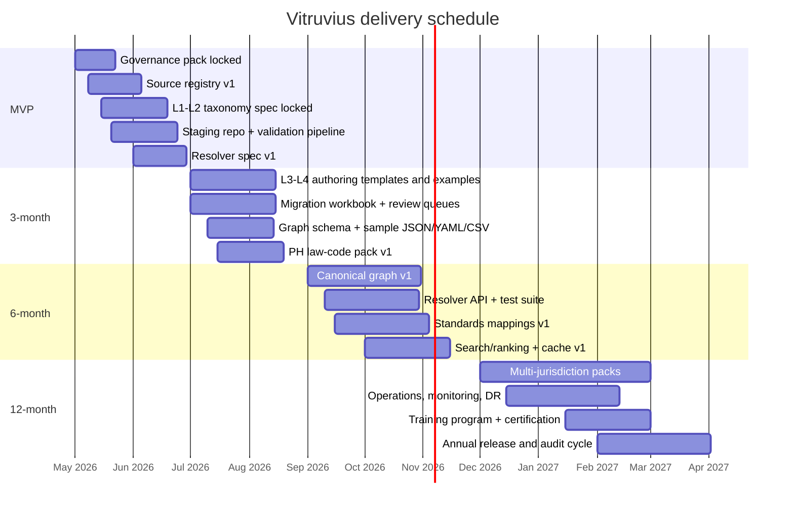

# Vitruvius implementation artifact checklist

## Executive summary

Build the delivery sequence around two non-negotiables: a **governed master taxonomy pack** first, and a **deterministic Vitruvian Context resolver pack** second. The minimum viable implementation is not more data; it is a complete editorial, migration, runtime, and compliance operating system that prevents drift, preserves provenance, and keeps jurisdictional logic separate from canonical meaning.

The standards registry should privilege official material from the entity["organization","International Organization for Standardization","standards body"], entity["organization","buildingSMART International","bim standards body"], entity["organization","National Institute of Building Sciences","US building sciences organization"], entity["organization","Construction Specifications Institute","US construction specs organization"], entity["organization","International Code Council","model code publisher"], entity["organization","National Fire Protection Association","standards organization"], entity["organization","American Society of Civil Engineers","engineering society"], entity["organization","European Committee for Standardization","standards body"], plus jurisdictional authorities such as the entity["organization","Department of Public Works and Highways","Philippines infrastructure agency"], entity["organization","Bureau of Fire Protection","Philippines fire agency"], entity["organization","Australian Building Codes Board","Australia code authority"], entity["organization","Singapore Civil Defence Force","Singapore fire authority"], and the entity["organization","UK Government","England building regulations publisher"]. ISO 12006-2:2015 and ISO 12006-3:2022 remain the core classification and dictionary framework references; the ISO 19650 series, including Part 6 published in 2025, governs information management; IFC 4.3 is the current ISO-aligned open exchange standard; bSDD is the official dictionary service; OmniClass in NBIMS-US v3 remains a multi-table classification reference; Uniclass now provides browse/download/API access; and ICC, NFPA, Eurocodes/CEN, ASCE, and the relevant national law portals provide the regulatory and technical source layers. citeturn8search5turn8search2turn0search4turn0search5turn1search4turn1search3turn1search1turn1search16turn15search2turn15search1turn10search0turn10search8turn9search0turn2search0turn2search2turn12search0turn12search1turn6view0turn7search0turn7search1turn7search2turn5search2

## Governance and editorial control pack

**Owner legend:** TL = taxonomy lead, KM = knowledge manager, PO = product owner, DE = data engineer, PE = platform engineer, LE = legal/compliance, MLE = search/ML engineer, QA = QA lead.

| Priority | Artifact | Owner | Purpose | Minimum contents / acceptance criteria |
|---|---|---|---|---|
| P0 | Locked decisions register | TL + PO | Freeze the architectural invariants so taxonomy, mappings, and resolver logic cannot drift. | Single source of truth for backbone rules, facet rules, jurisdiction model, resolver scope, “AI may propose but not decide,” and deletion/deprecation policy; approved and versioned. |
| P0 | Steward roster and RACI | TL + PO | Make every Level 1 domain and every source family explicitly owned. | Named steward per domain, deputy reviewer, escalation path, SLA for reviews, and override authority. |
| P0 | Change control policy | TL + KM | Prevent silent taxonomy mutation. | Rules for add/change/deprecate/merge/split, required evidence, review quorum, release notes, redirects, and rollback steps. |
| P0 | Release and versioning policy | TL + PE | Separate taxonomy releases, mapping-pack releases, and resolver releases. | Semantic versioning, hotfix rules, effective dates, sunset dates, backward compatibility window, and migration note requirements. |
| P0 | Canonical ID scheme | TL + DE | Keep internal identity stable even when paths or external mappings change. | Opaque immutable IDs, human-readable path codes, reserved prefixes by object class, alias/redirect format, and collision tests. |
| P0 | Standards mapping policy | TL + KM | Standardize exact/broader/narrower/related/candidate mapping behavior. | Required fields per mapping, source authority, version, map status, confidence, citation URI, and prohibition on “forced exact” mappings. |
| P0 | AI use policy | TL + MLE + LE | Limit AI to proposal/QA roles and ban AI from editorial authority or runtime truth selection. | Allowed tasks, banned tasks, confidence thresholds, human-review requirements, audit logging, and data-handling constraints. |
| P1 | Definitions and naming policy | TL + KM | Keep labels, definitions, abbreviations, and synonyms consistent. | Preferred label rules, ASCII code rules, pluralization policy, acronym rules, definition style guide, and multilingual handling. |
| P1 | Jurisdiction precedence policy | TL + LE | Resolve national, regional, agency, and project-specific conflicts consistently. | Precedence ladder, inheritance rules, suppression rules, conflict handling, and examples for law versus standard versus guidance. |

## Taxonomy authoring pack

| Priority | Artifact | Owner | Purpose | Minimum contents / acceptance criteria |
|---|---|---|---|---|
| P0 | Vitruvian Master Taxonomy specification | TL + KM | Define the official L1–L4 taxonomy scope and editorial rules. | Level 1 inventory, Level 2–4 authoring rules, “one canonical home” rule, allowed exceptions, and steward sign-off. |
| P0 | Node authoring template | TL + KM | Ensure every node is authored the same way. | Fields for ID, label, definition, parent, lineage, required facets, aliases, examples, non-examples, and steward. |
| P0 | Definition template | KM | Raise semantic quality before migration begins. | Short definition, applicability note, exclusion note, related concepts, and evidence requirement. |
| P0 | Synonym/thesaurus rules | KM + MLE | Improve search without contaminating canonical labels. | Preferred term, admitted term, deprecated term, common misspelling, regional synonym, and forbidden synonym rules. |
| P1 | Facet handbook | TL | Make `primary_domain`, `asset_scope`, `lifecycle_stage`, `knowledge_type`, `jurisdiction`, `standard_mapping[]`, `project_type`, and `performance_topic` operational. | One-page definition for each facet, cardinality, examples, anti-examples, and nullability rules. |
| P1 | Cross-discipline relationship vocabulary | TL + KM | Keep graph edges typed and finite. | Allowed predicates, direction, domain-range matrix, examples, and prohibited generic edges like `RELATED_TO` except as temporary fallback. |
| P1 | Examples corpus | KM | Give editors concrete positive and negative examples. | 100–200 curated examples spanning buildings, infrastructure, code topics, historical topics, systems, materials, and roles. |
| P1 | Notable references curation guide | KM | Standardize how handbooks, reference works, and canonical design texts are represented. | Inclusion criteria, edition handling, author handling, and relation pattern to taxonomy nodes. |
| P2 | Editorial review checklist | QA + KM | Make quality review fast and repeatable. | Fifteen-minute checklist for label, definition, parentage, facets, mappings, duplicates, citations, and path integrity. |

## Ingestion, migration, and QA pack

| Priority | Artifact | Owner | Purpose | Minimum contents / acceptance criteria |
|---|---|---|---|---|
| P0 | Source inventory script set | DE | Produce a complete inventory before any reclassification starts. | Scripts for file crawl, metadata extraction, document family detection, duplicate hashing, and manifest export. |
| P0 | Legacy-to-canonical mapping workbook | DE + KM | Give reviewers one place to approve or reject migrations. | One row per legacy item with candidate canonical node, candidate facets, candidate jurisdiction, confidence, reviewer decision, and notes. |
| P0 | Validation ruleset | DE + QA | Reject structurally invalid data before it enters staging. | Required fields, enum validation, duplicate detection, path integrity, circular parent checks, broken mapping URI checks, and date/version checks. |
| P0 | Staging repository layout | DE + PE | Keep proposals separate from canonical content. | Canonical repo, staging repo, rejected queue, review output, manifests, and audit snapshot layout. |
| P0 | Review queue design | KM + PE | Turn ambiguous proposals into a controlled workflow. | Status model, reviewer assignment, diff view, batch approval rules, and mandatory rationale on rejection. |
| P1 | Migration QA checklist | QA | Catch quality defects before graph rebuilds. | Random sample audit, high-risk class audit, legal citation audit, null-rate thresholds, and duplicate leakage checks. |
| P1 | Heuristic extraction rules | MLE + DE | Improve classifier input quality before AI touches anything. | Regex and parser rules for code numbers, standards numbers, jurisdictions, editions, dates, agencies, and discipline cues. |
| P1 | Confidence policy matrix | TL + MLE | Define what can auto-accept and what can never auto-accept. | See thresholds below; must be machine-enforced in pipeline. |
| P2 | Golden test dataset | QA + KM | Provide a fixed benchmark for migration quality. | 500–1,000 labeled records spanning all core domains, multiple jurisdictions, and edge cases. |

**Recommended confidence thresholds**

| Proposal type | Threshold | Action |
|---|---:|---|
| Alias normalization, spelling cleanup | ≥0.98 | Auto-accept if no conflict |
| Duplicate detection candidate | ≥0.97 | Auto-merge only if exact hash/title/support match; otherwise reviewer |
| Facet assignment on existing canonical node | ≥0.95 | Single human review |
| L3–L4 node placement | Any score | Human review required |
| Exact legal/standards mapping | Any score | Human review required |
| L1–L2 structural changes | N/A | AI prohibited |

**Recommended human review ratios**

| Workstream | Review ratio |
|---|---:|
| L1–L2 taxonomy | 100% |
| L3–L4 new nodes | 100% |
| Legal and standards mappings | 100% |
| Facet backfill on low-risk existing nodes | 25–50% sample after stable performance |
| Aliases / thesaurus cleanup | 10–25% sample after stable performance |

## Resolver and runtime pack

| Priority | Artifact | Owner | Purpose | Minimum contents / acceptance criteria |
|---|---|---|---|---|
| P0 | Vitruvian Context resolver spec | TL + PE | Define the runtime contract that turns canonical knowledge into context-specific outputs. | Inputs, output schema, precedence sequence, evidence requirements, failure modes, and non-AI rule. |
| P0 | Precedence engine rules | LE + TL | Make local-vs-global applicability deterministic. | `project > municipal > agency > state/province > national > supranational > international`, tie-break rules, and explicit suppression behavior. |
| P0 | Resolver API contract | PE + PO | Prevent UI, search, and automation teams from guessing payloads. | Request/response schema, error codes, cache headers, pagination, provenance block, and deprecation policy. |
| P0 | Resolver test suite | QA + PE | Prove that context resolution is deterministic. | Golden cases for PH, SG, UK-ENG, AU-NSW, US, and INTL defaults, plus conflict and fallback cases. |
| P1 | Performance SLA and benchmarking plan | PE | Keep the resolver usable as the graph grows. | p50/p95 latency targets, throughput targets, acceptable cache-hit rates, and synthetic benchmark dataset. |
| P1 | Caching strategy | PE + DE | Avoid recomputing stable resolutions. | Cache keys by canonical ID + jurisdiction + stage + project type + version; invalidation on mapping-pack release. |
| P1 | Search/ranking policy | MLE + PO | Ensure taxonomy and evidence retrieval remain explainable. | Weighting by text relevance, jurisdiction match, stewarded status, freshness, and authority. |
| P2 | Runtime observability pack | PE + QA | Detect silent correctness regressions. | Resolver traces, slow-query log, cache stats, conflict counters, unmapped-node counters, and alert thresholds. |

## Standards and legal source pack

The source registry should be a first-class artifact, not a miscellaneous bookmark list. It needs official landing pages, edition/version fields, allowed reuse notes, internal citation pattern, and fallback sources when an official site is unstable. The source set below covers the minimum standards and legal families Vitruvius must support from day one. IFC 4.3.2.0 is the current official documentation set; bSDD is the official dictionary service; OmniClass remains published through NBIMS-US/NIBS; Uniclass provides browse/download/API; MasterFormat is maintained by CSI; ICC and NFPA maintain the IBC and NFPA 101 families; Eurocodes sit within the CEN/JRC ecosystem; and national authorities publish the relevant local code frameworks. citeturn0search3turn0search4turn0search5turn1search4turn1search3turn1search1turn1search16turn15search2turn15search1turn10search0turn10search8turn6view0turn7search0turn7search1turn7search2turn2search0turn2search2turn12search0turn12search1

| Priority | Source pack item | Owner | Purpose | Minimal contents / acceptance criteria |
|---|---|---|---|---|
| P0 | ISO framework pack | TL + KM | Anchor taxonomy, dictionaries, data templates, and BIM information management in the official ISO family. | ISO 12006-2, 12006-3, 19650-1/2/3/4/5/6, 23386, 23387, official catalog link, version/status, reuse note, and internal citation format. citeturn8search5turn8search2turn8search7turn8search6turn8search0turn8search1 |
| P0 | buildingSMART pack | TL + DE | Support IFC class references and official dictionary mappings. | IFC 4.3 docs, IFC standard page, bSDD service page, API/docs note, and mapping object pattern. citeturn0search3turn0search8turn0search5 |
| P0 | OmniClass / NBIMS-US pack | TL + KM | Support elements, work results, products, phases, disciplines, roles, information, materials, and properties mappings. | OmniClass intro, NBIMS-US table index, table-to-facet notes, and version metadata. citeturn1search4turn1search3 |
| P0 | Uniclass / NBS pack | TL + KM | Support UK-oriented mappings across systems, products, spaces, activities, roles, and files. | Browse/download/API links, table notes, and mapping examples. citeturn1search1turn1search19 |
| P0 | CSI pack | TL + KM | Support work-results/specification mappings. | MasterFormat landing page, standards overview, edition field, and licensing note. citeturn1search16turn1search2 |
| P0 | ICC / I-Codes pack | LE + KM | Support model-code mappings for building, fire, mechanical, plumbing, and accessibility topics. | IBC landing page, I-Codes family page, edition field, adoption note, and chapter/section citation pattern. citeturn15search2turn15search4 |
| P0 | NFPA pack | LE + KM | Support life safety, suppression, alarm, and electrical code mappings. | NFPA 101 page, codes-and-standards access note, edition field, and section-level citation pattern. citeturn15search1turn15search15 |
| P0 | Eurocodes / CEN pack | LE + TL | Support EN-based structural and product-standard mappings with national annex awareness. | CEN overview, European Standards page, Eurocodes portal note, annex handling rule, and `EU` vs national overlay guidance. citeturn10search0turn10search8turn10search10turn10search11turn10search7 |
| P0 | ASCE pack | TL + LE | Support loads, flood, retrofit, and related technical standards referenced in U.S. practice. | ASCE 7, 24, 41 family registry entries, edition fields, and “adopted by code vs advisory” flag. citeturn9search0turn9search1turn9search4 |
| P0 | Philippines primary law/code pack | LE + KM | Support PH-first deployment while staying extensible. | DPWH NBC portal, PD 1096 / IRR references, BP 344, Fire Code of 2008, permit/clearance family registry, and national-to-local overlay pattern. Use official/primary sources first and retain a fallback legal mirror when needed. citeturn2search0turn2search2turn12search0turn12search1 |
| P1 | Other-jurisdiction starter pack | LE | Prove the model is jurisdiction-flexible from the start. | UK-ENG Building Regulations / Approved Documents, Australia NCC + state variations, Singapore Building Control Act / Fire Safety Act / Fire Code, plus registry fields for local adoption/amendment metadata. citeturn5search2turn6view0turn7search0turn7search1turn7search2turn7search22 |
| P1 | Source licensing matrix | LE + PO | Avoid copyright and reuse mistakes. | Official source, permitted storage, allowed excerpt length, link-only rule, subscription flag, and internal redistribution note. |
| P1 | Source citation handbook | KM | Standardize how editors cite sections, clauses, and editions. | Citation URI pattern, chapter/section locator rules, historical-version handling, and fallback citation pattern for PDFs. |

## Implementation, operations, training, and risk pack

| Priority | Artifact | Owner | Purpose | Minimum contents / acceptance criteria |
|---|---|---|---|---|
| P0 | Graph schema ADR | PE + TL | Freeze the runtime graph model before large-scale loading. | Node classes, edge classes, required properties, unique constraints, and provenance rules. |
| P0 | Sample node JSON schema | DE + TL | Standardize content exchange between editorial, migration, and runtime layers. | JSON Schema, required fields, validation examples, and version field. |
| P0 | YAML / CSV export templates | DE | Enable batch authoring and migration. | Canonical headers, enum lists, examples, and round-trip validation tests. |
| P0 | CI/CD pipeline spec | PE | Make validation and releases automatic. | Lint, schema validation, duplicate checks, review-gate enforcement, build artifact creation, release tagging, and rollback steps. |
| P1 | Backup / restore and snapshot policy | PE | Protect taxonomy, mappings, and graph state. | Snapshot frequency, retention, restore test cadence, and disaster-recovery RTO/RPO. |
| P1 | Monitoring and audit log plan | PE + QA | Preserve accountability for every structural change and runtime decision. | Change events, mapping approvals, resolver traces, user access logs, and retained evidence of who approved what. |
| P1 | Editor onboarding guide | KM | Shorten ramp-up time for new reviewers and stewards. | Core concepts, authoring rules, examples, anti-examples, and review etiquette. |
| P1 | Reviewer checklists and sample exercises | QA + KM | Turn tacit knowledge into repeatable practice. | Ten to twenty review drills using real migration candidates and expected decisions. |
| P1 | Test datasets | QA + DE | Support load testing, resolver testing, and editorial training. | Small, medium, and large datasets with expected outputs and seeded edge cases. |
| P1 | Access control model | LE + PE | Separate global taxonomy, jurisdiction packs, and client/project overlays safely. | Role matrix, environment separation, project-overlay isolation, and break-glass rules. |
| P1 | Copyright and licensing checklist | LE | Keep standards and code text handling lawful. | Link-vs-store decision tree, quote limits, subscription sources, accepted mirrors, and downstream sharing restrictions. |
| P1 | Privacy and project-overlay checklist | LE + PE | Prevent leakage of client-specific compliance interpretations or internal notes. | Data classification, overlay confidentiality flags, approvals for export, and retention/deletion rules. |

## Delivery schedule, milestones, and ownership

### MVP to year-one schedule

| Horizon | Deliverables | Primary owner | Exit criteria |
|---|---|---|---|
| MVP | Locked decisions, steward roster, release policy, ID scheme, L1–L2 taxonomy spec, source registry v1, staging repo, validation rules, resolver spec v1 | TL + PO + DE + PE | No uncontrolled structural changes possible; all new content must pass schema validation and review |
| 3 months | L3–L4 authoring templates, examples corpus, migration workbook, review queues, graph schema, sample JSON/YAML/CSV, PH law-code pack v1 | TL + KM + DE + LE | Editorial team can author and review at scale; first controlled migration batch can run |
| 6 months | Canonical graph v1, resolver API/test suite, standards mappings v1, ranking policy, cache v1, audit logs | PE + TL + QA + MLE | End-to-end taxonomy → graph → resolver path works with provenance and repeatable tests |
| 12 months | Multi-jurisdiction packs, DR/backup, monitoring, training program, annual release cycle | PO + LE + PE + KM | Production-ready governance and operations with sustained editorial throughput |

### Final priority order

1. **Lock the governance pack.** Without it, every downstream artifact becomes unstable.
2. **Stand up taxonomy authoring and migration controls.** This is the minimum system for producing trustworthy canonical content.
3. **Build the resolver pack only after the taxonomy and mappings are governed.** Otherwise the runtime engine will hard-code bad assumptions.
4. **Treat the source registry and licensing matrix as infrastructure.** If standards provenance is weak, the entire system becomes legally and technically fragile.
5. **Delay broad automation until the review queues, validation rules, and golden datasets are in place.** AI without editorial controls will cost more than it saves.