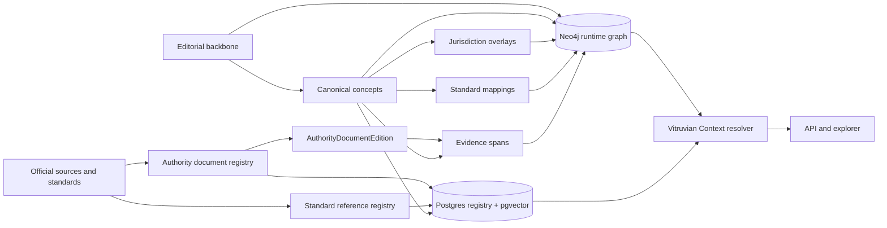
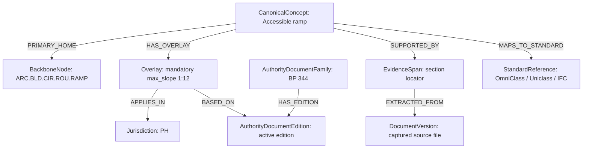

# Production-Ready Master AEC Taxonomy for The Vitruvian Context

## Executive summary

The most robust backbone for **The Vitruvian Context** is not a graph “learned” from documents first. It is a **governed, standards-informed editorial backbone** that assigns every canonical concept one primary home in a stable AEC taxonomy, then connects that backbone to jurisdictional overlays, authoritative documents, evidence spans, and external standard references. In other words: **taxonomy first, graph second, document ingestion third**. That design is the only one that stays stable while regulations, editions, projects, and jurisdictions continue to change. citeturn15view0turn10view1turn14view1turn26view0turn15view4turn23view1

No single published standard can serve as the whole master backbone. entity["organization","Construction Specifications Institute","standards body us"] OmniClass is a multi-table classification system organized by information facets; entity["organization","NBS","uk specification platform"] Uniclass is likewise a unified multi-table classification system; entity["organization","buildingSMART International","openbim standards"] IFC is a lifecycle-spanning open data schema for buildings and infrastructure; the entity["organization","International Code Council","model codes"] I-Codes and IBC are model code families; and the Eurocodes are a structural design family. Each is authoritative in its own scope, but each solves a different problem. The right architecture is therefore a **Vitruvian editorial backbone** mapped outward to OmniClass, Uniclass, IFC, I-Codes/IBC, Eurocodes, and bSDD, not replaced by any of them. citeturn15view0turn10view1turn23view3turn15view3turn15view4turn23view1turn23view2

For production use, I recommend an **18-domain backbone** with **orthogonal facets** for lifecycle, asset type, performance topic, knowledge type, geography, and standards context. This keeps the backbone stable while letting the resolver answer context questions such as “what applies in this jurisdiction, on this date, for this asset, in this project phase?” Lifecycle facets should be aligned to ISO 19650 delivery/operations concepts and to the eight-stage RIBA Plan of Work, while asset and performance facets should align to IFC scope plus practical building-performance themes used in professional guidance. citeturn25view0turn25view1turn25view2turn15view5turn14view1turn23view3

For the first country pack, the entity["country","Philippines","southeast asia"] model should start with: BP 344 for accessibility, RA 9514 for fire safety, PD 856 for sanitation, the DPWH-managed National Building Code and referral references, the Philippine Green Building Code, the Local Government Code basis for city and municipal ordinances, plumbing code families managed through professional regulation structures, and hazard context from PHIVOLCS, PAGASA, and HazardHunterPH. Those should be modeled as **AuthorityDocumentFamily/Edition + Overlay + EvidenceSpan**, never as duplicated “truth” embedded inside concept nodes. citeturn16view3turn16view1turn1search1turn6search17turn6search0turn20search1turn16view5turn24search1turn24search2turn24search11

This recommendation is not a conceptual reset of your current direction; it is a strengthening of it. The uploaded Vitruvian Context integration, cross-discipline taxonomy, resolver spec, locked decisions, and migration/governance documents already point toward a stable canonical layer, typed cross-domain relationships, deterministic resolution, additive migration, and shadow-graph rollout. This report keeps those invariants and turns them into a production-ready ontology and implementation sequence. fileciteturn0file0 fileciteturn0file1 fileciteturn0file2 fileciteturn0file3 fileciteturn0file8 fileciteturn0file9

## Standards-informed design

A master AEC ontology should treat the external standards ecosystem as **complementary layers** rather than competing taxonomies.

OmniClass is useful because it explicitly treats construction information as multiple inter-related tables: entities by function, entities by form, spaces by function, spaces by form, elements, work results, products, phases, disciplines, organizational roles, and more. Uniclass does the same in a UK-origin system using tables for entities, spaces, systems, products, activities, materials, project management, and other classes. IFC, by contrast, is not a simple classification table set; it is an open ISO-backed information schema for buildings and infrastructure works across lifecycle phases including feasibility, conceptual design, coordinated design, procurement, construction, and operation/maintenance. The I-Codes/IBC and Eurocodes are yet another category: coordinated code families used to regulate or structure compliance, especially for safety, structural design, and public welfare. bSDD then sits above this landscape as a dictionary federation service linking classifications, definitions, properties, and terms. citeturn15view0turn23view0turn10view1turn10view2turn10view3turn10view4turn10view5turn14view1turn15view2turn26view0turn15view3turn15view4turn23view1turn23view2

The practical consequence is decisive: **do not choose one of these systems as the Vitruvian backbone**. Use them as **mapped references**. The backbone should be an editorial taxonomy optimized for semantically stable navigation and resolution. External systems should be stored as `StandardReference` and `StandardMapping` nodes, because each external system classifies something different: function, form, work result, product, process, delivery stage, regulatory obligation, or exchange schema. citeturn15view0turn10view1turn23view3turn26view0turn23view1

That architecture also matches the direction already embedded in your uploaded materials: a stable canonical layer; typed cross-discipline relations; deterministic, explainable resolution; and shadow-graph-first migration. fileciteturn0file0 fileciteturn0file1 fileciteturn0file2 fileciteturn0file3 fileciteturn0file10



The design rule that matters most is therefore simple: **one primary home per concept, many typed relationships everywhere else**. A concept such as “accessible ramps” should have one canonical home in the backbone, while its relationships to structural slabs, drainage, fire egress, accessibility law, and OmniClass/Uniclass/IFC mappings are expressed as graph edges. That gives you the stability of a taxonomy and the expressiveness of a knowledge graph at the same time. fileciteturn0file1 fileciteturn0file10

## Proposed master taxonomy

The table below proposes a production-ready set of top-level domains. I recommend treating the first sixteen as **core operational domains** and the last two as **auxiliary knowledge-commons domains**. The auxiliary domains matter greatly for precedent, learning, history, and retrieval, but they should not become the default “home” for compliance truth.

| Code | Top-level domain | Brief definition and representative subdomains |
|---|---|---|
| ARC | Architecture and Interior Design | Building form, interior architecture, spatial organization, detailing, envelopes, wayfinding, conservation practice |
| URB | Site Planning, Urban Design and Landscape | Master planning, land use, public realm, site grading, ecology, landscape systems, campus planning |
| CIV | Civil and Transportation Infrastructure | Roads, rail, airports, ports, utilities corridors, traffic engineering, external drainage |
| STR | Structural and Seismic Engineering | Concrete, steel, timber, masonry, aluminium systems, load paths, retrofit, seismic design |
| GEO | Geotechnical and Underground Engineering | Soils, foundations, retaining structures, ground improvement, excavation support, tunnelling, slopes |
| MEC | Mechanical, Thermal and Refrigeration | HVAC, hydronics, refrigeration, heat rejection, thermal controls, plant systems |
| ELE | Electrical, Lighting and Power | Power distribution, lighting, grounding, generation, backup power, renewable integration |
| PLS | Plumbing, Sanitary and Public Health | Water supply, internal drainage, sewerage, stormwater interfaces, hot water, sanitary fixtures |
| FLS | Fire Protection, Fire Suppression and Life Safety | Sprinklers, standpipes, alarms, smoke control, compartmentation, egress, fire strategy |
| SEC | Security, Communications and Smart Building Systems | Access control, CCTV, intrusion detection, structured cabling, ICT, BAS/BMS, OT integration |
| CON | Construction, Methods and Temporary Works | Constructability, sequencing, logistics, temporary structures, method statements, QA/QC, commissioning |
| MAT | Materials, Products and Fabrication | Material classes, products, assemblies, specifications, off-site fabrication, product substitution logic |
| COM | Law, Codes, Standards and Compliance | Statutes, regulations, referral codes, permits, inspections, classifications, conformance rules |
| PER | Sustainability, Resilience and Building Performance | Energy, carbon, water, climate adaptation, IAQ, daylight, acoustics, comfort, durability, resilience |
| DIG | Digital Delivery, BIM, GIS and Computation | IFC, IDS, BCF, bSDD, CDE, geospatial integration, semantic modeling, parametric/computational workflows |
| OPS | Operations, Maintenance and Asset Management | FM, asset information requirements, maintenance planning, lifecycle cost, rehab, change-of-use |
| HIS | History, Theory, Typologies and Precedent | Movements, periods, typologies, theory, criticism, precedent studies, heritage interpretation |
| FIG | People, Organizations, Works and Awards | Architects, engineers, firms, agencies, projects, buildings, bridges, awards, curated figure lists |

This split is informed by the multi-facet classification practice of OmniClass and Uniclass, the building-and-infrastructure breadth of IFC, the lifecycle scope of ISO 19650, the RIBA stage model, and coordinated regulatory families such as the I-Codes and Eurocodes. citeturn15view0turn10view1turn14view1turn25view0turn25view1turn25view2turn26view0turn15view4

The key orthogonal facets should **not** be promoted to top-level domains. They should remain reusable dimensions attached to concepts, documents, overlays, and queries.

| Facet family | Recommended values |
|---|---|
| Lifecycle stage | strategy, briefing, feasibility, concept design, spatial coordination, technical design, procurement, construction, commissioning, handover, operation, maintenance, adaptation, deconstruction, reuse |
| Asset type | building, room/space, site, campus, bridge, road, rail asset, tunnel, port/waterway, utility network, industrial plant, landscape/public realm, heritage asset |
| Performance topic | structural integrity, fire life safety, accessibility, energy and carbon, water, IAQ and ventilation, thermal comfort, acoustics, daylight, durability, maintainability, security, resilience, public health |

That lifecycle vocabulary is best anchored in ISO 19650 delivery/operations concepts and the RIBA Plan of Work stages, while the performance topics should be broad enough to absorb both code-driven and outcome-driven queries. For the Philippines pilot specifically, the DPWH Philippine Green Building Code already foregrounds energy efficiency, water and wastewater management, materials sustainability, solid waste management, and site sustainability, which argues strongly for giving those performance topics first-class facet status early. citeturn25view0turn25view1turn25view2turn15view5turn6search0turn6search15

A useful sample taxonomy fragment is below. What matters here is that it is a **canonical tree**, not the only browsing view the UI may expose.

```text
ARC Architecture and Interior Design
  ARC.BLD Building design
    ARC.BLD.CIR Circulation and access
      ARC.BLD.CIR.ROU Routes
        ARC.BLD.CIR.ROU.RAMP Accessible ramps
    ARC.BLD.ENV Envelope
      ARC.BLD.ENV.WLL Wall systems
      ARC.BLD.ENV.ROF Roof systems

STR Structural and Seismic Engineering
  STR.SYS Structural systems
    STR.SYS.FRM Frame systems
      STR.SYS.FRM.RC Reinforced-concrete frames
    STR.SYS.LAT Lateral systems
      STR.SYS.LAT.BRC Braced frames
      STR.SYS.LAT.SHR Shear walls

COM Law, Codes, Standards and Compliance
  COM.PH Philippines
    COM.PH.NBC National building code family
    COM.PH.ACC Accessibility law family
    COM.PH.FIR Fire code family
    COM.PH.SAN Sanitation code family
  COM.GLB Global reference systems
    COM.GLB.ICC I-Codes / IBC
    COM.GLB.EU Eurocodes
    COM.GLB.BIM IFC / IDS / BCF / bSDD
    COM.GLB.CLS OmniClass / Uniclass

HIS History, Theory, Typologies and Precedent
  HIS.ARC.MOD Modern architecture
  HIS.CIV.IND Industrial-era infrastructure
  HIS.TYP.MUS Museum typologies
  HIS.TYP.HOU Housing typologies

FIG People, Organizations, Works and Awards
  FIG.PER Architects
  FIG.PER Engineers
  FIG.ORG Professional bodies
  FIG.WRK Buildings and structures
  FIG.AWD Major awards and prize lists
```

A user-facing “History of Architecture → Modern Architecture → Le Corbusier” browse path can still exist. The stable ontology should simply treat that as a **projected view** over the canonical tree: `Modern architecture` lives under `HIS`, `Le Corbusier` lives under `FIG.PER`, and the UI exposes the relationship through typed edges rather than duplicating the person into multiple trees. That method also generalizes well for curated lists such as official Pritzker laureates, RIBA collections, and engineering archives. citeturn27view1turn28view0turn27view2

## Ontology and resolver model

The backbone should be expressed through a small number of strongly typed node classes. The most important point is that **classes carry different epistemic roles**: a canonical concept is not an authority document, an authority document is not an extraction artifact, and an overlay is not the same thing as evidence.

| Node class | Purpose | Required metadata fields | Example |
|---|---|---|---|
| `BackboneNode` | Stable taxonomy location | `backbone_id`, `path_code`, `pref_label`, `definition`, `level`, `parent_id`, `domain_code`, `aliases[]`, `steward`, `release_version`, `status` | `ARC.BLD.CIR.ROU.RAMP` |
| `CanonicalConcept` | Resolvable concept or topic | `canonical_id`, `pref_label`, `definition`, `primary_backbone_id`, `knowledge_type`, `aliases[]`, `facet_lifecycle[]`, `facet_asset[]`, `facet_performance[]`, `status`, `steward` | “Accessible ramp” |
| `AuthorityDocumentFamily` | Normative family identity | `family_id`, `title`, `short_title`, `doc_kind`, `issuing_authority`, `jurisdiction_root`, `publisher`, `official_citation` | “BP 344” |
| `AuthorityDocumentEdition` | Time-bound edition/adoption | `edition_id`, `family_id`, `edition_label`, `effective_from`, `effective_to`, `publication_date`, `status`, `supersedes_id`, `language`, `access_class` | “IRR edition” |
| `DocumentVersion` | Extraction artifact for a captured file | `doc_version_id`, `source_uri`, `checksum`, `mime_type`, `capture_date`, `parser`, `ocr_used`, `license_note` | captured PDF hash |
| `EvidenceSpan` | Verifiable locator into an edition or version | `evidence_id`, `edition_id`, `document_version_id`, `locator_type`, `locator_value`, `snippet`, `quote_hash`, `confidence` | section/page/paragraph span |
| `Overlay` | Context-specific obligation or exception | `overlay_id`, `target_canonical_id`, `overlay_kind`, `jurisdiction_id`, `operator`, `property_key`, `value`, `unit`, `condition_expr`, `legal_force`, `effective_from`, `effective_to`, `source_edition_id` | `max_slope = 1:12` |
| `StandardReference` | External code/classification/standard pointer | `standard_ref_id`, `system`, `code`, `title`, `edition`, `publisher`, `uri`, `status`, `jurisdiction_scope` | OmniClass, IFC, IBC, Eurocode reference |

Two additional support classes should be treated as mandatory in practice even though they are not on the minimum list: `Jurisdiction` and `StandardMapping`. Without them, overlays and crosswalks will become ambiguous and expensive to reason over.

The relationship palette should likewise stay small, typed, and semantically explicit.

| Relationship type | Source → target | Meaning |
|---|---|---|
| `HAS_PARENT` | `BackboneNode` → `BackboneNode` | Taxonomic hierarchy |
| `PRIMARY_HOME` | `CanonicalConcept` → `BackboneNode` | Single canonical home |
| `RELATED_TO` | `CanonicalConcept` ↔ `CanonicalConcept` | Generic semantic link where nothing stronger applies |
| `BROADER_THAN` / `NARROWER_THAN` | `CanonicalConcept` ↔ `CanonicalConcept` | Formal semantic scope relation |
| `REQUIRES` | `CanonicalConcept` → `CanonicalConcept` | Technical dependency |
| `CONSTRAINS` | `CanonicalConcept` → `CanonicalConcept` | Rule or discipline constraint |
| `USES_MATERIAL` | `CanonicalConcept` → `CanonicalConcept` | Material dependency |
| `SERVED_BY` | `CanonicalConcept` → `CanonicalConcept` | Building service relationship |
| `PROTECTED_BY` | `CanonicalConcept` → `CanonicalConcept` | Fire/security/protective coverage |
| `DESIGNED_BY` / `ENGINEERED_BY` / `BUILT_BY` | `Work` → `Person/Organization` | Work authorship and delivery provenance |
| `ISSUED_BY` | `AuthorityDocumentFamily` → `Organization` | Issuing body |
| `HAS_EDITION` | `AuthorityDocumentFamily` → `AuthorityDocumentEdition` | Document lineage |
| `SUPERSEDES` | `AuthorityDocumentEdition` → `AuthorityDocumentEdition` | Temporal legal/standard succession |
| `SUPPORTED_BY` | `CanonicalConcept` → `EvidenceSpan` | Verifiable support for meaning or rule |
| `EXTRACTED_FROM` | `EvidenceSpan` → `DocumentVersion` | Extraction provenance |
| `HAS_OVERLAY` | `CanonicalConcept` → `Overlay` | Context-specific truth attachment |
| `APPLIES_IN` | `Overlay` or `AuthorityDocumentEdition` → `Jurisdiction` | Jurisdiction scope |
| `MAPS_TO_STANDARD` | `CanonicalConcept` → `StandardReference` | Crosswalk to external system |

Your uploaded cross-discipline relationship taxonomy already points in this direction; the production refinement is simply to make every relationship materially typed and operationally testable. fileciteturn0file1

The resolver should also distinguish **selection** from **composition**. A production-ready precedence model is not a pure “highest level wins” stack. It should work like this:

| Rule layer | What the resolver does |
|---|---|
| Validity | Filter by effective dates, edition status, jurisdiction chain, asset type, occupancy, lifecycle stage, and explicit predicate conditions |
| Operator semantics | Interpret overlays as `ADD`, `NARROW`, `REPLACE`, or `EXCEPTION` rather than blindly “override” |
| Legal force | Rank sources by normative force: adopted law/code, delegated ordinance, IRR, department order/circular, professional standard, guidance/commentary |
| Specificity | Prefer overlays that target the exact concept/property and the narrower condition set |
| Temporal order | Prefer the active and later-valid edition within the same legal force |
| Conflict handling | If two equally valid, equally forceful overlays conflict materially, return a `conflict_set` rather than inventing a winner |

That distinction matters especially in the Philippines. A city ordinance usually **adds to** or **narrows** a national baseline if legally delegated; it should not be assumed to nullify the national rule. Therefore the resolver should merge compatible overlays and only select a single value when the property is materially exclusive.

Below is a small graph example adapted to the “accessible ramps” pattern already documented in your uploaded golden example. fileciteturn0file10



An example schema for canonical node metadata:

```json
{
  "$schema": "https://json-schema.org/draft/2020-12/schema",
  "title": "CanonicalConceptMetadata",
  "type": "object",
  "required": [
    "canonical_id",
    "pref_label",
    "definition",
    "primary_backbone_id",
    "knowledge_type",
    "status",
    "release_version"
  ],
  "properties": {
    "canonical_id": { "type": "string", "pattern": "^VTN-[A-Z]+-[0-9]{7}$" },
    "pref_label": { "type": "string", "minLength": 1 },
    "definition": { "type": "string", "minLength": 1 },
    "aliases": {
      "type": "array",
      "items": { "type": "string" },
      "default": []
    },
    "primary_backbone_id": { "type": "string" },
    "knowledge_type": {
      "type": "string",
      "enum": [
        "concept",
        "process",
        "requirement",
        "exception",
        "standard",
        "person",
        "organization",
        "work",
        "project"
      ]
    },
    "facet_lifecycle": {
      "type": "array",
      "items": { "type": "string" }
    },
    "facet_asset": {
      "type": "array",
      "items": { "type": "string" }
    },
    "facet_performance": {
      "type": "array",
      "items": { "type": "string" }
    },
    "standard_mappings": {
      "type": "array",
      "items": {
        "type": "object",
        "required": ["system", "code", "mapping_type", "confidence"],
        "properties": {
          "system": { "type": "string" },
          "code": { "type": "string" },
          "mapping_type": { "type": "string", "enum": ["exact", "close", "broader", "narrower"] },
          "confidence": { "type": "number", "minimum": 0, "maximum": 1 }
        }
      }
    },
    "status": {
      "type": "string",
      "enum": ["draft", "reviewed", "approved", "deprecated"]
    },
    "release_version": { "type": "string" },
    "steward": { "type": "string" }
  }
}
```

An example schema for `resolve(context, query) -> resolved_truth`:

```json
{
  "$schema": "https://json-schema.org/draft/2020-12/schema",
  "title": "ResolvedTruthResponse",
  "type": "object",
  "required": [
    "query",
    "context",
    "candidates",
    "resolved_truth",
    "resolution_trace",
    "confidence"
  ],
  "properties": {
    "query": {
      "type": "object",
      "required": ["canonical_id"],
      "properties": {
        "canonical_id": { "type": "string" },
        "property_key": { "type": "string" },
        "intent": { "type": "string" }
      }
    },
    "context": {
      "type": "object",
      "required": ["jurisdiction_code", "as_of_date"],
      "properties": {
        "jurisdiction_code": { "type": "string" },
        "as_of_date": { "type": "string", "format": "date" },
        "asset_type": { "type": "string" },
        "occupancy": { "type": "string" },
        "lifecycle_stage": { "type": "string" },
        "project_type": { "type": "string" }
      }
    },
    "candidates": {
      "type": "array",
      "items": {
        "type": "object",
        "required": ["overlay_id", "property_key", "operator", "legal_force", "jurisdiction_code"],
        "properties": {
          "overlay_id": { "type": "string" },
          "property_key": { "type": "string" },
          "operator": { "type": "string", "enum": ["ADD", "NARROW", "REPLACE", "EXCEPTION"] },
          "value": {},
          "unit": { "type": "string" },
          "legal_force": { "type": "string" },
          "jurisdiction_code": { "type": "string" },
          "source_edition_id": { "type": "string" }
        }
      }
    },
    "resolved_truth": {
      "type": "object",
      "required": ["property_key", "result_type"],
      "properties": {
        "property_key": { "type": "string" },
        "result_type": { "type": "string", "enum": ["single_value", "composed", "conflict", "none"] },
        "value": {},
        "unit": { "type": "string" },
        "applicable_sources": {
          "type": "array",
          "items": { "type": "string" }
        },
        "conflict_set": {
          "type": "array",
          "items": { "type": "string" }
        }
      }
    },
    "resolution_trace": {
      "type": "array",
      "items": {
        "type": "object",
        "required": ["step", "decision"],
        "properties": {
          "step": { "type": "string" },
          "decision": { "type": "string" },
          "inputs": { "type": "array", "items": { "type": "string" } }
        }
      }
    },
    "confidence": {
      "type": "number",
      "minimum": 0,
      "maximum": 1
    }
  }
}
```

## Philippines overlay strategy

The first Philippines pack should be modeled as a **jurisdictional overlay system**, not a second taxonomy. The national legal backbone starts with statutory and code families such as BP 344 for accessibility, RA 9514 for fire safety, PD 856 for sanitation, and the DPWH-managed National Building Code/related referral references. Local ordinances belong above that as jurisdiction-scoped overlays because the Local Government Code expressly empowers city legislative bodies to enact ordinances and exercise general-welfare powers. Hazard context should be ingested separately from government sources such as PHIVOLCS, PAGASA, and HazardHunterPH rather than hard-coded into legal rules. Plumbing should be represented through the professional/legal history reflected by the PRC and NAMPAP records. citeturn16view3turn16view1turn1search1turn6search17turn6search0turn20search1turn20search3turn16view5turn24search0turn24search1turn24search2turn24search11

| Philippines source family | Primary authority | How to model it |
|---|---|---|
| Accessibility Law | BP 344 | `AuthorityDocumentFamily` + active editions/IRRs + overlays for ramps, paths, rails, parking, entrances |
| Fire Code | RA 9514 | Separate family with active edition chain, inspection/protection requirements as property overlays |
| Sanitation | PD 856 | Public-health and sanitary requirements; often cross-links to plumbing, drainage, wastewater, occupancy health |
| National Building Code family | DPWH/NBCP administration | Treat statutory family and referral materials separately; never collapse all into one document node |
| Philippine Green Building Code | DPWH | Model as referral/performance-oriented overlay family for energy, water, waste, materials, site sustainability |
| Economic/socialized housing rules | BP 220 and implementing rules | Use as subtype-specific overlays tied to project type and housing class |
| Plumbing code family | PRC / NAMPAP history | Model metadata-first, then attach licensed or official editions where access permits |
| Electrical code family | Relevant professional/code authority | Model metadata-first and keep text access licensed if official machine-readable access is limited |
| Local zoning and city ordinances | City / municipality / sanggunian | Store as jurisdiction-delta overlays, not copied parallel taxonomies |
| Hazard context | PHIVOLCS, PAGASA, HazardHunterPH | Store as geographic overlays with provenance and disclaimer flags, separate from normative legal overlays |

Two practical rules matter here.

First, **jurisdiction should be hierarchical and explicit**: `PH` → region/province if used administratively → city/municipality → barangay → site/project. That lets the resolver walk up or down the chain deterministically.

Second, **overlay kind should be explicit**. I recommend at least four kinds:

- `legal_normative`
- `standards_adopted`
- `project_contractual`
- `hazard_contextual`

That separation prevents a PHIVOLCS seismic map or PAGASA wind zone from being confused with a legislative mandate, even though both may influence final design truth. HazardHunterPH explicitly describes itself as a one-stop hazard assessment source using hazard information generated by government agencies, which makes it highly valuable as contextual input but not by itself a substitute for legal code text. citeturn24search1turn24search11turn24search15

BP 344 is especially instructive for modeling because Section 1 ties accessibility features directly to permitting and names facilities such as sidewalks, ramps, and railings. That means overlays for accessibility should often be modeled as **permit-gated mandatory properties** rather than merely descriptive concepts. RA 9514, by contrast, foregrounds public safety and fire-prevention enforcement; it therefore tends to create a different overlay profile centered on protection systems, hazard classifications, inspections, and enforcement actions. citeturn16view3turn16view1

The DPWH pages that surface the National Building Code references and the Philippine Green Building Code are operationally important even when machine access is inconsistent, because they tell you which official families and checklists the agency currently treats as part of the live enforcement ecosystem. The Green Building Code is explicitly described by DPWH as a referral code to the NBCP, so it should be modeled as a distinct but linked authority family rather than fused into the base building code family. citeturn6search17turn6search14turn6search0

## Implementation roadmap and repo specification

The least-risk implementation path is to **extend** your current architecture rather than replace it. Your uploaded audit, readiness plan, implementation plan, PR sequence, risk register, and golden example already assume a Neo4j-plus-Postgres stack, additive v2 APIs, shadow-graph migration, parity gates, rollback discipline, and governed taxonomy evolution. This report is therefore a schema-and-content expansion plan, not a greenfield restart. fileciteturn0file4 fileciteturn0file5 fileciteturn0file6 fileciteturn0file8 fileciteturn0file9 fileciteturn0file10

| Phase | Timeline | Primary deliverables | Primary responsibility |
|---|---|---|---|
| Backbone freeze | 2 weeks | Approve L1/L2 domains, path-code rules, steward model, ID policy | Taxonomy lead + domain stewards |
| Ontology and schema | 2 weeks | Pydantic/TS schemas, graph labels, Postgres registries, validation rules | Backend/data engineering |
| Philippines pilot pack | 3 weeks | PH jurisdiction tree, core document families, first overlays, evidence spans, golden tests | Regulatory SME + data engineering |
| Standards crosswalk layer | 2 weeks | OmniClass, Uniclass, IFC, IBC/I-Code, Eurocode mapping registries | Taxonomy + standards stewards |
| Resolver and search | 2 weeks | Deterministic resolution engine, search facets, standard and evidence endpoints | Backend engineering |
| Migration and shadow read | 2–3 weeks | Shadow graph, parity checks, idempotent migration runner, rollback rehearsals | Backend/data engineering + QA |
| Governance and validation | 1–2 weeks, then ongoing | Review queues, benchmark set, AI policy, release process, steward approvals | Governance lead |

### Recommended stack and tradeoffs

| Component | Best starting choice | Alternatives | Why this is the best start | When to switch |
|---|---|---|---|---|
| Graph database | Neo4j | Neptune / JanusGraph / ArangoDB / PG graph extensions | Best balance of traversal ergonomics, developer productivity, and fit with your current repo direction | Only switch if you hit multi-region or hyperscale constraints |
| Relational registry | Postgres | MariaDB / SQL Server | Best for editions, audit trails, migrations, joins, pgvector, and governance metadata | Rarely necessary to switch |
| Vector store | pgvector in Postgres | Qdrant / Weaviate | Lowest operational complexity; good enough for taxonomy suggestion and evidence retrieval | Switch only if chunk count and ANN load become dominant |
| Full-text search | Neo4j FTS plus Postgres trigram | Elastic / OpenSearch | Enough for canonical concepts and evidence discovery without another major system | Add dedicated search only after proven need |
| Local AI | Ollama with Qwen for structured proposals; Nomic for embeddings | Larger hosted models later | Fits local Mac development, works offline, sufficient for candidate generation and dedupe | Upgrade only for multilingual recall or heavy edge suggestion quality |
| Cache | Redis optional | none initially | Useful for resolved-context memoization | Add when traffic justifies it |

### Performance guardrails

| Operation | Recommended p95 target | Guardrail |
|---|---|---|
| Exact node lookup by canonical ID | < 100 ms | No LLM calls; indexed graph/SQL only |
| Resolve one concept in one jurisdiction/date | < 250 ms | Precompute jurisdiction ancestry and edition validity |
| Search with facets and jurisdiction | < 300 ms | Full-text index plus prefiltered facet sets |
| Overlay fan-out per concept | < 50 candidates before ranking | Prune by jurisdiction, date, and property key early |
| Legacy parity during migration | 100% for governed legacy query set | Shadow graph is a gate, not a best-effort test |

The rule for AI should be strict: **no LLM in the hot-path resolver**. Use local Qwen only for proposal generation, tagging suggestions, document-family grouping, relation candidates, and low-risk crosswalk hypotheses. Use Nomic embeddings for retrieval, deduplication, and candidate search. Every AI-produced assertion that touches canonical placement, legal overlays, or standards mappings should enter a review queue, not write directly to the backbone. That is fully consistent with your uploaded resolver/governance direction. fileciteturn0file2 fileciteturn0file3 fileciteturn0file8

### Recommended repository and folder specification

The most important directory principle is: **governance docs live in `.ai`, but canonical content does not**. Canonical backbone data, jurisdiction packs, and standards mappings should live with executable runtime content; `.ai` should hold decisions, governance, review methods, and benchmark artifacts.

```text
.ai/
  taxonomy-governance/
    00_principles/
      backbone_governance.md
      id_policy.md
      steward_model.md
      ai_policy.md
    01_change_requests/
      backbone/
      overlays/
      standards/
    02_review_queues/
      pending/
      approved/
      rejected/
    03_validation/
      benchmark_sets/
      parity_reports/
      mapping_reviews/
    04_country_methods/
      philippines_method.md
      local_ordinance_method.md
  vitruvian-context/
    00_architecture/
      system_overview.md
      resolver_contract.md
    01_precedence/
      precedence_rules.md
      conflict_policy.md
    02_api/
      v2_contracts.md
      example_payloads.md
    03_perf/
      benchmarks.md
      load_profiles.md

003_Canonical-Knowledge-Layer/
  backbone/
    l1/
    l2/
    concepts/
    people/
    works/
    organizations/
  authorities/
    global/
    PH/
  standards/
    omniclass/
    uniclass/
    ifc/
    icc/
    eurocodes/

config/
  jurisdictions/
    PH/
      jurisdiction_tree.yaml
      authority_index.yaml
      ordinance_registry.yaml

scripts/vitruvius/taxonomy/
  validate/
  import/
  mappings/
  migration/
  shadow/
```

This mirrors the separation implied by your current architecture: governance and plans in `.ai`; canonical knowledge in the canonical layer; runtime configuration in `config`; operational scripts in `scripts`. fileciteturn0file0 fileciteturn0file3 fileciteturn0file8

## Sources and validation

The master source policy should prefer **primary and official issuers first**, then publisher-maintained standards portals, then professional archives for history and figures, and only then secondary references.

| Category | Sources to prioritize | Why they belong first |
|---|---|---|
| Global construction classification | CSI / OmniClass, NBS / Uniclass | These are formal, maintained classification systems |
| Open digital data standards | buildingSMART IFC, bSDD, IDS, BCF | These define interoperable digital semantics and exchange requirements |
| Model codes and structural design families | ICC I-Codes / IBC, Eurocodes | These organize regulatory and structural-design truth at scale |
| Information management lifecycle | ISO 19650 family, RIBA Plan of Work | These stabilize lifecycle and information-exchange facets |
| Philippines statutory and regulatory law | Lawphil, Official Gazette, DPWH, BFP, DOH, DILG, PRC | Official issuers or official legal publication sources |
| Philippines hazards and geospatial context | PHIVOLCS, PAGASA, HazardHunterPH / GeoRiskPH | Government-origin hazard and environmental context |
| History, precedent, and notable figures | Pritzker laureates site, RIBA Collections, ICE historical archives, IStructE archives, ASCE historical resources | Curated, institutional sources reduce noise and duplication |

For the global standards stack, use official maintainers: OmniClass from the Construction Specifications Institute, Uniclass from NBS, IFC and bSDD from buildingSMART, I-Codes/IBC from ICC, Eurocodes from the European Commission/JRC, and ISO 19650 for lifecycle information management. For fire, performance, and security subdomains, official standards portals from NFPA, ASHRAE, and ASIS should also be treated as first-class source families rather than ad hoc references. citeturn15view0turn10view1turn23view3turn23view1turn26view0turn15view4turn25view0turn25view1turn31search1turn31search6turn31search2

For history and notable figures, use institutional curators, not generic web search. The official Pritzker laureates list is excellent for the architecture-award branch; RIBA Collections provide deep archival support for architecture, movements, and precedent; and ICE archives are useful for civil-engineering figures and works. citeturn27view1turn28view0turn27view2turn27view0

Validation should be both **structural** and **substantive**. Structural validation checks IDs, path codes, graph connectivity, orphan nodes, supersession chains, and overlay predicates. Substantive validation checks whether the chosen home domain makes sense, whether an overlay is legally sourced, whether evidence spans actually support the modeled assertion, and whether a standard mapping is exact/close/broader/narrower with a reviewable confidence score. Your uploaded governance and risk materials already anticipate this kind of controlled rollout and steward review. fileciteturn0file8 fileciteturn0file9

A useful acceptance policy is:

- **L1–L2 backbone**: human steward only.
- **L3–L4 additions**: AI may propose, steward approves.
- **Legal overlays**: AI may extract candidates, human/legal SME approves.
- **Standards mappings**: AI may propose with confidence; low-confidence mappings hidden by default.
- **Runtime resolution**: deterministic only; always produce a machine-readable trace.

## Open questions and limitations

Some official Philippines sources are machine-inconsistent or publisher-protected, especially with referral/professional codes and some agency-hosted code references. That is not a reason to delay the ontology; it is a reason to separate **document-family metadata** from **licensed/full-text access** so the graph can be built before every source is perfectly retrievable. The official portals themselves still establish the authority families you need to model. citeturn6search17turn6search14turn31search6turn31search7

A second limitation is that local-ordinance practice can vary widely by Philippine city and municipality. The ontology should therefore begin with a **national baseline plus ordinance-delta model**, not a promise of immediate full local coverage. The right first milestone is not “all LGU law”; it is “clean national baseline + one or two exemplar city packs + deterministic precedence.” citeturn20search1turn20search3

The final architectural recommendation, stated plainly, is this: **build a stable editorial AEC backbone, keep lifecycle/asset/performance as facets, attach all law and local variation as overlays, and use external standards as mapped references rather than as the backbone itself**. That is the most production-ready structure for a global Vitruvian Context resolver, and it is fully compatible with the governed migration path already present in your uploaded plans. citeturn15view0turn10view1turn14view1turn26view0turn15view4turn23view1 fileciteturn0file0 fileciteturn0file2 fileciteturn0file3