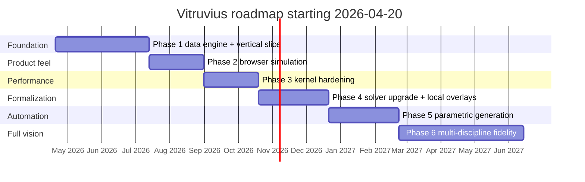

# Vitruvius Constraint-Grade Data Engine and Phase 1 Vertical Slice

**Download:** [vitruvius_constraint_grade_data_engine_phase1_report.md](sandbox:/mnt/data/vitruvius_constraint_grade_data_engine_phase1_report.md)

## Executive summary

I will build Vitruvius as two separate but connected systems: an **offline constraint-grade data engine** and an **online deterministic runtime**. Offline, I will acquire codes, standards, climate references, and pricing data; convert them into reviewed, versioned rule packs; and admit only validated payloads into the vault. Online, I will never parse source documents. I will only load admitted rule packs, compile them into formal constraints, run deterministic Rust kernels, price the result, and rank options in seconds. That architecture matches the current Vitruvius research direction: rules in the vault, orchestration in Python, deterministic kernels in Rust, verification in Z3, and browser deployment through Wasm. fileciteturn0file0 citeturn18view14turn22view3turn19view13turn19view15turn19view7

Phase 1 must stay narrow if I want it to be real. My recommendation is a **Philippines-first, city-overlay-ready vertical slice** for a **repeatable rental building typology on a rectangular urban lot**, answering: **Compliance → Envelope → Quantity → Cost → ROI**. The correct production wager is not “build all disciplines now.” It is “make one vertical slice exact, explainable, and fast.” DPWH, Lawphil, DHSUD, PSA, PAGASA, and the Philippine professional code bodies already expose or control the core source landscape I need for that first pack. citeturn1search5turn18view2turn21view2turn3search1turn3search3turn18view5turn18view6turn22view4turn6search1turn2search2turn21view8turn21view11

The hard truth is this: I will not get credible “exact AC units, lights, plumbing, full cost, and ROI in seconds” by pushing an LLM harder. I only get there by building the admission pipeline, rule schema, compiler, deterministic kernels, quantity taxonomy, pricing oracle, and validation harness first. If I do that, the browser simulation becomes the visible tip of a trustworthy engine. If I skip it, the browser app becomes a polished lie. fileciteturn0file0

## Goals, scope, and assumptions

### Goals

My goals for the data engine are simple and non-negotiable. I want to convert unstructured rules into **versioned machine-readable constraints**, keep the runtime **deterministic**, preserve **source-level traceability**, and hit **seconds-level user-facing latency** by moving document work offline. I also want the same computational core to run server-side through Python and in-browser through Rust/Wasm. Z3 is the right formal verifier for satisfiability checking, PyO3 is the right Python↔Rust bridge, and the Rust/Wasm toolchain is already built around shipping Rust kernels to the web. citeturn18view14turn22view3turn19view15turn19view7turn19view13

### Scope

This report covers two concrete deliverables:

- the **constraint-grade data engine**, including source acquisition, OCR, clause segmentation, LLM-assisted annotation, human review, schema admission, storage, and compilation; and
- the **Phase 1 vertical slice**, which takes one lot and one active jurisdiction pack, generates compliant schemes, computes envelope and quantities, prices them, and ranks them by payback/ROI and value.

It does **not** assume full multi-discipline permit-grade MEP automation in the first release. I can credibly do shell/core, deterministic envelope, quantity takeoff, cost, and ROI in Phase 1. I should not claim full mechanical/electrical/plumbing permit fidelity until the relevant code packs, engineering formulas, templates, and validation fixtures exist and are hardened. fileciteturn0file0

### Assumptions

The request leaves several details unspecified, so I am fixing them as explicit assumptions:

- **Primary national baseline:** Philippines. I am making this assumption because the current Vitruvius research already centers PD 1096, RA 9514, NSCP, PEC, and Philippine cost context. The **specific city or municipality is still unspecified**, so local zoning, parking, permit fee schedules, and utility overlays must remain separate packs. fileciteturn0file0 citeturn1search5turn18view2turn6search1turn2search2
- **Initial building typology:** one repeatable rental building type. I recommend a small-to-mid-rise rental residential building because the revenue model is clean and the plan repetition makes quantity and ROI modeling tractable. The exact typology is otherwise unspecified.
- **Code licensing:** several critical standards are not freely redistributable. ASEP is the recognized structural body behind NSCP publications, IIEE is the official PEC source, PSME sells the Philippine Mechanical Engineering Code, ASHRAE climate/technical standards are licensed, and IEC standards are sold through IEC. I should therefore keep raw purchased texts out of public Git and store only manifests, hashes, and approved extracts/derived rule payloads in the repo. citeturn6search1turn2search2turn21view8turn21view11turn21view6turn21view7
- **Pricing coverage:** internal historical cost data is unspecified, so I will seed the oracle with official Philippine indices and cost references first, then layer private vendor quotes and trade rates on top. citeturn18view5turn18view6turn7search4
- **Team and budget:** headcount, salaries, and budget are unspecified. I provide rough FTE ranges later and mark hard budget items as unspecified.

### Prioritized deliverables

I will prioritize the deliverables in this order:

1. source manifests and provenance discipline;  
2. rule schema and admission policy;  
3. extraction pipeline with OCR, segmentation, LLM annotation, and review queue;  
4. rule-pack builder and RocksDB storage layout;  
5. Python Z3 compiler;  
6. Rust envelope and takeoff kernels through PyO3;  
7. pricing oracle and ROI evaluator;  
8. Wasm/browser simulation shell;  
9. CI gates that block unsafe, unreviewed, regressive, or unaudited changes.  

That order is not optional. It is the shortest path to a trustworthy product. fileciteturn0file0 citeturn19view0turn19view2turn18view14turn22view3turn19view3turn19view4turn19view5

## Data sources and extraction engine

The data engine will live or die on source quality. I should treat sources in four tiers: **statutory law**, **professional/technical standards**, **pricing and market data**, and **local overlays**. The first production pack should be national and narrow. Local ordinances should be plugged in later as separate overlays, not baked into the baseline pack. For HVAC and climate assumptions, PAGASA should be my public baseline, with ASHRAE climate data added where I need licensed, software-grade climatic design tables. citeturn1search5turn18view2turn21view2turn3search1turn3search3turn22view4turn21view6turn22view0turn22view2

### Prioritized data sources

| Priority | Source class | What I should ingest first | Why it matters |
|---|---|---|---|
| Highest | National statutory code pack | DPWH National Building Code / PD 1096 / IRR / NBCDO issuances | Baseline envelope, height, occupancy, permitting logic |
| Highest | Fire and life safety | RA 9514 Fire Code | Egress, fire protection, life-safety constraints |
| Highest | Accessibility | BP 344 | Accessibility obligations at scheme level |
| Highest | Easements / water | PD 1067 Water Code | Waterway and easement constraints where applicable |
| Highest | Housing/subdivision overlays | DHSUD IRR for PD 957 and BP 220 | Lot/subdivision feasibility, housing standards |
| High | Structural practice | NSCP via ASEP | Later structural sizing and compliance fidelity |
| High | Electrical practice | PEC via IIEE | Electrical quantity/sizing rules and future fidelity |
| High | Mechanical practice | PSME Code | HVAC and mechanical engineering fidelity |
| High | Plumbing practice | Revised National Plumbing Code via NAMPAP / official publication trail | Plumbing fixture/routing/sizing fidelity |
| High | Climate datasets | PAGASA normals, ASHRAE Standard 169 / Handbook | HVAC load assumptions and climate normalization |
| High | Pricing baselines | PSA CMWPI/CMRPI, DPWH DUPA / cost references | Official market baselines and escalation anchors |
| Medium | Local overlays | LGU zoning ordinance, CLUP, parking rules, permit fees, utility policies | City-specific feasibility; jurisdiction currently unspecified |
| Medium | Vendor pricing | supplier quotes, equipment catalogs, subcontractor rates | Real-world cost usefulness and locality tuning |

These priorities follow the official and authoritative sources already available: DPWH publishes the NBC portal and related references, Lawphil hosts the statutory texts, DHSUD exposes the relevant IRR references, PSA publishes construction material indices, PAGASA publishes climatological normals, ASEP is the recognized NSCP publisher, IIEE is the PEC source, PSME sells the mechanical code, and ASHRAE/IEC provide the official standards channels. citeturn1search5turn18view2turn21view2turn3search1turn3search3turn18view5turn18view6turn22view4turn6search1turn2search2turn21view8turn21view11turn21view6turn21view7

### Extraction methodology

I should route every document through the **cheapest reliable extraction path first**.

**Acquisition and manifesting.** Every source gets a manifest entry with title, publisher, licensing class, jurisdiction, domain, effective date, acquisition date, document hash, and review status. If I do not have this, I do not have an auditable knowledge base.

**Text path selection.** If a PDF is born-digital, I should extract text and layout directly and skip OCR. If it is scanned, I should first use a local OCR path—OCRmyPDF plus Tesseract for inexpensive, automatable recovery—then escalate only hard pages to stronger document-AI services. Azure Document Intelligence explicitly targets text, key-value pairs, tables, and structure extraction; Google Document AI explicitly targets high-accuracy document extraction/classification/splitting; PaddleOCR is a strong open-source fallback for structured document parsing. citeturn19view10turn19view11turn19view8turn19view9turn10search3

**Clause segmentation and table recovery.** I should split documents into clauses, definitions, formulas, exceptions, and tables before any LLM step. This matters because many code obligations and engineering values live in tables rather than prose. My extraction system therefore needs table-first recovery for electrical values, climate data, fee schedules, and standards summaries. citeturn19view8turn19view9

**LLM-assisted annotation.** The LLM should never “interpret the law” freely. I will only allow it to map a clause or table segment into a strict schema, using a constrained vocabulary and schema-constrained JSON output. The model’s job is structure recovery, not authority.

**Deterministic normalization.** After annotation, deterministic code will normalize dates, units, variable names, jurisdiction codes, enumerations, and target entities. This stage must be code, not AI.

**Human-in-the-loop promotion.** Human review is mandatory for life-safety rules, formula-bearing rules, low-confidence extractions, and any rule that materially affects cost or compliance. The reviewer’s job is adjudication, not full manual transcription.

**Canonical pack promotion.** Only reviewed, validated rules can be admitted into a signed jurisdiction pack. The existing Vitruvius principle is exactly right here: the vault stores **data**, not executable code. fileciteturn0file0

### System component architecture and data flow

```mermaid
flowchart LR
    A[Official and licensed sources\nlaws, standards, climate, prices] --> B[Acquisition manifest\nhash, license, jurisdiction, effective dates]
    B --> C{Text path}
    C -->|Born-digital| D[Direct text and layout extraction]
    C -->|Scanned| E[OCR pipeline\nOCRmyPDF / Tesseract\ncloud fallback if needed]
    D --> F[Clause segmentation\nformula and table recovery]
    E --> F
    F --> G[LLM-assisted annotation\nschema-constrained JSON]
    G --> H[Deterministic normalization\nunits, variables, dates, enums]
    H --> I[Human review queue]
    I --> J[Signed rule packs\nversioned manifests]
    J --> K[(RocksDB / local rule vault)]
    K --> L[Python orchestrator]
    L --> M[Z3 compiler]
    L --> N[Rust kernels\ngeometry, quantity, metrics]
    M --> O[Compliance verdict / witnesses]
    N --> P[Envelope / quantities]
    P --> Q[Pricing oracle]
    Q --> R[ROI / ranking]
    N --> S[Wasm build]
    R --> T[API / browser simulation]
    S --> T
```



This architecture is the right one because it makes the slow work offline and the fast work online. RocksDB supports prefix-oriented iteration and logical partitioning with column families, which maps well to jurisdiction/domain/target retrieval. Z3 is built for satisfiability checking over formal theories. PyO3 is designed to wrap Rust for Python. Bevy ECS is explicitly a fast, massively parallel standalone ECS. wasm-bindgen and wasm-pack are the standard Rust/Wasm bridge. React Three Fiber is the rendering layer, not the truth layer. citeturn19view0turn19view2turn18view14turn22view3turn19view16turn19view7turn19view15turn8search4

## Constraint schema and deterministic compilation

The rule schema is the real contract of the system. If the schema is weak, everything else becomes ambiguous. I therefore recommend a **strict JSON admission schema** plus a **narrow internal AST** for executable logic. The minimum fields you requested—`id`, `source`, `clause`, `variables`, `units`, `formula`, `enforcement_level`, `confidence`, and `effective_date`—should all be mandatory, with a few additional fields for execution and governance. This also preserves the existing Vitruvius principle that rules remain structured data while computation lives in the compiler and kernels. fileciteturn0file0

### Schema field definitions

| Field | Type | Required | Meaning | Decision |
|---|---|---:|---|---|
| `id` | string | Yes | Stable rule id | Namespace by jurisdiction/domain/version |
| `source` | object | Yes | Title, publisher, source hash, refs | Preserve provenance |
| `clause` | string | Yes | Human-readable clause text or normalized summary | Keep close to the source |
| `jurisdiction` | string | Yes | `ph`, `ph.city`, etc. | Separate national from local overlays |
| `domain` | enum | Yes | architectural, fire, structural, electrical, plumbing, mechanical, costing, climate | Tight enums only |
| `target_entity` | string | Yes | lot, building, stair, conductor, pipe_run, etc. | Canonical vocabulary |
| `variables` | array | Yes | Bound variables with name, sort, unit, role | Canonicalize before compile |
| `units` | object | Yes | Unit system and base units | Normalize to SI internally |
| `formula` | object | Yes | AST/IR predicate or equation | Only admitted operators allowed |
| `constraint_type` | enum | Yes | min, max, ratio, equality, count, travel_distance, etc. | Drives compiler behavior |
| `enforcement_level` | enum | Yes | hard, soft, heuristic | Hard rules are non-waivable in runtime |
| `confidence` | float | Yes | Extraction confidence | Never sufficient alone for promotion |
| `effective_date` | object | Yes | start/end validity window | Required for temporal packs |
| `supersedes` | string/null | No | Previous rule id | Enables version chain |
| `review_status` | enum | Yes | draft, reviewed, admitted, retired | Production packs must be admitted only |
| `source_license` | enum | Yes | public, purchased, confidential | Controls storage policy |
| `notes` | string/null | No | Reviewer notes | Cannot replace the formula |

### Example rule AST payload

```json
{
  "id": "ph.pd1096.arch.setback.front.r1.v2005",
  "source": {
    "title": "Implementing Rules and Regulations of the National Building Code of the Philippines",
    "publisher": "DPWH",
    "source_class": "official",
    "document_hash": "sha256:9f0c...ab1d",
    "section_ref": "Rule VIII / Setbacks",
    "page_ref": "p. 123"
  },
  "jurisdiction": "ph",
  "domain": "architectural",
  "target_entity": "building_front_face",
  "clause": "Front setback shall not be less than 4.5 meters for the applicable class.",
  "variables": [
    {
      "name": "distance_to_front_property_line",
      "sort": "real",
      "unit": "m",
      "role": "measured_clearance"
    }
  ],
  "units": {
    "system": "SI",
    "base_length": "m"
  },
  "constraint_type": "minimum_clearance",
  "formula": {
    "op": ">=",
    "left": { "var": "distance_to_front_property_line" },
    "right": { "const": 4.5, "unit": "m" }
  },
  "enforcement_level": "statutory_hard",
  "confidence": 0.98,
  "effective_date": {
    "start": "2005-04-30",
    "end": null
  },
  "supersedes": "ph.pd1096.arch.setback.front.r1.v1977",
  "review_status": "admitted",
  "source_license": "public"
}
```

### Z3 compiler design

For Phase 1, I should keep the solver subset narrow and disciplined.

- Quantifier-free linear integer and real arithmetic first.  
- Discrete counts and booleans for parking, exit count, floor count, etc.  
- Ratios and affine transforms for FAR, site occupancy, height, and similar controls.  
- No unrestricted nonlinear geometry in Z3 for Phase 1. Geometry should be computed in Rust/Python first, then asserted into the solver as facts or bounds.  
- Unit normalization outside the solver.  
- Unsat witnesses and traceability as first-class outputs.

That split is the right one because Z3 is excellent at satisfiability over logical formulas and supported theories, but it is not a substitute for a geometry kernel. citeturn18view14

### Example Z3 translation

```python
from z3 import Real, RealVal, Solver

distance_to_front_property_line = Real("distance_to_front_property_line")

solver = Solver()
solver.add(distance_to_front_property_line >= RealVal("4.5"))
```

A second example is FAR:

```python
from z3 import Real, RealVal, Solver

gross_floor_area = Real("gross_floor_area")
lot_area = Real("lot_area")

solver = Solver()
solver.add(lot_area > 0)
solver.add(gross_floor_area / lot_area <= RealVal("6.0"))
```

The compiler must generate these from admitted ASTs, not from hand-coded business logic. That is why the compiler needs golden fixtures, regression tests, and explicit review coverage. Cargo’s testing model, Clippy’s lint surface, proptest’s property-based tooling, and Criterion’s regression benchmarking all support that discipline. citeturn20view1turn20view2turn19view3turn19view4turn19view5

## Phase 1 vertical slice design

### What Phase 1 must actually do

Phase 1 should answer one commercially useful question in a way that is fast, deterministic, and auditable:

> Given this lot and this active rule pack, what is the best compliant building I can build, what does it cost, and how quickly do I recover my capital?

To make that real, I should scope Phase 1 to:

- one national code pack;
- one local overlay schema, even if the actual city pack is still unspecified;
- one lot geometry class first;
- one building typology first;
- one revenue model first;
- one ranking objective first: **fastest payback**, with cost and value side metrics.

That is enough to ship an honest MVP and still preserve the larger architecture.

### Rust/Python/WebAssembly split

**Rust kernels**
- lot normalization and polygon processing;  
- setback carving and buildable envelope generation;  
- floor stack generation under FAR/height/site occupancy bounds;  
- deterministic area, volume, and count accumulation;  
- quantity aggregation and later routing-complexity metrics;  
- shared crate target for native backend and browser Wasm.

**Python orchestration**
- rule-pack retrieval and binding context;  
- Z3 compiler;  
- scenario generation/ranking;  
- pricing oracle;  
- ROI calculations;  
- traces, audit logs, and report assembly.

**Browser/Wasm**
- start backend-first through PyO3;  
- then compile the same Rust core to Wasm with wasm-pack/wasm-bindgen;  
- keep React Three Fiber in charge of view state and rendering only;  
- defer browser threading until the single-thread path is already fast and stable, because shared memory requires cross-origin isolation. fileciteturn0file0 citeturn22view3turn19view16turn19view15turn19view7turn19view12turn19view13turn8search4

### Quantity takeoff taxonomy

| Quantity family | Examples | Owner | Pricing role |
|---|---|---|---|
| Counts | units, stairs, toilets, doors, windows, parking slots, fixture placeholders, light points | Rust + controlled templates | discrete unit pricing |
| Lengths | wall runs, perimeter, conduit runs, pipe runs, beam lengths | Rust | material and labor basis |
| Areas | lot area, footprint, GFA, leasable area, common area, façade, roof | Rust | revenue + finish pricing |
| Volumes | excavation, fill, concrete, masonry, water storage | Rust | structural/civil pricing |
| Fittings | elbows, tees, bends, junctions, sleeves | Rust once topology exists | MEP material/labor uplift |
| Routing complexity | turns, shaft passages, congestion score, density zone | Rust metrics + Python scoring | topology multipliers |
| Financial spaces | leasable vs non-leasable area | Rust + Python categorization | ROI model |

The non-negotiable rule is that quantities must be derived from **deterministic geometry or deterministic templates**. If I use a template, that template must itself be versioned, reviewed, and traceable. fileciteturn0file0

### Pricing oracle design

The pricing oracle should be a distinct layer with four stacked data sources:

1. **Official baselines** from PSA CMWPI/CMRPI and DPWH cost references.  
2. **Direct unit rates** by SKU, locality, supplier, date, and currency.  
3. **Labor model** with base trade multipliers and topology multipliers.  
4. **Project-level adders** such as contingency, overhead, permits, taxes, escalation, and financing assumptions.

The core fields should include `item_code`, `unit`, `base_rate`, `currency`, `location_code`, `source_type`, `source_ref`, `effective_date`, `labor_multiplier`, `topology_multiplier`, `waste_factor`, and `contingency_rule`. The oracle must return both line items and rollups so I can explain why a “smaller” geometry still priced higher because of complexity. PSA and DPWH should be the public anchors; vendor quotes and internal historical costs become private overlays later. citeturn18view5turn18view6turn7search4

### Cost and ROI model

For Phase 1, I should keep ROI brutally simple and transparent.

- **Capex** = direct materials + labor + equipment + contingency + permits/overhead  
- **Gross annual revenue** = leasable area × rent per sqm × occupancy  
- **Net annual revenue** = gross annual revenue − opex allowance  
- **Simple payback** = capex / net annual revenue  
- **Secondary metrics** = cap rate, sensitivity bands, downside case

I should not hide assumptions. Every scheme must show the rent basis, occupancy basis, opex basis, price snapshot date, and locality used.

## Validation, CI, security, and performance

I should assume every layer will fail unless I prove otherwise. The system therefore needs validation at the source, schema, compiler, kernel, oracle, and end-to-end levels.

### Validation test matrix

| Layer | What I test | Method | Pass criterion | Gate |
|---|---|---|---|---|
| Source manifests | hashes, metadata completeness, licensing flags | fixture corpus | no missing provenance | block merge |
| OCR / segmentation | clause and table recovery | golden docs + reviewer diff | critical clauses recovered correctly | block promotion |
| Rule admission | schema validity, enums, dates, units | JSON schema validation | 100% valid payloads only | block promotion |
| Unit normalization | SI conversion and canonical vars | golden conversions + fuzzing | no silent drift | block merge |
| Z3 compiler | AST → solver encoding | golden compiler fixtures | expected formulas/witnesses | block merge |
| Geometry kernel | envelope carve and measurement | golden fixtures + property-based tests | deterministic within tolerance | block merge |
| Quantity engine | counts/areas/volumes | canonical takeoff fixtures | stable expected totals | block merge |
| Pricing oracle | date/locality/multiplier logic | fixed snapshots | stable itemized totals | block merge |
| End-to-end slice | lot → ROI pipeline | canonical lots | compliant outputs with full trace | release gate |
| Performance | latency and memory | Criterion + runtime benches | no budget regression | release gate |
| Native/Wasm parity | same inputs, same outputs | parity fixtures | identical or tolerance-safe results | release gate |

The testing and enforcement tools are already there: Cargo runs unit/integration/doc tests, Clippy brings an extensive lint surface, proptest supports property-based tests, Criterion catches performance regressions, and RustSec/cargo-audit style tooling covers dependency issues. Rust itself is explicitly designed around performance, memory-efficiency, and compile-time safety, which is exactly why I should tolerate its complexity in the kernel layer instead of retreating to dynamic-language hot paths. citeturn20view1turn20view2turn19view3turn19view4turn19view5turn13search14turn22view5

### CI gates and enforcement

My minimum CI gates should be:

- `.ai/00_system/EXECUTION_LOOP.md` enforced as process law;
- `.ai/00_system/RUST_CONSTRAINTS.md` enforced as Rust implementation law;
- rule-pack schema validation on every changed fixture;
- compiler golden suites;
- `cargo fmt --check`;
- `cargo clippy -- -D warnings`;
- `cargo test` and doctests;
- property-based suites for geometry and quantities;
- benchmark comparisons against stored baselines;
- dependency audits;
- `wasm-pack build` smoke test;
- native-vs-wasm parity tests.

No merge should be allowed if the rule pack is unaudited, the compiler goldens drift, the Rust benchmark regresses, or the browser build diverges from native output. citeturn19view3turn20view1turn19view4turn19view5turn13search14

### Security and privacy

My security model should be boring and strict:

- **No executable code in the rule vault.** Rules are data only. fileciteturn0file0  
- **Licensed source texts stay out of public Git.** Store manifests, hashes, and admissible transforms only. citeturn21view6turn21view7turn21view8turn21view11  
- **Client lots, vendor quotes, and private rate cards stay private** in controlled storage.  
- **Signed rule packs and dated pricing snapshots** must be traceable by hash.  
- **Every answer must log** rule-pack hash, pricing-snapshot hash, compiler version, and kernel version.  
- **Use local-first extraction where possible, cloud escalation only when necessary** for difficult documents. OCRmyPDF/Tesseract are good local baselines; Azure/Google document AI should be selective escalations, not the default path. citeturn19view10turn19view11turn19view8turn19view9

### Performance targets

I should publish Phase 1 performance budgets now, not later.

**Offline**
- ingestion/OCR/extraction are asynchronous and resumable;
- compiled rule fragments cached per pack hash;
- climate packets and pricing snapshots precomputed by locality/date.

**Online**
- warmed rule-pack load: **< 200 ms**  
- envelope generation for one rectangular lot: **< 500 ms**  
- quantity takeoff for one candidate: **< 500 ms**  
- pricing + ROI for one candidate: **< 250 ms**  
- ranking 10–20 schemes end-to-end: **p95 < 5 s**  
- browser parameter update on a warmed Wasm kernel: **< 200 ms**

That target profile is achievable only if runtime never does OCR, never reinterprets prose, and never moves bloated JSON geometry across the Python/Rust/JS boundaries. RocksDB prefix lookup, column families, PyO3 bindings, wasm-bindgen, and wasm-pack all support that design. Shared-memory browser threading can wait until the single-thread path is already fast. citeturn19view0turn19view2turn22view3turn19view15turn19view7turn19view12turn19view13

## Roadmap, resources, and repo outputs

### Phase deliverables and timelines

| Phase | Objective | Core outputs | Duration | Rough FTE |
|---|---|---|---|---|
| Phase 1 | Data engine + vertical slice | manifests, extraction pipeline, AST schema, Z3 compiler, envelope kernel, quantity/cost/ROI API | 10–14 weeks | Founder + 1 engineer + 0.5 data engineer + 0.25 domain review |
| Phase 2 | Browser simulation | Wasm build, R3F viewer, sliders, trace panel, scheme explorer | 6–8 weeks | Founder + 1 front-end engineer + 0.5 Rust support |
| Phase 3 | Kernel hardening | benchmarked kernels, parity fixtures, general polygon support, cache model | 6–8 weeks | Founder + 1 Rust engineer |
| Phase 4 | Solver expansion + local overlays | richer compiler subset, city overlays, temporal packs, better witnesses | 8–10 weeks | Founder + 1 compiler engineer + reviewers |
| Phase 5 | Parametric generation | richer scheme generator, better objective functions, search orchestration | 8–10 weeks | Founder + 1 optimization engineer |
| Phase 6 | Multi-discipline fidelity | deeper struct/HVAC/plumbing/electrical kernels and coordination | 12–20 weeks | Founder + 2–3 engineers + SMEs |

These durations assume founder-led execution with AI-assisted coding, but they still require serious review, testing, and rule adjudication. Budget and salary are unspecified.



### Resource estimates

A realistic Phase 1 staffing envelope is:

- **Founder/operator:** 1.0 FTE  
- **Rust/Python systems engineer:** 1.0 FTE  
- **Data/extraction engineer:** 0.5–1.0 FTE  
- **Domain reviewers:** 0.25–0.5 pooled FTE across architecture/code/cost  
- **Front-end engineer:** optional in Phase 1, needed in Phase 2  

If unspecified, I would keep the first phase founder-led with one strong engineer and contract review support rather than hiring a large team too early.

### Risk analysis and mitigation

The risks are predictable.

- **Extraction errors.** OCR, tables, and clause splitting can poison the vault. I mitigate this with manifests, hashes, goldens, schema validation, and review gates.
- **Compiler errors.** A bad AST→Z3 translation can produce formally wrong answers. I mitigate this with golden translation fixtures and witness-based review.
- **Codex/Rust errors.** AI-generated Rust can compile while still being numerically wrong, allocation-heavy, or regressively slow. I mitigate this with strict hot-path rules, review, `clippy`, property tests, and benchmark gates.
- **Pricing drift.** Materials and labor move. I mitigate this by separating static rule packs from dated pricing snapshots and indexing official PSA baselines. citeturn18view5turn18view6
- **Model drift.** Extraction quality shifts across model versions. I mitigate it by pinning model versions and replaying the golden corpus on any model change.
- **Licensing risk.** Proprietary standards cannot be casually redistributed. I mitigate this by keeping raw texts private and versioning manifests, hashes, and admitted transforms only.
- **Scope explosion.** The biggest founder risk is trying to jump to full multidisciplinary automation before the first vertical slice is exact. I mitigate this by refusing cross-phase leakage.

### Exact repo outputs to produce

| Path | Purpose | Example files |
|---|---|---|
| `.ai/00_system/EXECUTION_LOOP.md` | process law | `EXECUTION_LOOP.md` |
| `.ai/00_system/RUST_CONSTRAINTS.md` | Rust safety/performance rules | `RUST_CONSTRAINTS.md` |
| `.ai/00_system/PERFORMANCE_BUDGETS.md` | explicit latency budgets | `PERFORMANCE_BUDGETS.md` |
| `.ai/00_system/RULE_ADMISSION_POLICY.md` | promotion policy | `RULE_ADMISSION_POLICY.md` |
| `.ai/13_research/` | research artifacts | `vitruvius-constraint-grade-data-engine-report.md` |
| `.ai/02_audits/` | audit docs | `phase1-vertical-slice-audit.md` |
| `.ai/03_plans/` | implementation plans | `phase1-vertical-slice-plan.md` |
| `data/manifests/sources/ph/` | source manifests | `pd1096.yml`, `ra9514.yml`, `bp344.yml`, `pd957.yml` |
| `data/private/raw/` | non-public raw docs | `pd1096_irr.pdf`, `nscp_2024.pdf`, `pec_2017.pdf` |
| `rules/schemas/` | admission schemas | `rule_ast.schema.json`, `quantity_item.schema.json`, `price_item.schema.json` |
| `rules/extraction/` | OCR and annotation pipeline | `ocr_router.py`, `segment_clauses.py`, `annotate_rule.py` |
| `rules/review/` | review and promotion | `review_queue.py`, `promotion.py` |
| `rules/packs/ph/base/` | national packs | `ph_base_2026q2.pack.json`, `manifest.json` |
| `rules/packs/ph/local_overlay/` | local packs | `city_overlay_template.pack.json` |
| `engine-py/vitruvius/compiler/` | Z3 compiler + normalization | `z3_compiler.py`, `unit_normalizer.py`, `binding_context.py` |
| `engine-py/vitruvius/pricing/` | oracle + ROI | `oracle.py`, `rate_snapshot.py`, `roi.py` |
| `engine-py/vitruvius/api/` | Phase 1 endpoints | `compute_envelope.py`, `quantity_takeoff.py`, `cost_estimate.py`, `rank_schemes.py` |
| `engine-rs/crates/geometry_core/` | envelope and measurement kernels | `src/envelope.rs`, `src/measure.rs` |
| `engine-rs/crates/quantity_core/` | takeoff kernels | `src/takeoff.rs` |
| `engine-rs/crates/wasm_bridge/` | browser target | `src/lib.rs` |
| `web/sim/` | simulation shell | `src/App.tsx`, `TracePanel.tsx`, `EnvelopeScene.tsx` |
| `tests/golden/rules/` | compiler/rule goldens | `setback_front.json`, `far_limit.json` |
| `tests/golden/vertical_slices/` | end-to-end fixtures | `lot_a_expected.json`, `lot_b_expected.json` |
| `tests/property/` | property suites | `geometry_props.rs`, `quantity_props.rs` |
| `benchmarks/` | performance baselines | `phase1_kernel_bench.rs`, `baseline.json` |

## Final recommendation

If I want Vitruvius to become a real company rather than an endless research project, I should treat the **constraint-grade data engine** as the actual moat and the **Phase 1 vertical slice** as the first saleable proof. The winning order is fixed:

1. acquire and admit authoritative sources;  
2. normalize them into a strict AST schema;  
3. prove the compiler and kernels with goldens;  
4. price deterministic quantities with dated local snapshots;  
5. expose the result in a browser only after the math is trustworthy.

That path is production-grade, founder-usable, and commercially legible. It is also the shortest honest path to answering Vitruvius’s core promise without lying about law, cost, or ROI. fileciteturn0file0