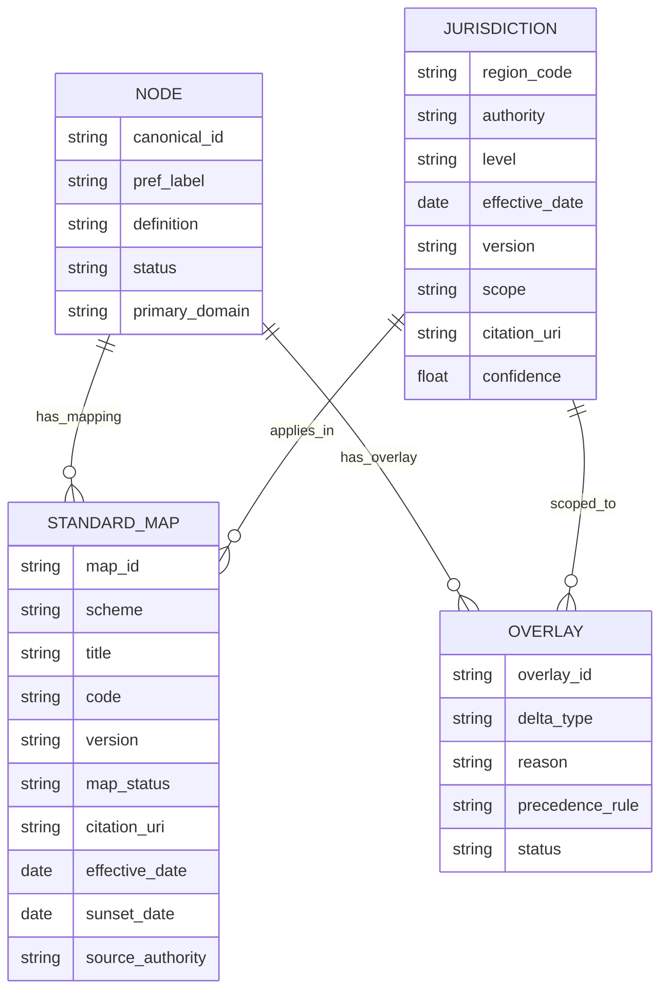
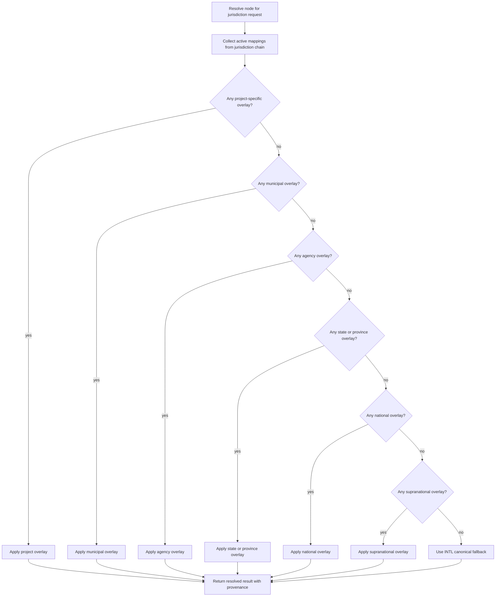
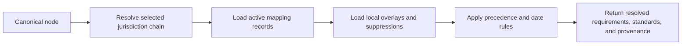

# Governed jurisdiction handling for Vitruvius

## Executive summary

Vitruvius should **not** build separate full taxonomies per country, state, or agency. The best long-term model is a **single canonical international backbone** plus a **jurisdiction facet** and a **thin overlay layer** for local variants, amendments, and regulatory applicability. That design matches the way the major AEC standards actually separate concerns: ISO 12006-2 provides a classification framework, ISO 12006-3 and ISO 23386/23387 support machine-readable dictionaries and data templates, IFC supports external classification references, and bSDD distributes governed classes and properties rather than one jurisdiction-specific master tree. citeturn0search25turn0search3turn7search0turn7search1turn0search5turn7search2turn6search3

The regulatory reality is also hierarchical, not monolithic. England uses Building Regulations supported by Approved Documents; Australia uses the NCC with state and territory variations and explicit state-law override rules; Singapore combines statute, regulations, Approved Document, and Fire Code; the Eurocodes are supranational structural standards with national annexes and Nationally Determined Parameters; California healthcare facilities are governed through a specialized agency regime now under HCAI, formerly OSHPD. That means Vitruvius needs **jurisdiction-aware mappings and override logic**, not duplicated discipline trees. citeturn10search9turn8search7turn2search0turn5search0turn6search1turn2search15turn3search19turn3search7

The recommended operating pattern is therefore: **canonical node → jurisdiction-aware mapping records → overlay nodes only when local law materially changes meaning, scope, or compliance path**. Anything else creates drift, duplicate maintenance, and false confidence in AI-generated classifications.

## Standards context and jurisdiction design choices

Official anchor sources for this problem should come first from entity["organization","International Organization for Standardization","standards organization"], entity["organization","buildingSMART International","openbim org"], entity["organization","International Code Council","building code organization"], entity["organization","National Fire Protection Association","fire standards body"], entity["organization","American Society of Civil Engineers","civil engineering society"], entity["organization","CEN-CENELEC","european standards bodies"], entity["organization","NBS","uk construction platform"], and entity["organization","Construction Specifications Institute","specifications standards body"]. ISO 12006-2 defines a framework for built-environment classification systems; ISO 12006-3 defines a language-independent information model for dictionaries and taxonomies; ISO 23386 defines how properties are authored and maintained in interconnected dictionaries; ISO 23387 defines machine-readable data templates; IFC allows references to external or local classification systems; and bSDD distributes dictionaries published by independent organizations. Those sources all point toward the same conclusion: the core model must separate canonical meaning from external applicability and mapping. citeturn0search25turn0search3turn7search0turn7search1turn0search5turn0search13turn7search2turn7search13

The three viable taxonomy patterns are shown below.

| Model | What it is | Strengths | Failure mode | Verdict |
|---|---|---|---|---|
| **Per-jurisdiction trees** | Separate full trees for `INTL`, `US`, `UK-ENG`, `AU-NSW`, `SG`, etc. | Easy to explain to nontechnical users; local teams can browse “their code tree” | Massive duplication; drift between trees; weak cross-border analytics; AI often forks concepts that should remain one concept | **Do not use as the primary model** |
| **Facet-based mappings** | One canonical tree with jurisdiction stored as metadata on node applicability and standards mappings | Lowest duplication; strongest search, analytics, and crosswalks; matches IFC/bSDD/ISO patterns | Too abstract if local law changes the concept materially | **Best default** |
| **Overlay or variant trees** | Canonical tree plus thin local overlays carrying only deltas, exceptions, and local interpretations | Handles real jurisdictional differences cleanly without cloning entire trees | Needs explicit precedence, inheritance, and review policy | **Use selectively, on top of facet-based mappings** |

The correct answer is therefore a **hybrid**: a single canonical international taxonomy, jurisdiction as a facet, and an overlay layer for local deltas only. That is exactly how the external systems behave. Eurocodes are common European structural standards, but their Nationally Determined Parameters and National Annexes are jurisdictional overlays; the NCC is national, but state and territory variations must be applied and may be overridden by state law; NFPA publishes jurisdictional-change versions of some codes; English Approved Documents are guidance for meeting the Building Regulations, not a separate ontological universe. citeturn2search4turn2search12turn2search0turn5search0turn8search7turn8search18turn1search26turn10search9turn10search12

A source-family view makes the difference clear.

| Source family | What Vitruvius should store | What Vitruvius should **not** do |
|---|---|---|
| ISO / IFC / bSDD | Canonical semantics, dictionary patterns, data templates, external classification references, machine-readable identifiers | Convert ISO or IFC into a country tree |
| Model codes and standards | Versioned mapping records with applicability by jurisdiction, edition, and effective date | Treat one standard family as a universal taxonomy |
| Public law and statutes | Jurisdiction, issuing authority, legal scope, effective dates, and citation URIs | Mix enabling law and technical requirements into one uncontrolled label set |
| National annexes / amendments / variations | Overlay records and precedence metadata | Fork the whole domain tree for each annex or amendment |

The most important modeling principle is blunt: **jurisdiction is usually not a subject domain; it is an applicability condition**. Only create a localized variant node when a jurisdiction creates a genuinely distinct concept, class, or compliance pathway. Everything else belongs in mappings, overlays, or provenance.

## Recommended jurisdiction model

The jurisdiction model for Vitruvius should have three layers:

1. **Canonical node**: the stable, jurisdiction-neutral concept, class, system, process, or rule topic.
2. **Jurisdiction object**: the applicability context, expressed as a hierarchical region or authority slice.
3. **Mapping or overlay record**: the local code, standard, statute, annex, or agency-specific interpretation attached to the canonical node.

That design is justified by IFC’s distinction between classified objects and external classification references, and by bSDD’s role as a dictionary distribution service rather than a localized rule engine. citeturn0search5turn0search13turn7search2turn6search3



The `jurisdiction` facet itself should be an array of objects, not a string. A string code such as `SG` or `UK-ENG` is too weak to support precedence, date filtering, provenance, or audit.

| Field | Type | Cardinality | Required | Meaning | Recommendation |
|---|---|---:|---:|---|---|
| `region_code` | string | 1 | yes | Normalized jurisdiction identifier | Hierarchical code, left-to-right broad → narrow |
| `authority` | string | 1 | yes | Issuing or governing body | Human-readable official authority name |
| `level` | enum | 1 | yes | Granularity of jurisdiction | `international`, `supranational`, `national`, `state_province`, `agency`, `municipal`, `project` |
| `effective_date` | date | 1 | yes | Date the applicability becomes effective | Use official effective date, not publication date when different |
| `version` | string | 0..1 | recommended | Edition/amendment/revision | Preserve source edition exactly |
| `scope` | string or string[] | 1..n | yes | What subject the jurisdiction object governs | Prefer controlled vocabulary such as `fire_safety`, `healthcare_facilities`, `structural_design` |
| `citation_uri` | string | 1 | yes | Official source URI | Always official landing page or official clause URI |
| `confidence` | number | 1 | yes | Mapping confidence | `1.0` for reviewed official entries; lower for AI proposals |

Vitruvius should also add four fields beyond your requested minimum, because they are operationally necessary: `parent_region_code`, `status`, `sunset_date`, and `legacy_aliases`. Without `parent_region_code`, inheritance is weak; without `status` and `sunset_date`, editions pile up without enforceable release logic; without `legacy_aliases`, renamed authorities such as OSHPD → HCAI become a breaking change. The renaming is official: OSHPD became the Department of Health Care Access and Information in 2021. citeturn3search19turn3search4

A workable normalized region-code policy is:

| Example | Meaning | Notes |
|---|---|---|
| `INTL` | Global default | Use when no jurisdiction is specified |
| `EU` | European supranational scope | Use for EU-level or Europe-wide standards families; do **not** assume it replaces national law |
| `US-FED` | U.S. federal scope | Use only for federal rules or federal agency requirements |
| `US-CA-HCAI` | California healthcare facility agency scope | Prefer this over legacy `US-CA-OSHPD`; store the old code as alias |
| `UK-ENG` | England | Correct for Approved Documents and Building Regulations guidance that apply to England |
| `AU-NSW` | New South Wales | Use state overlay on top of national NCC |
| `SG` | Singapore | Use for statutes, BCA Approved Document, and SCDF Fire Code |

The examples above match how the official source families are scoped. The NCC is national but carries state and territory variations and explicit override rules; English Approved Documents are published for compliance with Building Regulations in England; Singapore’s building regime is anchored in the Building Control Act and Fire Safety Act plus BCA and SCDF instruments; Eurocodes are supranational structural standards with national annexes. citeturn8search7turn8search18turn10search9turn10search12turn4search0turn4search1turn6search1turn2search3turn2search0turn5search0

The mapping object should carry legal and standards applicability, not just a code reference.

```json
{
  "$schema": "https://json-schema.org/draft/2020-12/schema",
  "title": "VitruviusJurisdictionObject",
  "type": "object",
  "required": [
    "region_code",
    "authority",
    "level",
    "effective_date",
    "scope",
    "citation_uri",
    "confidence"
  ],
  "properties": {
    "region_code": { "type": "string", "examples": ["INTL", "EU", "US-FED", "US-CA-HCAI", "UK-ENG", "AU-NSW", "SG"] },
    "authority": { "type": "string" },
    "level": {
      "type": "string",
      "enum": ["international", "supranational", "national", "state_province", "agency", "municipal", "project"]
    },
    "effective_date": { "type": "string", "format": "date" },
    "version": { "type": ["string", "null"] },
    "scope": {
      "oneOf": [
        { "type": "string" },
        { "type": "array", "items": { "type": "string" } }
      ]
    },
    "citation_uri": { "type": "string", "format": "uri" },
    "confidence": { "type": "number", "minimum": 0, "maximum": 1 },
    "parent_region_code": { "type": ["string", "null"] },
    "status": { "type": "string", "enum": ["active", "deprecated", "superseded", "draft"] },
    "sunset_date": { "type": ["string", "null"], "format": "date" },
    "legacy_aliases": { "type": "array", "items": { "type": "string" } }
  }
}
```

The standards and legal mapping object should be equally explicit:

```json
{
  "map_id": "MAP-000441",
  "node_id": "VTN-TOP-FLS-EGRESS",
  "jurisdiction": {
    "region_code": "UK-ENG",
    "authority": "Secretary of State / MHCLG",
    "level": "national",
    "effective_date": "2025-03-24",
    "version": "Approved Document B 2019 + 2025 amendments",
    "scope": ["fire_safety", "means_of_egress"],
    "citation_uri": "OFFICIAL_URI_HERE",
    "confidence": 1.0
  },
  "scheme": "ApprovedDocument",
  "code": "ADB-Vol2-ChB1",
  "title": "Approved Document B",
  "map_status": "exact",
  "source_authority": "UK Government",
  "citation_uri": "OFFICIAL_URI_HERE",
  "effective_date": "2025-03-24",
  "sunset_date": null,
  "method": "human_reviewed"
}
```

A YAML variant is more readable for editorial maintenance:

```yaml
jurisdiction:
  region_code: AU-NSW
  authority: Australian Building Codes Board + New South Wales overlay
  level: state_province
  effective_date: 2025-05-01
  version: NCC 2022 Amendment 1 + NSW technical package
  scope:
    - buildings
    - plumbing_and_drainage
  citation_uri: OFFICIAL_URI_HERE
  confidence: 1.0
  parent_region_code: AU
  status: active
  sunset_date: null
  legacy_aliases: []
```

## Mapping strategy for standards, law, and local authorities

The mapping rule is straightforward: **map standards and law to canonical nodes by topic and applicability, not by copying their chapter structure into the taxonomy**. IFC already supports associating classification sources and classification references to objects, and bSDD is explicitly built to distribute terms from many independent dictionaries. That is the technical foundation for many-to-many, time-scoped, jurisdiction-aware mapping. citeturn0search5turn0search13turn7search2turn6search3

The model should distinguish four mapping targets:

| Mapping target | What it represents | Typical sources |
|---|---|---|
| **Legal basis** | Statute, regulation, ordinance, or enabling act | Building Regulations, Building Control Act, Fire Safety Act |
| **Regulatory guidance** | Official guidance document that supports compliance | Approved Documents, BCA Approved Document, agency manuals |
| **Technical consensus standard** | Standard cited directly or used by accepted solution | NFPA, ASCE, Eurocodes, CEN EN standards, Singapore Standards |
| **Classification / information standard** | Metadata and interoperability crosswalk | IFC, bSDD, Uniclass, MasterFormat |

The `map_status` vocabulary should be:

| `map_status` | Use when | Example |
|---|---|---|
| `exact` | The external source covers the same concept and scope | `means_of_egress` → IBC Chapter 10 |
| `broader` | The source spans more than the Vitruvius node | `fire_and_life_safety` → NFPA 101 |
| `narrower` | The source addresses only a narrower part | `means_of_egress` → SCDF Clause 2.3 |
| `related` | The source is relevant but conceptually different | `fire_and_life_safety` → EN 1991-1-7 accidental actions |
| `candidate` | Machine-proposed, not yet reviewed | AI extracted code reference |

That last example matters. A broad “Fire & Life Safety” node does **not** map exactly to Eurocode EN 1991-1-7. Eurocode 1 addresses structural actions, and EN 1991-1-7 specifically addresses accidental actions and disproportionate collapse. It is relevant to robustness and life safety, but it is **not** a general fire/life-safety code in the way IBC Chapter 10, NFPA 101, or SCDF Fire Code Chapter 2 are. Say that directly in the data: `related`, not `exact`. citeturn9search10turn9search6turn9search1turn9search0turn9search3turn9search7

A disciplined example set looks like this:

| Canonical Vitruvius node | Jurisdiction | External source | Why it fits | `map_status` |
|---|---|---|---|---|
| `VTN-TOP-FLS-EGRESS` Means of egress | `US` | IBC Chapter 10 citeturn9search0 | Direct egress design and occupant relocation requirements | `exact` |
| `VTN-TOP-FLS-EGRESS` Means of egress | `US` | NFPA 101 citeturn9search1 | Life safety by construction, protection, and occupancy; often broader than egress alone | `broader` |
| `VTN-TOP-FLS-EGRESS` Means of egress | `UK-ENG` | Approved Document B citeturn10search0turn10search9 | Official English guidance for meeting fire-safety requirements under Building Regulations | `exact` |
| `VTN-TOP-FLS-EGRESS` Means of egress | `SG` | Fire Code 2023 Chapter 2 / Clause 2.3 citeturn2search3turn9search3turn9search7 | Explicit means-of-escape requirements and clause-level requirements | `exact` / `narrower` at clause level |
| `VTN-TOP-STRUCT-ROBUSTNESS` Structural robustness | `EU` | EN 1991-1-7 citeturn9search10turn9search6 | Accidental actions and disproportionate collapse | `exact` |
| `VTN-TOP-FLS-GENERAL` Fire & life safety | `EU` | EN 1991-1-7 citeturn9search10turn9search6 | Relevant only through structural robustness, not general FLS | `related` |

The handling strategy by source family should be explicit.

| Source family | How to map it | Key jurisdiction rule |
|---|---|---|
| IBC / I-Codes | Map chapters and sections to topic nodes; store edition and official digital-code URI | Treat as model code, then attach state/local adoption or amendment overlays |
| NFPA | Map standard number and edition to topic nodes; store jurisdictional-change edition separately | Some jurisdictions adopt NFPA directly or with changes; do not assume uniform adoption |
| Eurocodes / CEN | Map EN family and part to structural topics; store country annex or NDP overlay separately | EU level is not enough; member-state annexes matter |
| ASCE | Map standard and edition to structural or hazard topics | Often referenced by building codes; do not treat as law unless adopted |
| UK Approved Documents | Map document and relevant part to topical nodes; store England scope and amendment history | Guidance, not statutory text; still operationally essential |
| Australian NCC | Map national provisions to node; add state/territory variation overlay | State law may override national code text |
| Singapore statutes / BCA / SCDF | Map statute as legal basis, Approved Document and Fire Code as compliance layers | Singapore routinely uses statute + regulation + code + approved document stack |
| Local or agency rules | Map to narrow topical nodes with explicit authority and scope | Only localize what is actually local |

The official source position behind that table is strong. The IBC is the foundation of the I-Codes; NFPA maintains a large codes-and-standards family and publishes jurisdictional-change variants; the Eurocodes are ten EN standards with national annex practice; the ABCB publishes the NCC with adopted amendment editions and jurisdictional variations; England’s Approved Documents are guidance for meeting Building Regulations; Singapore’s BCA and SCDF publish the relevant building and fire instruments. citeturn1search0turn1search21turn1search1turn1search26turn2search4turn2search12turn5search0turn2search2turn2search6turn8search7turn10search9turn10search12turn6search1turn2search3turn2search15

## Governance, inheritance, and precedence

Jurisdictional governance in Vitruvius should follow one hard rule: **local records may override applicability, not canonical meaning, unless an editor explicitly creates a variant concept**. That prevents hidden ontology forks.

The inheritance model should be:

- `INTL` provides default semantics and fallback mappings.
- A child jurisdiction inherits all active parent mappings unless it overrides or suppresses them.
- A local overlay contains **delta only**: add, narrow, replace, or suppress.
- A new canonical node is created only when the jurisdiction defines a genuinely distinct class or legal category.

This is the same logic already visible in the external source families. Eurocodes require national annex logic; the NCC explicitly requires state and territory variations to be complied with and says state or territory legislation may override the NCC; NFPA publishes explicit jurisdictional-change code versions; and English guidance is amended over time through official updates rather than wholesale reclassification. citeturn2search0turn5search0turn8search7turn1search26turn10search0turn10search12

A practical precedence order for resolution should be:

1. `project`
2. `municipal`
3. `agency`
4. `state_province`
5. `national`
6. `supranational`
7. `international`

Within the same level, resolve by:
- active status first
- later `effective_date`
- later edition or amendment
- explicit authority priority
- reviewed mapping over AI candidate
- narrower `scope` over broader one

That flow should be visible in the system, not hidden in code.



Conflict resolution should be policy-driven, not editorial improvisation.

| Conflict type | Resolution rule |
|---|---|
| Same source family, same jurisdiction, newer edition | Newer active edition supersedes older; keep old as historical |
| Same topic, different authorities, same level | Use authority-priority table and keep the non-winning mapping visible as conflict |
| Same concept but one source is legal basis and one is technical standard | Keep both; they are different relation types |
| Parent mapping conflicts with local overlay | Local overlay wins, but only in that jurisdiction scope |
| AI proposes mapping that conflicts with reviewed mapping | Reviewed mapping wins automatically |

Deprecation policy should be non-destructive. Never delete a mapping or jurisdiction object once released. Mark it `superseded` or `deprecated`, add `sunset_date`, and point to `supersedes` or `superseded_by`. That matters because all the official source families publish versioned and amended material: the NCC has editions and amendments, Approved Documents are updated over time, Singapore regulations and acts are amended, HCAI has code and regulatory updates, and NFPA maintains edition-based code families. citeturn8search10turn2search6turn10search0turn10search13turn4search12turn4search24turn3search7turn1search22

Release policy should separate:
- **taxonomy release**: semantic version of the canonical tree
- **jurisdiction-pack release**: semantic version per jurisdiction overlay package
- **mapping release**: versioned import batch or editorial release
- **hotfix**: reserved for citation URI corrections, effective dates, or precedence metadata

That structure mirrors the actual release behavior of the source systems better than a single monolithic dataset.

## Implementation, querying, and UI

Use **Git-managed files for governance** and a **graph or graph-plus-relational projection for runtime**. Folders are fine for source packages and editorial review, but folder trees are poor at representing inheritance, parallel mappings, overlapping jurisdiction scopes, or edition precedence. IFC and bSDD are both explicitly designed around references, dictionaries, and relationships, not filesystem hierarchy. citeturn0search5turn7search2turn6search3

The implementation stack should be:

| Layer | Best use |
|---|---|
| Repository files | Canonical taxonomy, jurisdiction packs, mapping packs, release diffs |
| Graph store | `APPLIES_IN`, `OVERRIDES`, `SUPPRESSES`, `MAPS_TO`, `SUPERSEDES`, `WITHIN_JURISDICTION` |
| Relational tables | Reporting, auditing, review queues, version snapshots |
| Search index | Natural-language lookup, AI candidate generation, jurisdiction-filtered retrieval |

The overlay workflow should be explicit.



The UI should expose three things simultaneously: the canonical concept, the active jurisdiction context, and the provenance stack. That means a **jurisdiction selector**, a **layer badge** showing `INTL → AU → AU-NSW` or `INTL → SG`, and an **evidence panel** showing source family, edition, effective date, official citation URI, and map status. Users should be able to switch between “canonical view” and “active local view” without losing the global concept.

The query model should support two high-value tasks immediately: “what applies here?” and “where do jurisdictions disagree?”

Illustrative Cypher for “find applicable codes for node X in jurisdiction Y”:

```cypher
MATCH (n:Node {canonical_id: $nodeId})
MATCH (j:Jurisdiction {region_code: $regionCode})
OPTIONAL MATCH path = (j)-[:WITHIN*0..]->(p:Jurisdiction)
WITH n, collect(DISTINCT p.region_code) + j.region_code AS regionChain
MATCH (n)-[:HAS_MAPPING]->(m:StandardMap)-[:APPLIES_IN]->(mj:Jurisdiction)
WHERE mj.region_code IN regionChain
  AND m.status = 'active'
RETURN m.scheme, m.code, m.title, mj.region_code, m.map_status, m.effective_date, m.citation_uri
ORDER BY mj.level_priority DESC, m.effective_date DESC;
```

Illustrative Cypher for “list nodes with conflicting mappings across jurisdictions”:

```cypher
MATCH (n:Node)-[:HAS_MAPPING]->(m1:StandardMap)-[:APPLIES_IN]->(j1:Jurisdiction),
      (n)-[:HAS_MAPPING]->(m2:StandardMap)-[:APPLIES_IN]->(j2:Jurisdiction)
WHERE m1.scheme = m2.scheme
  AND m1.code <> m2.code
  AND m1.status = 'active'
  AND m2.status = 'active'
  AND j1.region_code <> j2.region_code
RETURN n.canonical_id, n.pref_label, m1.scheme,
       collect(DISTINCT {jurisdiction: j1.region_code, code: m1.code}) AS set1,
       collect(DISTINCT {jurisdiction: j2.region_code, code: m2.code}) AS set2
LIMIT 100;
```

Illustrative SPARQL for “applicable mappings”:

```sparql
PREFIX vt: <https://vitruvius.example/schema#>

SELECT ?scheme ?code ?title ?region ?status ?effective ?uri
WHERE {
  VALUES ?node { vt:VTN-TOP-FLS-EGRESS }
  VALUES ?requestedRegion { "SG" }

  ?node vt:hasMapping ?m .
  ?m vt:scheme ?scheme ;
     vt:code ?code ;
     vt:title ?title ;
     vt:mapStatus ?status ;
     vt:effectiveDate ?effective ;
     vt:citationUri ?uri ;
     vt:appliesIn ?j .
  ?j vt:regionCode ?region .

  {
    FILTER(?region = ?requestedRegion)
  }
  UNION
  {
    ?j vt:isAncestorOf ?requested .
    ?requested vt:regionCode ?requestedRegion .
  }
}
ORDER BY DESC(?effective)
```

Illustrative Gremlin for “applicable mappings”:

```groovy
g.V().has('Node','canonical_id',nodeId).
  out('HAS_MAPPING').
  has('status','active').
  where(out('APPLIES_IN').values('region_code').where(within(regionChain))).
  project('scheme','code','title','region','map_status','effective_date').
    by('scheme').
    by('code').
    by('title').
    by(out('APPLIES_IN').values('region_code')).
    by('map_status').
    by('effective_date')
```

Illustrative SQL with recursive inheritance:

```sql
WITH RECURSIVE region_chain AS (
    SELECT region_code, parent_region_code, 0 AS depth
    FROM jurisdictions
    WHERE region_code = :region_code
  UNION ALL
    SELECT j.region_code, j.parent_region_code, rc.depth + 1
    FROM jurisdictions j
    JOIN region_chain rc ON rc.parent_region_code = j.region_code
)
SELECT n.canonical_id,
       m.scheme,
       m.code,
       m.title,
       j.region_code,
       m.map_status,
       m.effective_date,
       m.citation_uri
FROM standard_maps m
JOIN nodes n ON n.node_id = m.node_id
JOIN jurisdictions j ON j.jurisdiction_id = m.jurisdiction_id
JOIN region_chain rc ON rc.region_code = j.region_code
WHERE n.canonical_id = :node_id
  AND m.status = 'active'
ORDER BY rc.depth ASC, m.effective_date DESC;
```

Those examples are deliberately generic, but they encode the core rule: **first resolve the jurisdiction chain, then apply precedence, then return provenance**.

## Migration, editorial workflow, and risk controls

The migration path is to classify what you already have into three buckets: canonical concept, jurisdictional applicability, and local overlay delta. Most taxonomic corruption enters the system when all three are mixed inside one label.

A useful migration sequence is:

1. **Detect jurisdiction cues** in existing labels and source metadata.
2. **Normalize source families**: law, guidance, technical standard, classification standard.
3. **Assign `INTL` by default** where no local scope exists.
4. **Extract jurisdiction objects** from titles, citations, file paths, or authority names.
5. **Create mapping records** instead of cloning nodes where possible.
6. **Create overlay nodes only** where local semantics truly diverge.
7. **Run conflict and orphan checks** before release.

Automated heuristics should look for patterns such as:
- authority names: `SCDF`, `BCA`, `HCAI`, `ABCB`, `MHCLG`, `ICC`, `NFPA`
- jurisdiction keywords: `England`, `NSW`, `California`, `Singapore`, `National Annex`
- standards signatures: `EN 1991`, `ASCE 7`, `NFPA 101`, `IBC Chapter 10`
- local legal forms: `Act`, `Regulations`, `Approved Document`, `Code of Practice`, `Appendix`, `Amendment`

Those heuristics are justified by the official source structures themselves. England’s material is published as Regulations and Approved Documents; Australia uses NCC volumes, amendments, and state appendices; Singapore uses Acts, regulations, Approved Document, and Fire Code; Eurocodes use EN parts plus National Annex logic; California healthcare content is explicitly agency-scoped under HCAI. citeturn10search9turn10search0turn8search10turn8search18turn6search1turn2search15turn2search0turn5search0turn3search7

A practical confidence policy is:

| Confidence | Action |
|---:|---|
| `>= 0.92` | Auto-attach as candidate mapping if one source family and one jurisdiction are unambiguous |
| `0.80–0.91` | Editorial review required |
| `< 0.80` | Reject automatic mapping; keep as unresolved evidence |

Review should be forced regardless of score when:
- the same extracted code could belong to more than one scheme
- the text mixes law and technical standard
- the jurisdiction chain is ambiguous
- a local overlay would suppress an active parent mapping
- a standards edition is missing

The sample records below show the intended end state.

```json
{
  "canonical_id": "VTN-TOP-FLS-EGRESS",
  "pref_label": "Means of egress",
  "definition": "Design, construction, arrangement, and maintenance of exit access, exits, and exit discharge for safe occupant relocation or evacuation.",
  "primary_domain": "codes-standards-regulatory",
  "jurisdiction": [
    {
      "region_code": "INTL",
      "authority": "Vitruvius canonical editorial board",
      "level": "international",
      "effective_date": "2026-01-01",
      "version": "1.0.0",
      "scope": ["fire_safety", "life_safety", "means_of_egress"],
      "citation_uri": "OFFICIAL_INTERNAL_CANONICAL_URI",
      "confidence": 1.0,
      "parent_region_code": null,
      "status": "active",
      "sunset_date": null,
      "legacy_aliases": []
    }
  ],
  "standard_mapping": [
    {
      "scheme": "IBC",
      "code": "Chapter 10",
      "title": "Means of Egress",
      "map_status": "exact",
      "jurisdiction_region_code": "US",
      "effective_date": "2024-01-01",
      "citation_uri": "OFFICIAL_URI_HERE"
    }
  ]
}
```

```yaml
- canonical_id: VTN-TOP-FLS-EGRESS
  pref_label: Means of egress
  jurisdiction:
    - region_code: INTL
      authority: Vitruvius canonical editorial board
      level: international
      effective_date: 2026-01-01
      version: 1.0.0
      scope: [fire_safety, life_safety, means_of_egress]
      citation_uri: OFFICIAL_INTERNAL_CANONICAL_URI
      confidence: 1.0
      parent_region_code: null
      status: active
      sunset_date: null
      legacy_aliases: []
  standard_mapping:
    - scheme: IBC
      code: Chapter 10
      title: Means of Egress
      map_status: exact
      jurisdiction_region_code: US
      effective_date: 2024-01-01
      citation_uri: OFFICIAL_URI_HERE

- canonical_id: VTN-TOP-FLS-GENERAL
  pref_label: Fire and life safety
  jurisdiction:
    - region_code: US
      authority: ICC / NFPA adoption context
      level: national
      effective_date: 2024-01-01
      version: current
      scope: [fire_safety, life_safety]
      citation_uri: OFFICIAL_URI_HERE
      confidence: 1.0
      parent_region_code: INTL
      status: active
      sunset_date: null
      legacy_aliases: []
  standard_mapping:
    - scheme: NFPA
      code: "101"
      title: Life Safety Code
      map_status: broader
      jurisdiction_region_code: US
      effective_date: 2024-01-01
      citation_uri: OFFICIAL_URI_HERE

- canonical_id: VTN-TOP-STRUCT-ROBUSTNESS
  pref_label: Structural robustness
  jurisdiction:
    - region_code: EU
      authority: CEN/TC 250 Eurocodes
      level: supranational
      effective_date: 2006-07-01
      version: EN 1991-1-7
      scope: [structural_design, accidental_actions]
      citation_uri: OFFICIAL_URI_HERE
      confidence: 1.0
      parent_region_code: INTL
      status: active
      sunset_date: null
      legacy_aliases: []
  standard_mapping:
    - scheme: Eurocode
      code: EN 1991-1-7
      title: Accidental actions
      map_status: exact
      jurisdiction_region_code: EU
      effective_date: 2006-07-01
      citation_uri: OFFICIAL_URI_HERE

- canonical_id: VTN-TOP-FLS-EGRESS
  pref_label: Means of egress
  jurisdiction:
    - region_code: UK-ENG
      authority: UK Government
      level: national
      effective_date: 2025-03-24
      version: Approved Document B 2019 plus 2025 amendments
      scope: [fire_safety, means_of_egress]
      citation_uri: OFFICIAL_URI_HERE
      confidence: 1.0
      parent_region_code: INTL
      status: active
      sunset_date: null
      legacy_aliases: []
  standard_mapping:
    - scheme: ApprovedDocument
      code: ADB
      title: Fire safety Approved Document B
      map_status: exact
      jurisdiction_region_code: UK-ENG
      effective_date: 2025-03-24
      citation_uri: OFFICIAL_URI_HERE

- canonical_id: VTN-TOP-FLS-EGRESS
  pref_label: Means of egress
  jurisdiction:
    - region_code: SG
      authority: SCDF
      level: national
      effective_date: 2025-09-26
      version: Fire Code 2023
      scope: [fire_safety, means_of_escape]
      citation_uri: OFFICIAL_URI_HERE
      confidence: 1.0
      parent_region_code: INTL
      status: active
      sunset_date: null
      legacy_aliases: []
  standard_mapping:
    - scheme: FireCode
      code: Chapter 2 / Clause 2.3
      title: Means of Escape Requirements
      map_status: exact
      jurisdiction_region_code: SG
      effective_date: 2025-09-26
      citation_uri: OFFICIAL_URI_HERE

- canonical_id: VTN-TOP-HCF-REG
  pref_label: Healthcare facility regulatory compliance
  jurisdiction:
    - region_code: US-CA-HCAI
      authority: California Department of Health Care Access and Information
      level: agency
      effective_date: 2021-07-01
      version: current
      scope: [healthcare_facilities, building_safety, fire_life_safety]
      citation_uri: OFFICIAL_URI_HERE
      confidence: 1.0
      parent_region_code: US-CA
      status: active
      sunset_date: null
      legacy_aliases: [US-CA-OSHPD]
  standard_mapping:
    - scheme: AgencyRegulation
      code: HCAI-BSU
      title: HCAI Building Standards Unit codes and regulations
      map_status: exact
      jurisdiction_region_code: US-CA-HCAI
      effective_date: 2021-07-01
      citation_uri: OFFICIAL_URI_HERE
```

## Security, legal, and licensing controls

Do **not** treat standards text as freely copyable content. Vitruvius should store **metadata, pinpoint citations, URIs, structured mappings, and small permitted excerpts only when licensing allows**. That is the legally safe default because the official access models differ sharply by source family: NFPA provides official free online access but also commercial digital access; ICC provides official Digital Codes access; CSI distributes MasterFormat through paid Dynamic Standards access; the Uniclass API is governed by NBS terms; IFC is officially published and licensed under CC BY-ND 4.0. citeturn1search7turn1search13turn1search18turn5search23turn5search14turn7search16

The practical legal policy should be:

- store **official citation URI** and, where possible, a **pin-cite locator** such as chapter, clause, appendix, part, or table
- store official **edition**, **effective date**, **issuing authority**, and **jurisdiction scope**
- store **hashes** or fingerprints of source artifacts for integrity
- cache **metadata and structured relation data**, not full copyrighted bodies of text
- preserve **public-law links** directly to official legislation portals where available, such as legislation.gov.uk or Singapore Statutes Online
- explicitly separate **public law** from **licensed consensus standards**

That distinction is real in the source ecosystem. Public legislation is published on official legislative portals; standards access often runs through controlled digital platforms or subscription models. citeturn10search7turn4search0turn4search1turn1search18turn5search23turn5search14

The security policy should also assume that jurisdictional overlays may contain sensitive project-specific interpretations or waivers. Those should be modeled as `project`-level overlays with restricted access, never merged back into the public canonical layer.

The decisive recommendation is this: **make international semantics canonical, make jurisdiction explicit, and make local law a governed overlay, not a forked tree**. That gives Vitruvius the only model that can survive real-world code updates, annexes, agency variants, and AI-assisted ingestion without destroying semantic integrity.