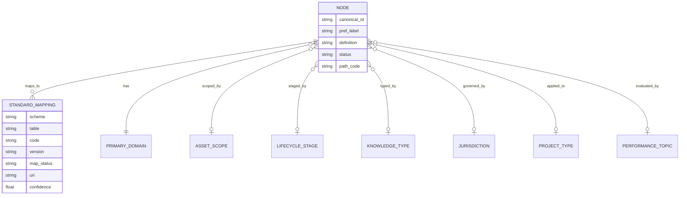
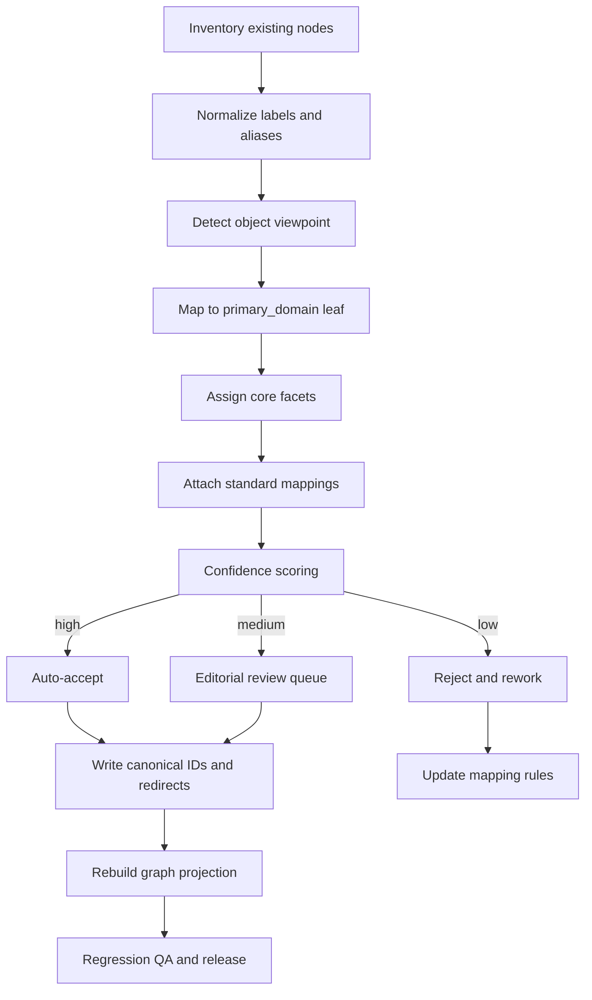

# Vitruvius governed taxonomy for the built environment

## Executive summary

Vitruvius should **not** use one giant mixed tree. It needs one **human-authored `primary_domain` backbone** for stable subject matter, plus a set of **separate governed vocabularies/facets** for lifecycle, spatial class, systems, work results, roles, materials, data types, project types, jurisdiction, and performance. That is the only structure that stays coherent at scale, and it matches how the major standards families actually divide the problem: ISO 12006 defines classification and dictionary frameworks, IFC defines exchange objects, bSDD defines dictionary publishing and property governance, OmniClass and Uniclass provide operational classifications, and ISO 19650 governs information management rather than subject taxonomy. citeturn17view4turn17view3turn21view0turn17view1turn17view5turn21view8

The correct design move is therefore: **author the L1 backbone yourselves**, freeze it, stop AI from inventing top-level categories, and force all ingestion to map into that backbone plus controlled facets. If a node can be both a discipline, a space, a work result, and a code subject at the same tree level, the information architecture is wrong. OmniClass, Uniclass, IFC, and bSDD should be treated as **crosswalk targets and semantic enrichers**, not as Vitruvius’s editorial source of truth. citeturn33view3turn35search0turn21view8turn17view0turn29view2

The recommended operating model is a **Level 1–4 canonical taxonomy** backed by immutable canonical IDs, versioned releases, steward ownership, controlled deprecation, and an AI policy in which models may **classify into the tree** but may never **change the tree** without human approval. That is also the safest way to support international scope while still mapping to regional standards such as IBC, NFPA, Eurocodes, ASCE, and national classification systems. citeturn17view0turn31view0turn22view4turn26view2turn27view0turn28view1

## Standards basis

At the standards layer, the relevant primaries are entity["organization","International Organization for Standardization","standards body"] for ISO 12006/19650/23386/23387/29481, entity["organization","buildingSMART International","openbim standards body"] for IFC and bSDD, entity["organization","National Institute of Building Sciences","us building standards body"] for NBIMS-US/OmniClass, entity["organization","Construction Specifications Institute","us specifications body"] for MasterFormat and OmniClass publication, entity["company","NBS","uk specification platform"] for Uniclass, entity["organization","International Code Council","model code body"] for the I-Codes/IBC, entity["organization","National Fire Protection Association","fire code body"] for NFPA codes, entity["organization","American Society of Civil Engineers","civil engineering society"] for civil and structural standards, and entity["organization","European Committee for Standardization","european standards body"] for Eurocodes and the wider European standards system. ISO 12006-2 explicitly says it is a **framework** for developing built-environment classification systems and not a complete operational classification; ISO 12006-3 extends that into a language-independent information model that can support ontologies, taxonomies, meronomies, lexicons, and thesauri; ISO 19650 covers information management across the asset lifecycle; IFC covers exchange objects for buildings and infrastructure; and bSDD provides a governed dictionary service for classes and properties. citeturn17view4turn17view3turn17view5turn21view0turn32search7turn17view1turn17view2

OmniClass remains important because it gives a multi-table built-environment classification suite in NBIMS-US, but the NBIMS-US reference set is still largely built from 2010–2013 table editions, several marked as pre-consensus approved drafts. Uniclass is operationally more current because it is updated quarterly and the live browse index now shows fifteen active tables, including Risk, Materials, and Properties and characteristics, even though parts of the NBS explanatory text still refer to twelve tables. That mismatch is a warning: external standards evolve on their own cadence, so Vitruvius must store **mapping version metadata** and never bake external table assumptions into canonical IDs. citeturn33view4turn33view3turn33view0turn35search0turn22view4

The practical consequence is simple. Vitruvius should use standards in four different ways: **framework** from ISO 12006 and ISO 19650, **exchange semantics** from IFC, **dictionary/property governance** from bSDD, and **classification crosswalks** from OmniClass, Uniclass, MasterFormat, and regulatory code families. It should not copy any one of those systems wholesale. citeturn17view4turn17view5turn21view0turn29view1turn33view3turn35search0

| Standard family | What it gives Vitruvius | What it does **not** give Vitruvius | Source basis |
|---|---|---|---|
| ISO 12006-2 | A framework for classification tables/views across the full lifecycle of buildings and civil works | A complete publish-ready taxonomy | citeturn17view4 |
| ISO 12006-3 | A common object-oriented framework for dictionaries, ontology/taxonomy/meronomy/thesaurus linkage, and API-oriented interconnection | Domain editorial decisions, leaf labels, or governance policy for your app | citeturn17view3 |
| ISO 19650 series | Information management, naming, status, revision, exchange, security, and H&S information processes | Subject taxonomy | citeturn17view5turn18search0turn18search1turn31view0 |
| IFC4x3 | Machine-readable object, system, actor, task, material, property, and classification semantics for buildings and infrastructure | A usable editorial IA for engineers and knowledge managers | citeturn21view0turn21view1turn21view2turn21view8 |
| bSDD | Dictionary publishing, class/property distribution, verification workflow, versioning, and API consumption | Your canonical editorial hierarchy | citeturn17view0turn17view1turn17view2turn29view2 |
| OmniClass | Multi-table classification across entities, spaces, elements, work results, products, phases, disciplines, roles, information, materials, properties | Global neutrality or current operational governance for every market | citeturn33view4turn33view3turn23view0 |
| Uniclass | A live, operational classification suite across lifecycle use cases, with API and mappings | A discipline table directly equivalent to `primary_domain` | citeturn35search0turn22view5 |
| MasterFormat | Work-result and specification packaging logic, including Division 00/01 and Divisions 02–49 practice | Enterprise subject taxonomy | citeturn30view0 |
| IBC, NFPA, Eurocodes, ASCE, CEN | Regulatory and technical rule families by topic and jurisdictional context | A universal knowledge graph backbone | citeturn26view2turn26view5turn27view0turn28view1 |

## Backbone and controlled hierarchies

The backbone should be **stable, human-authored, and intentionally shallow**. My recommendation is to stop the canonical tree at **Level 4**. Anything deeper should usually become one of three things instead: a standards mapping, a synonym/alias, or a local thesaurus term. That keeps the editorial model governable while still allowing very deep retrieval through external codes and graph relations. This is exactly the role split implied by ISO 12006-2, ISO 12006-3, IFC classification references, and bSDD dictionaries. citeturn17view4turn17view3turn21view8turn29view1

```mermaid
graph TD
    V[Vitruvius controlled vocabulary stack]
    V --> PD[primary_domain backbone]
    V --> AS[asset_scope tree]
    V --> LS[lifecycle_stage tree]
    V --> KT[knowledge_type tree]
    V --> PT[project_type tree]
    V --> PF[performance_topic tree]
    V --> SE[system_element class tree]
    V --> WR[work_result and process tree]
    V --> RC[role class tree]
    V --> MC[material class tree]
    V --> DT[data_type class tree]
    V --> RG[regulation and standards tree]

    PD --> ARC[Architecture and Interior Design]
    PD --> URB[Landscape Urbanism and Planning]
    PD --> CIV[Civil Site and Infrastructure]
    PD --> GEO[Geotechnical and Earth]
    PD --> STR[Structural and Seismic]
    PD --> MEP[Building Services Engineering]
    PD --> CON[Construction and Fabrication]
    PD --> OPS[Operations and Asset Management]
    PD --> REG[Codes Standards and Regulatory]
    PD --> PRA[Project Delivery and Practice]
    PD --> DIG[Digital Delivery BIM Data]
    PD --> PER[Performance Sustainability Resilience]
```



The Level 1 backbone should be:

Architecture and Interior Design; Landscape, Urbanism and Planning; Civil, Site and Infrastructure Engineering; Geotechnical and Earth Engineering; Structural and Seismic Engineering; Mechanical, Thermal and Process Engineering; Electrical, Lighting, ICT and Controls; Plumbing, Public Health and Fire Protection; Construction, Manufacturing and Field Execution; Operations, Maintenance and Asset Management; Codes, Standards and Regulatory Control; Project Delivery, Commercial and Professional Practice; Digital Delivery, BIM, Data and Computation; Performance, Sustainability and Resilience. That gives Vitruvius the human-authored “brain stem” the app currently lacks, while keeping spaces, lifecycle stages, materials, work results, and data types out of the same level as disciplines. citeturn17view4turn33view3turn35search0turn21view0

<details>
<summary>Suggested Level 1–4 primary_domain backbone</summary>

- **Architecture and Interior Design**
  - History and Theory
    - History of architecture
      - Ancient and classical
      - Medieval and vernacular
      - Early modern
      - Modern and contemporary
    - Theory and criticism
      - Design theory
      - Typology and morphology
      - Representation and semiotics
      - Phenomenology and experience
  - Programming and Spatial Design
    - Briefing and requirements
      - Functional requirements
      - Adjacency and flow
      - Area programming
    - Space planning
      - Occupancy planning
      - Universal design integration
      - Human factors
    - Architectural composition
      - Massing
      - Proportion
      - Circulation
  - Envelope and Detail Design
    - Wall systems
      - Curtain walls
      - Rainscreens
      - Masonry envelopes
    - Roof systems
      - Flat roofs
      - Sloped roofs
      - Waterproofing and drainage
    - Openings and shading
      - Windows
      - Doors
      - External shading devices
  - Interior Architecture
    - Interior construction
      - Partitions
      - Ceilings
      - Floor finishes
    - FF&E and equipment
      - Fixed furnishings
      - Loose furnishings
      - Appliances and specialty equipment
    - Signage and wayfinding
      - Identification signage
      - Directional systems
      - Accessibility signage

- **Landscape, Urbanism and Planning**
  - Landscape Architecture
    - Softscape
      - Planting design
      - Irrigation
      - Soil and growing media
    - Hardscape
      - Paving
      - Site furniture
      - Retaining and edging
  - Urban and Regional Planning
    - Land use and zoning
      - Use controls
      - Density and FAR
      - Setbacks and envelopes
    - Mobility and public realm
      - Streetscapes
      - Active transport
      - Civic space
  - Heritage and Place
    - Cultural landscapes
    - Conservation areas
    - Context and character analysis

- **Civil, Site and Infrastructure Engineering**
  - Surveying and Geomatics
    - Control and geodesy
    - Topographic survey
    - GIS and spatial data
  - Site Engineering
    - Grading and earthworks
    - Paving and external works
    - Utility corridors
  - Transportation
    - Roads and highways
      - Alignment
      - Pavements
      - Traffic control
    - Rail
      - Track
      - Stations
      - Signalling interfaces
    - Air and marine support works
      - Airfield landside
      - Port-side civil works
  - Water and Drainage
    - Stormwater
      - Collection
      - Storage and detention
      - Treatment and outfall
    - Sanitary and wastewater collection
      - Gravity networks
      - Pumping
      - Treatment interfaces

- **Geotechnical and Earth Engineering**
  - Investigation and Characterization
    - Boreholes and sampling
    - In situ testing
    - Laboratory testing
  - Foundations
    - Shallow foundations
    - Deep foundations
    - Ground improvement
  - Earth Retention and Slopes
    - Retaining walls
    - Excavation support
    - Slope stability
  - Geohazards
    - Settlement
    - Liquefaction
    - Landslide and erosion

- **Structural and Seismic Engineering**
  - Analysis and Loads
    - Structural modelling
    - Load paths
    - Serviceability and deflection
    - Robustness and disproportionate collapse
  - Material Systems
    - Concrete structures
    - Steel structures
    - Timber structures
    - Masonry structures
    - Aluminium and composites
  - Lateral and Hazard Design
    - Seismic design
    - Wind design
    - Flood and tsunami design
  - Assessment and Retrofit
    - Existing-structure assessment
    - Retrofit strategies
    - Forensic evaluation

- **Mechanical, Thermal and Process Engineering**
  - HVAC
    - Airside systems
      - Ventilation
      - Air distribution
      - Filtration
    - Hydronic systems
      - Chilled water
      - Heating water
      - Pumps and piping
  - Thermal Plant
    - Boilers and heating
    - Chillers and cooling
    - Heat recovery and thermal storage
  - Refrigeration and Special Process Cooling
    - Refrigeration systems
    - Cold rooms
    - Process cooling
  - Indoor Environmental Quality
    - Thermal comfort
    - Ventilation effectiveness
    - IAQ monitoring

- **Electrical, Lighting, ICT and Controls**
  - Power
    - Utility service and substations
    - MV and LV distribution
    - Emergency and standby power
  - Lighting
    - Daylight integration
    - Artificial lighting
    - Controls and dimming
  - ICT and Communications
    - Structured cabling
    - Wireless systems
    - AV and communications rooms
  - Automation and Security
    - BMS and BAS
    - Access control
    - CCTV and intrusion
    - Sensor networks

- **Plumbing, Public Health and Fire Protection**
  - Plumbing
    - Domestic water
    - Fixtures and appliances
    - Hot water generation and recirculation
  - Drainage and Waste
    - Sanitary drainage
    - Roof drainage
    - Wastewater pumping
  - Fire Protection
    - Suppression systems
    - Fire pumps and water storage
    - Detection and alarm
    - Smoke management interfaces
  - Special Gas Systems
    - Fuel gas
    - Medical gas
    - Laboratory distributions

- **Construction, Manufacturing and Field Execution**
  - Planning and Logistics
    - Sequencing and phasing
    - Site logistics
    - Temporary works interfaces
  - Execution and Quality
    - QA/QC and inspection
    - Testing and commissioning preparation
    - NCRs and corrective action
  - Safety and Risk
    - Site safety
    - Worker protection
    - Permit-to-work
  - Industrialized Construction
    - Prefabrication
    - Modular construction
    - DfMA

- **Operations, Maintenance and Asset Management**
  - Facility Operations
    - Work orders
    - Service delivery
    - Space and occupancy management
  - Maintenance and Renewal
    - Preventive maintenance
    - Condition-based maintenance
    - Renewal and replacement
  - Asset Information
    - Asset register
    - Handover information
    - Document and record control
  - Reuse and End of Life
    - Retrofit
    - Adaptive reuse
    - Decommissioning and demolition

- **Codes, Standards and Regulatory Control**
  - Codes and Ordinances
    - Building codes
    - Fire and life safety codes
    - Accessibility codes
    - Planning and zoning controls
  - Technical Standards
    - Structural standards
    - Product and performance standards
    - Information management standards
  - Permits and Approvals
    - Development approvals
    - Building permits
    - Occupancy and completion approvals
  - Compliance and Enforcement
    - Inspections
    - Variances
    - Compliance evidence and audit trails

- **Project Delivery, Commercial and Professional Practice**
  - Delivery and Procurement
    - Design-bid-build
    - Design-build
    - CM at risk / EPC / PPP
  - Commercial Management
    - Cost planning and estimating
    - Procurement packaging
    - Contract administration
  - Professional Practice
    - Governance
    - Ethics and liability
    - QA systems
  - Stakeholders and Roles
    - Client and owner roles
    - Design consultants
    - Contractors and suppliers
    - Authorities and independent reviewers

- **Digital Delivery, BIM, Data and Computation**
  - BIM and Coordination
    - Authoring
    - Coordination
    - Clash and issue management
  - OpenBIM and Interoperability
    - IFC
    - bSDD
    - BCF / IDS / linked document delivery
  - Data Engineering
    - Knowledge graphs
    - Taxonomies and dictionaries
    - Metadata pipelines
  - Computation and Automation
    - Computational design
    - Scripting and automation
    - AI-assisted classification and QA

- **Performance, Sustainability and Resilience**
  - Energy and Carbon
    - Operational energy
    - Embodied carbon
    - LCA and whole-life carbon
  - Human Performance
    - Acoustics
    - Daylight
    - Thermal comfort
    - Indoor environmental quality
  - Water and Ecology
    - Water efficiency
    - Stormwater quality
    - Site ecology
  - Risk and Resilience
    - Hazard assessment
    - Continuity and recovery
    - Climate adaptation
    - Security and hardening

</details>

<details>
<summary>Supporting controlled hierarchies that should be governed separately from primary_domain</summary>

- **Lifecycle stage**
  - Strategy
    - Need identification
    - Feasibility
    - Business case
  - Brief
    - Employer information requirements
    - Functional brief
    - Project definition
  - Design
    - Concept design
    - Schematic / developed design
    - Coordinated design
    - Technical design
  - Delivery
    - Procurement
    - Fabrication
    - Construction
    - Testing and commissioning
  - Operations
    - Occupancy and operation
    - Maintenance and inspection
    - Refurbishment and retrofit
    - End of life and deconstruction

- **Asset and spatial classes**
  - Region
    - Territory
    - Network
    - Corridor
  - Site
    - Parcel
    - Campus
    - Plot and easement
  - Facility
    - Building
    - Bridge
    - Road
    - Railway
    - Marine facility
    - Utility facility
  - Facility part
    - Wing / block
    - Storey / level
    - Zone
  - Space and location
    - Room
    - Circulation space
    - Shaft / void
    - External area
  - Physical realization
    - System
    - Element
    - Product
    - Material

- **System and element classes**
  - Substructure
    - Foundations
    - Earth retention
    - Underground enclosure
  - Superstructure
    - Frames
    - Floors
    - Roof structures
  - Envelope
    - External walls
    - Curtain walls
    - Roof coverings
    - Openings
  - Interiors
    - Partitions
    - Finishes
    - Ceilings
    - Joinery
  - Building services systems
    - HVAC
    - Electrical power
    - Lighting
    - ICT
    - Plumbing
    - Fire protection
    - Controls and automation
  - Site and infrastructure systems
    - Pavements
    - Drainage
    - Utilities
    - Traffic systems

- **Work results and process classes**
  - Procurement and contracting requirements
  - General requirements
  - Existing conditions and enabling works
  - Concrete / masonry / metals / wood / thermal-moisture protection
  - Openings / finishes / specialties / equipment / furnishings
  - Conveying / fire suppression / plumbing / HVAC / electrical / communications
  - External works / utilities / transport systems
  - Construction activities
    - Survey
    - Excavation
    - Placement and installation
    - Testing
    - Commissioning
    - Handover

- **Role classes**
  - Client and owner
  - Authority having jurisdiction
  - Architect and lead designer
  - Specialist engineer
  - Quantity surveyor / cost manager
  - Contractor / construction manager
  - Subcontractor / fabricator / supplier
  - Facility manager / operator
  - Reviewer / certifier / inspector

- **Material classes**
  - Inorganic materials
    - Concrete
    - Masonry
    - Glass
    - Metals
  - Organic materials
    - Timber
    - Plastics
    - Bituminous products
  - Composite and engineered materials
    - FRP
    - CLT / glulam
    - Composite panels
  - Materials by form
    - Sheet
    - Board
    - Profile
    - Membrane
    - Coating
    - Loose fill

- **Regulation and standards classes**
  - Model codes
    - Building
    - Fire and life safety
    - Accessibility
    - Existing buildings
  - Technical design standards
    - Structural loads and resistance
    - Product and test standards
    - Energy and environmental standards
  - Information standards
    - BIM information management
    - Data dictionaries
    - Exchange and linked documents

- **Project type classes**
  - Buildings
    - Residential
    - Commercial
    - Institutional
    - Industrial
    - Mixed-use
  - Interiors
    - Workplace
    - Hospitality
    - Healthcare interiors
  - Infrastructure
    - Bridge
    - Road
    - Rail
    - Airport
    - Port and marine
    - Water and wastewater
    - Energy and utilities
  - Urban and landscape
    - Public realm
    - Campus
    - Park
    - District planning

- **Data type classes**
  - Narrative information
    - Policy
    - Requirement
    - Guidance
    - Procedure
  - Structured information
    - Classification
    - Property set
    - Data template
    - Dataset
  - Model information
    - BIM model
    - Analysis model
    - GIS model
    - Coordination model
  - Project information containers
    - Drawing
    - Specification
    - Schedule
    - Calculation
    - Submittal
    - Record document

</details>

## Facet model

The facet layer should be deliberately narrow. The core facets you specified are correct, and they should be mandatory metadata on almost every node. Everything else should either be contained in the auxiliary controlled vocabularies above or exposed as graph relationships rather than as free text. This mirrors the distinction across ISO 12006, ISO 19650, IFC classification references, and bSDD dictionary structures. citeturn17view4turn17view5turn21view8turn29view1



| Facet | Cardinality | Definition | Controlled use |
|---|---:|---|---|
| `primary_domain` | exactly 1 | Canonical human-authored subject home of the node | Must resolve to a Level 4 leaf under the primary backbone |
| `asset_scope` | 1..n | Where the knowledge applies in the asset/spatial hierarchy | Region, site, facility, facility part, storey, space, system, element, product, material |
| `lifecycle_stage` | 1..n | When the knowledge is primarily relevant | Strategy through deconstruction |
| `knowledge_type` | exactly 1 | What kind of knowledge object it is | Concept, rule, standard, procedure, calculation, detail, spec section, model, dataset, case study |
| `jurisdiction` | 0..n | Legal or normative applicability | `INTL`, regional, national, subnational, or project-specific |
| `standard_mapping[]` | 0..n | External mappings to published schemes | Store scheme, table, code, version, URI, map status, confidence |
| `project_type` | 0..n | Project context where the node is used | Building, interiors, bridge, road, rail, utility, district, etc. |
| `performance_topic` | 0..n | What outcome the node affects | Safety, fire, accessibility, energy, carbon, water, acoustics, comfort, resilience, security |

The facet definitions should be stored as code-controlled vocabularies, not ad hoc tags. `standard_mapping[]` should be typed, not a string list. A good minimum object is: `{scheme, table, code, title, version, uri, map_status, confidence, authority}`. `map_status` should be one of `exact`, `broader`, `narrower`, `related`, or `candidate`. That gives Vitruvius enough precision to preserve ambiguity honestly instead of pretending every mapping is exact. IFC explicitly allows classification references to formally published or locally defined systems, which is exactly why this array must support many-to-many mappings. citeturn21view8turn29view1

## Crosswalks and mappings

The most important implementation decision is this: **crosswalk by object class, not by discipline label**. “Architecture” does not map cleanly to one OmniClass table, one Uniclass table, or one IFC entity family. The right mapping depends on whether the node is about a facility type, a space, an element, a system, a product, a material, a role, a lifecycle stage, or a document. Vitruvius therefore needs its own editorial `primary_domain`, then standards mappings chosen by node type. citeturn33view3turn35search0turn21view8

| Vitruvius class intention | Primary crosswalk target | Secondary crosswalk target | IFC or bSDD anchor | Implementation note | Basis |
|---|---|---|---|---|---|
| Facility / asset type | OmniClass Table 11 or 12 | Uniclass `Co` / `En` | IFC `IfcFacility`, `IfcBuilding`, `IfcBridge`, `IfcRoad`, `IfcRailway`, `IfcMarineFacility` | Use for asset classes and facility typologies | citeturn33view4turn33view3turn22view0turn21view3 |
| Space / location | OmniClass Table 13 | Uniclass `SL` | IFC `IfcSpace`, `IfcSpatialStructureElement`, `IfcSpatialZone` | Use for spatial knowledge and room/location rules | citeturn33view4turn22view0turn21view3 |
| Element / function | OmniClass Table 21 | Uniclass `EF` | IFC `IfcElement`, `IfcBuiltElement`, `IfcDistributionElement` | Use for functional systems and element classes | citeturn23view2turn33view3turn22view0turn21view4 |
| Work result / specification package | OmniClass Table 22 | CSI MasterFormat and, where useful, Uniclass `Ss` | IFC `IfcTask` for process linkage, not for section taxonomy | Best for specification sections, packages, and installation work | citeturn33view3turn30view0turn21view5 |
| Product class | OmniClass Table 23 | Uniclass `Pr` | IFC type entities and bSDD class/property links | Best for manufacturer and type-level objects | citeturn33view2turn35search0turn17view2 |
| Lifecycle stage | OmniClass Table 31 | ISO 19650 process parts and Uniclass `PM` / `FI` | IFC `IfcTask` and schedules | Do not confuse lifecycle stage with subject domain | citeturn33view0turn17view5turn22view0turn21view5 |
| Discipline | OmniClass Table 33 | No direct Uniclass equivalent | IFC actor-role combinations only indirectly | Keep as Vitruvius editorial backbone, not an imported code list | citeturn23view1turn22view5turn21view6 |
| Role / participant | OmniClass Table 34 | Uniclass `Ro` | IFC `IfcActor` | Use for stakeholder and responsibility modeling | citeturn23view4turn35search0turn21view6 |
| Information / document | OmniClass Table 36 | Uniclass `FI` | IFC `IfcDocumentInformation`, `IfcClassification` | Use for document, dataset, model, and record types | citeturn33view1turn35search4turn16search0turn21view8 |
| Material / property | OmniClass Table 41 / 49 | Uniclass `Ma` / `PC` | IFC `IfcMaterial`, `IfcPropertySet` | Use for material semantics and technical attributes | citeturn23view5turn23view6turn35search1turn35search2turn15search3turn21view7 |

A few exact crosswalk examples are already exposed by NBS on live Uniclass product pages. `Pr_30_59_98_96 Wood window units` maps to IFC `IfcWindowType.WINDOW`; `Pr_20_93_85_14 Concrete solid wall and composite wall units` maps to IFC `IfcWallType.SOLID`; and `Pr_65_52_34_66 Pressure gauges` maps to IFC `IfcFlowInstrumentType.PRESSUREGAUGE`. These are the kinds of mappings Vitruvius should store in `standard_mapping[]`, with table and version metadata attached. citeturn14search5turn14search3turn14search7

For regulations and standards, the crosswalk is by **topic and jurisdiction**, not by static leaf code. IBC organizes occupancy, special uses, egress, accessibility, structural design, electrical, mechanical, plumbing, and conveying systems as separate topic chapters; NFPA maintains a large codes-and-standards family for fire and life safety; ASCE standards are grouped across structural, water, construction, transportation, environmental, materials, disasters, and pipelines; and the Eurocodes family consists of ten European structural standards EN 1990–1999, used with related material, product, execution, and test standards in the CEN system. Vitruvius should therefore maintain a `regulation_class` tree and attach jurisdiction-specific mappings instead of forcing those topics into the discipline tree. citeturn34view0turn34view2turn34view3turn34view4turn34view5turn34view6turn34view7turn26view5turn28view1turn27view0turn27view3turn27view5

| Topic area | Recommended authority families to map | Why |
|---|---|---|
| Building and occupancy regulation | IBC and related I-Codes | Building law is topic-structured around occupancy, egress, accessibility, systems, and structural design | 
| Fire and life safety | NFPA 101, NFPA 13/70/72/5000, IFC, IBC fire chapters | Fire topics cut across architecture, MEP, operations, and emergency systems |
| Accessibility | IBC Chapter 11 plus ICC A117.1 and local accessibility law | Accessibility is a cross-cutting performance and compliance topic |
| Structural design | ASCE 7/24/41, Eurocodes EN 1990–1999, IBC structural chapters | Loads, flood, retrofit, and regional structural design criteria belong in a regulated standards layer |
| Digital information management | ISO 19650, ISO 23386, ISO 23387, ISO 29481, IFC4x3, bSDD, CEN/TC 442 | These define process, dictionary, template, and exchange semantics rather than domain labels |
| European product and execution standards | CEN TCs, especially TC 250, 350, 371, 442 and relevant product committees | Needed for European project delivery, sustainability, BIM, and product compliance |

The table above is a policy recommendation grounded in the published structure of those standards families. citeturn26view2turn26view5turn28view2turn27view0turn27view5turn20view0turn20view1turn20view2turn32search7

## Governance model

The canonical rule is: **freeze the structure, version the content, and separate canonical identity from external mappings**. A standards-derived code is not a safe primary key because standards change on their own release cycle, and different schemes classify the same thing from different viewpoints. The canonical ID must therefore be **opaque and immutable**, while the human-readable path code remains helpful but replaceable. That is consistent with ISO 19650 naming logic, IFC’s use of globally unique identification in the core model, and bSDD’s use of immutable activated content and versioned dictionary codes. citeturn31view0turn21view2turn29view1turn29view2

A practical scheme is:

| Field | Recommendation | Rationale |
|---|---|---|
| `canonical_id` | `VTN-<kind>-<7 digits>` e.g. `VTN-DOM-000184` | Opaque, immutable, never reused |
| `path_code` | `dom.arc.env.wall.curtain` | Human-readable path, allowed to change with redirects |
| `uri` | `vitruvius://class/VTN-DOM-000184` | Canonical internal reference |
| `status` | `proposed`, `active`, `deprecated`, `merged`, `superseded` | Supports non-destructive lifecycle |
| `release_version` | semantic versioning for taxonomy releases | bSDD explicitly recommends semantic versioning for dictionary versions |
| `authority` | steward group or editor | Clear ownership and approval trail |
| `standard_mapping[]` | per-scheme, per-version object | Preserves exact/broader/narrower/related ambiguity honestly |

Change control should be lightweight but formal. Every new canonical node should require: a preferred label, definition, parent, steward, at least one usage example, and at least one external mapping or an explicit note that no usable mapping exists. Deletions should be forbidden; use deprecation with redirect or merge instead. Activated content should be treated as immutable in the same spirit as bSDD’s active dictionary versions. citeturn29view2turn17view0

The AI policy should be explicit and strict. AI may propose `primary_domain`, facets, synonyms, and candidate standards mappings with confidence scores; it may not create new Level 1–2 nodes, mutate canonical IDs, or silently fork external standards. Low-confidence matches should route to review, and any rulebook or standards citation extracted by AI should preserve the authority, edition, and jurisdiction. This is the only policy that scales without corrupting the tree. It is also aligned with bSDD’s verification model and with the NBS license guidance that users should not adapt Uniclass by creating their own codes. citeturn17view0turn22view4turn29view2

A useful operational threshold is: auto-accept at ≥0.92 confidence when there is one clear leaf and one clear standards family; queue for review at 0.75–0.91; reject below 0.75. The review queue should also be forced when the candidate mapping would cross more than one object viewpoint, such as a node that appears to be both a work result and a system, or both a regulation and a design concept. That threshold model is an implementation recommendation, but it directly follows from the multi-view nature of ISO 12006, IFC, and the classification families above. citeturn17view4turn21view8turn33view3turn35search0

## Implementation and migration

Use **folders for editorial governance** and a **graph for runtime intelligence**. The taxonomy itself should live in a version-controlled repository as YAML or JSON under semantic release tags, because a taxonomy is editorial content and needs review, diffing, and rollback. The application runtime should consume that repository into a graph or document index so one node can have one canonical home but many relationships, mappings, aliases, and contextual edges. ISO 12006-3, IFC, and bSDD all assume machine-interpretable schemas and dictionary services; that makes “YAML as source, graph as projection” the cleanest architecture. citeturn17view3turn21view0turn29view1

| Layer | Best use | Do this |
|---|---|---|
| Git folder repo | Canonical taxonomy source of truth | Store L1–4 trees, definitions, steward ownership, release tags |
| Build pipeline | Validation and compilation | Validate schema, uniqueness, parentage, redirects, mapping object format |
| Graph store | Runtime retrieval and traversal | Store `BELONGS_TO`, `RELATED_TO`, `MAPS_TO_STANDARD`, `APPLIES_TO_STAGE`, `APPLIES_TO_SCOPE` |
| Search index | Fast retrieval and auto-classification | Index labels, aliases, definitions, examples, mapped codes, jurisdictions |
| Raw-source layers | Ingestion staging only | Never let raw folders define ontology |

For the current Vitruvius stack, keep the **raw-source → conversion → canonical-knowledge → derived-content → manifests** separation, but move the taxonomy out of those ingestion folders and into its own governed vocabulary package. Raw and derived nodes should point to canonical taxonomy IDs; they should not define taxonomy structure themselves.

A minimal node schema should look like this:

```json
{
  "canonical_id": "VTN-DOM-000184",
  "path_code": "dom.elec.ctrl.bms",
  "pref_label": "BMS and BAS",
  "definition": "Digital control, monitoring, automation, and supervisory functions for building systems.",
  "status": "active",
  "primary_domain": "VT.DOM.ELEC",
  "lineage": [
    "VT.DOM.ELEC",
    "VT.DOM.ELEC.CTRL",
    "VT.DOM.ELEC.CTRL.BMS"
  ],
  "facets": {
    "asset_scope": ["VT.FAC.ASSET.SYSTEM"],
    "lifecycle_stage": [
      "VT.FAC.LIFE.TECHNICAL_DESIGN",
      "VT.FAC.LIFE.CONSTRUCTION",
      "VT.FAC.LIFE.OPERATIONS"
    ],
    "knowledge_type": "VT.FAC.KNOW.CONCEPT",
    "jurisdiction": ["INTL"],
    "project_type": ["VT.FAC.PROJ.BUILDING"],
    "performance_topic": [
      "VT.FAC.PERF.ENERGY",
      "VT.FAC.PERF.SECURITY"
    ]
  },
  "standard_mapping": [
    {
      "scheme": "IFC",
      "table": null,
      "code": null,
      "title": "IfcDistributionControlElement family",
      "version": "IFC4x3",
      "map_status": "broader",
      "uri": null,
      "confidence": 0.86,
      "authority": "vitruvius-editorial"
    }
  ],
  "aliases": ["Building management system", "Building automation system"],
  "steward": "digital-delivery-working-group",
  "release_version": "1.0.0"
}
```

That schema is a Vitruvius recommendation, grounded in IFC classification, bSDD dictionary metadata, and ISO 19650 information control patterns. citeturn21view8turn29view1turn31view0

A compact YAML and CSV export pattern should look like this:

```yaml
- canonical_id: VTN-DOM-000071
  path_code: dom.civ.water.storm
  pref_label: Stormwater
  parent_id: VTN-DOM-000068
  primary_domain: VT.DOM.CIV
  status: active
  facets:
    asset_scope: [VT.FAC.ASSET.SITE, VT.FAC.ASSET.SYSTEM]
    lifecycle_stage: [VT.FAC.LIFE.TECHNICAL_DESIGN, VT.FAC.LIFE.CONSTRUCTION]
    knowledge_type: VT.FAC.KNOW.CONCEPT
    jurisdiction: [INTL]
  standard_mapping:
    - scheme: OmniClass
      table: "32"
      code: null
      version: "NBIMS-US V3"
      map_status: related
```

```csv
canonical_id,path_code,pref_label,parent_id,primary_domain,status,asset_scope,lifecycle_stage,knowledge_type,jurisdiction
VTN-DOM-000071,dom.civ.water.storm,Stormwater,VTN-DOM-000068,VT.DOM.CIV,active,"SITE|SYSTEM","TECHNICAL_DESIGN|CONSTRUCTION",CONCEPT,INTL
VTN-DOM-000184,dom.elec.ctrl.bms,BMS and BAS,VTN-DOM-000176,VT.DOM.ELEC,active,SYSTEM,"TECHNICAL_DESIGN|OPERATIONS",CONCEPT,INTL
```

The migration should be staged, automated, and reviewable:



The migration plan should be executed in six passes. First, inventory all existing node labels, folders, and current parents. Second, classify each node by **viewpoint**: discipline, space, system, work result, role, regulation, material, process, or data type. Third, assign exactly one `primary_domain` leaf and the required facets. Fourth, attach standards mappings with map status and version. Fifth, queue ambiguous records for review. Sixth, write permanent redirects from legacy node IDs to new canonical IDs, then rebuild the graph and regression-test search and traversal. That is the fastest safe path from today’s mixed hierarchy to a governed taxonomy. The current raw-source and conversion layers remain useful, but only as ingestion stages, not as ontology. 

Downloadable sample machine-readable exports:

- [YAML sample with 84 nodes](sandbox:/mnt/data/vitruvius_taxonomy_sample_84_nodes.yaml)
- [JSON sample with 84 nodes](sandbox:/mnt/data/vitruvius_taxonomy_sample_84_nodes.json)

These sample files are intentionally small enough to test ingestion, validation, and UI rendering before you author the full production tree.