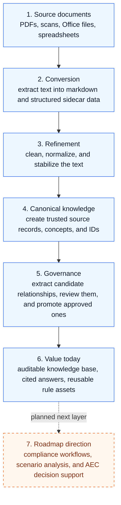

# Vitruvius

```
 ██╗   ██╗██╗████████╗██████╗ ██╗   ██╗██╗   ██╗██╗██╗   ██╗███████╗
 ██║   ██║██║╚══██╔══╝██╔══██╗██║   ██║██║   ██║██║██║   ██║██╔════╝
 ██║   ██║██║   ██║   ██████╔╝██║   ██║██║   ██║██║██║   ██║███████╗
 ╚██╗ ██╔╝██║   ██║   ██╔══██╗██║   ██║╚██╗ ██╔╝██║██║   ██║╚════██║
  ╚████╔╝ ██║   ██║   ██║  ██║╚██████╔╝ ╚████╔╝ ██║╚██████╔╝███████║
   ╚═══╝  ╚═╝   ╚═╝   ╚═╝  ╚═╝ ╚═════╝   ╚═══╝  ╚═╝ ╚═════╝ ╚══════╝

   ─────────────────────────────────────────────────────────────────
     An auditable document-to-knowledge engine for technical rule systems.
         Building toward compliance-grade reasoning and AEC decision support.
                    Firmitas · Utilitas · Venustas
   ─────────────────────────────────────────────────────────────────
```

**Vitruvius is, today, an auditable document-to-knowledge pipeline for complex
technical and regulatory corpora** — with the built environment as its primary
target domain in this repository. It ingests messy source material, converts it
into machine-readable text, refines and canonicalizes that text into structured
knowledge, and builds governed relationships, graph artifacts, and traceable
query surfaces on top of it.

**Vitruvius is also building toward a Multi-Objective Constraint Solver for the
built environment** — a headless, deterministic engine for Architecture,
Engineering, and Construction that treats physics, building code, and cost as
first-class inputs and treats geometry as a *derivative* that falls out when
all constraints are satisfied. That AEC reasoning layer is the strategic
direction, not the cleanest description of what the repository delivers today.

It is not a 3D modeler. It is not a general knowledge graph that incidentally
handles buildings. It is designed around a single guiding principle:

> **The Physics are Universal, but the Parameters are Local.**
>
> Gravity, fluid dynamics, electrical resistance, and spatial collision behave
> identically in Manila, Singapore, and New York. A 2.0 m setback carves the
> same mathematical voxel regardless of what language the law is written in.
> Only the numerical parameters of the law — the actual 2.0 m, the actual
> fire-rated wall thickness, the actual minimum ceiling clearance — vary by
> jurisdiction. This separation is the core enabler of international
> scalability without engine bloat.

A second principle runs alongside the first:

> **The computer is blind to human concepts. It only knows lines, points,
> bounds, and graphs.**
>
> A plumbing pipe is a line segment with a 0.05 m clearance radius. A
> subdivision road is a line segment with a 5.0 m clearance radius. The Rust
> kernel does not know the difference. The same `aabb_intersects` math routes
> a fire sprinkler through a ceiling plenum and a highway through topography.
> This is **true fractal scale agnosticism** — the same data structures and
> algorithms operate at every scale without scale-specific code.

Vitruvius is built as a **Compound AI System** rather than a monolithic LLM.
Responsibilities are strictly separated across five layers, each structurally
incapable of the failure modes of the others:

```
 ┌──────────────────────────────────────────────────────────────────┐
 │                       Natural Language                           │
 │                   (English questions in / out)                   │
 └──────────────────────────────┬───────────────────────────────────┘
                                ▼
 ┌──────────────────────────────────────────────────────────────────┐
 │   LLM  ─  "Mouth and Ears"            Ollama / gemma4:e4b         │
 │   English → tool-call JSON → English. Never computes.             │
 └──────────────────────────────┬───────────────────────────────────┘
                                ▼
 ┌──────────────────────────────────────────────────────────────────┐
 │   Python  ─  "Logic"                  pipeline_cli + orchestration │
 │   Routes requests, compiles ASTs, dispatches to kernels.          │
 └───┬──────────────────┬──────────────────┬──────────────────┬─────┘
     ▼                  ▼                  ▼                  ▼
 ┌────────┐    ┌────────────────┐   ┌────────────────┐   ┌──────────┐
 │RocksDB │    │  Rust (Kernels)│   │   Z3 SMT       │   │ Datalog  │
 │        │    │                │   │                │   │  (_rs)   │
 │ Rules  │    │  ECS + BVH +   │   │  Adjudicator   │   │          │
 │        │    │  A* + parry3d  │   │                │   │ <logic>  │
 │versioned│   │  voxel CSG +   │   │  inequality    │   │ fact set │
 │ legal  │    │  FEA + fluid   │   │  compiler      │   │ verified │
 │ ASTs   │    │  + Wasm target │   │  sat / unsat   │   │          │
 └────────┘    └────────────────┘   └────────────────┘   └──────────┘
```

- **RocksDB holds the Rules** — versioned legal ASTs, jurisdictional parameters, pricing data.
- **Python holds the Logic** — orchestration, Z3 compilation, tool-call dispatch.
- **Rust holds the Physics** — compiled deterministic kernels for collision, pathfinding, FEA, fluid dynamics, voxel CSG. Evolving toward an Entity-Component-System (bevy_ecs) data-oriented design — see [The Next Phase](#the-next-phase--aec-constraint-solver).
- **Z3 is the Adjudicator** — formal verification of whether a proposed configuration satisfies all active constraints.
- **The LLM is the Mouth and Ears** — structured tool calls only, never raw mathematical answers.

This defense-in-depth structure is what makes Vitruvius **mathematically incapable
of lying about physics or law**: the LLM cannot hallucinate a clearance because
it is never permitted to compute one, and the Rust kernel cannot bend a rule
because rules are not in Rust — they arrive compiled from RocksDB via Python.

> **Reference corpus.** This repository's active development corpus is
> **PD 1096 — The National Building Code of the Philippines and its IRR**,
> with RA 9514 (Fire Code), NSCP (Structural Code), PEC (Electrical Code),
> BP 344 (Accessibility), BP 220/PD 957 (Subdivision & socialized housing),
> and PD 1067 (Water Code) as adjacent rule packages. PD 1096 is the
> benchmark the tests, audits, and decision-log numbers are measured
> against. Additional jurisdictions plug in through the rule-package system
> (see [Adapting Vitruvius to a new jurisdiction](#adapting-vitruvius-to-a-new-jurisdiction)).

Vitruvius enforces a hard boundary between raw text, candidate signals, and
canonical truth — and treats every transformation as auditable. The pipeline
is **deterministic-first**: AI is the exception, not the rule. On the PD 1096
reference corpus, a full end-to-end run touches the local LLM (Ollama /
`gemma4:e4b`) roughly **4 times** — vs. ~25 in the pre-deterministic-filter
era.

> **Looking for the deep docs?** The knowledge base lives in
> [`.ai/`](./.ai/). Start with
> [`.ai/01_roadmap/master-roadmap.md`](./.ai/01_roadmap/master-roadmap.md)
> for the authoritative phase contract, and
> [`.ai/13_research/AEC-ECS-SC_RESEARCH.md`](./.ai/13_research/AEC-ECS-SC_RESEARCH.md)
> for the consolidated research document that defines the next phase. This
> README is the tourist map; `.ai/` is the terrain.

---

## Vitruvius: Compound AI System Definition

Vitruvius operates as a **Compound AI System**. It abandons the
monolithic LLM approach — where a single model is trusted to read,
reason, and calculate — in favor of a multi-component engine. The
generative AI is **subordinated to deterministic mathematical and
logical constraints**: it is a modular piece within a larger,
verifiable pipeline, never the final authority on a compliance
decision.

### 1. The Semantic Extractor (Generative Component)

- **Engine:** Local LLM via Ollama, default `gemma4:e4b`.
- **Function:** Natural language understanding and unstructured-input
  parsing. Translates messy domain-specific input (scanned ordinances,
  clinical guidelines, engineering specs, code-of-practice PDFs, exam
  syllabi, etc.) into formal intermediate representations — JSON
  verdicts for the Tier-1/Tier-2 review layer, or `<logic>` Datalog
  fact sets when the Sprint Z `z_neuro_symbolic` flag is on.
- **Constraint:** Subordinated to deterministic verifiers. Every LLM
  verdict is cross-checked by:
  - the **pre-review filter** (`pre_review_filter.py`, 8 deterministic
    rules) — typically auto-accepts or auto-rejects ~78% of PD 1096
    candidates before the LLM sees them;
  - the **17-rule Phase 7 promotion validator**
    (`promotion_validator.py`) — rejects records that violate the
    closed predicate vocabulary, schema, audit integrity, or
    compatibility pairs regardless of what the LLM said;
  - optionally the **Sprint Z Rust Datalog evaluator**
    (`datalog_rs/` crate, `z_neuro_symbolic` flag) — rejects the
    LLM's verdict when the `<logic>` block fails to parse or fails to
    derive the conclusion from the facts.

### 2. The Mathematical Verifier (Deterministic Component)

- **Engine:** Z3 Theorem Prover + Rust/Wasm spatial kernels.
- **Function:** Geometric and logical verification of parametric
  constraints.
- **Components:**
  - **Z3 inequality compiler**
    (`scripts/vitruvius/geometric/inequality_compiler.py`) — compiles
    extracted parametric rules into a Z3 incremental solver and
    returns a `ComplianceVerdict` with the specific violating
    parameters.
  - **Z3 spatial constraint solver**
    (`scripts/vitruvius/spatial/constraint_solver.py`, Sprint H
    Stream L.5) — evaluates parametric spatial constraints against
    observed values.
  - **Rust Datalog evaluator**
    (`scripts/vitruvius/datalog_rs/`) — a pyo3 crate with a
    hand-rolled Datalog engine (shipped in Sprint Z S1.2 after
    `crepe` proved too fragile) that verifies the `<logic>` fact
    sets emitted by the LLM.
  - **Wasm spatial kernels**
    (`scripts/vitruvius/engine_rs/` workspace, compiled to
    `wasm32-unknown-unknown`, loaded via `wasmtime` in
    `compound/wasm_kernel.py`) — run geometric primitives
    (`aabb_intersects`) in a hermetic Wasm sandbox, suitable for
    constrained environments.
- **Constraint:** When the verifier returns `unsat`, the LLM's
  assumption is rejected. The `check_compliance` function in
  `inequality_compiler.py` collects every violating parameter, and
  the Datalog bridge in the ontology prompt directive rejects the
  verdict when the `<logic>` block cannot derive its stated
  conclusion. Both paths are live behind feature flags today.
- **Geometry representation:** 3D polyhedral meshes via `trimesh`
  + `manifold3d` (not strict CAD B-Rep — shipped in Sprint GEOM
  Stream GEOM.3). The mesh level-of-detail is sufficient for
  architectural envelope checks under PD 1096 and adapts cleanly to
  any other envelope-style compliance problem (minimum-room,
  circulation-clearance, ventilation shaft, etc.). Non-geometric
  professional domains bypass the geometric verifier entirely —
  the Z3 inequality compiler and the Datalog evaluator are
  sufficient on their own.

### 3. The Immutable Vault (Topological Component)

- **Engine:** RocksDB (via the `rocksdict 0.3.29` binding) +
  event-sourced graph + differential dataflow.
- **Function:** Maintains the persistent, uncorrupted state of the
  active professional corpus (statutes, codes, clinical guidelines,
  engineering standards, or whatever `001_Raw-Source-Layer/`
  contains) and its historical precedents. For this repository that
  corpus is PD 1096 + its IRR.
- **Components:**
  - **RocksDB-backed event store**
    (`scripts/vitruvius/graph/rocksdb_event_store.py`) — append-only
    log with primary (`event:{event_id}`) + secondary time-index
    (`ts:{timestamp}:{event_id}`) key layout. O(1) count via a
    reserved `meta:event_count` key. Flag
    `hp_rocksdb_event_store` defaults true as of AD-029.
  - **RocksDB-backed verdict cache**
    (`scripts/vitruvius/review/rocksdb_stateful_registry.py`) —
    keyed on `(source_hash, relationship_hash, model_version)` for
    Phase 6A Resume gap closure. Flag `hp_rocksdb_verdict_cache`
    defaults true as of AD-029.
  - **Differential dataflow**
    (`scripts/vitruvius/compound/differential_propagator.py` +
    `dependency_tracker.py`, Sprint Z Stream S3) — `propagate(deltas)`
    walks the `DependencyTracker` once per `Delta` batch, so
    downstream invalidation runs in **O(Δ)** in the size of the
    changed set, not in the total graph size. Amendments to PD 1096
    no longer require a full re-inference pass.
- **Constraint:** The vault's state is updated exclusively via the
  append-only event log; generative LLM inference is never invoked
  during graph mutation. Migration from the older SQLite backends
  is supported by `ple-kv-migrate --store {event,registry}`
  (idempotent, dry-run capable).

### 4. The Orchestrator (Control Component)

- **Engine:** Python control plane in `scripts/pipeline_cli.py` +
  `scripts/vitruvius/`.
- **Function:** Routes data streams between the Generative,
  Deterministic, and Topological components. Every stage is a
  re-runnable `run_*` handler with lazy imports (AD-015) so the CLI
  stays usable in minimal environments.
- **Constraint:** Enforces ingestion-layer invariants before state
  can transition between layers:
  - **Merkle directory hash** (`scripts/vitruvius/merkle_fs.py`,
    Sprint HP.1) — content-addressable lock over directory state;
    makes structural drift cheap to detect.
  - **SHA-256 file hash**
    (`scripts/vitruvius/scanner.py::_sha256_of_file`, RI-009 closed)
    — every file entry carries an immutable content hash.
  - **Z3 admission check** (`spatial/constraint_solver.py`,
    `geometric/inequality_compiler.py`) — parametric constraints
    must be SAT-checkable before they enter the canonical layer.
  - **Monte Carlo dropout uncertainty utility**
    (`scripts/vitruvius/graph/mc_dropout.py::compute_epistemic_uncertainty`,
    Sprint GT Stream GT.5.3) — computes the epistemic uncertainty
    of a Bayesian model head as the sample variance of MC-dropout
    predictions. The utility ships; wiring it into the ingestion
    gate as a hard admission threshold is follow-up work.

### Feature-flag map

All generative-vs-deterministic trade-offs are gated behind feature
flags in `config/vitruvius.yaml`. Flag-OFF behaviour is
byte-identical to the pre-Sprint-Q pipeline.

| Component | Flag | Default |
|---|---|---|
| Neuro-symbolic Datalog verification | `z_neuro_symbolic` | false |
| Adversarial reviewer swarm | `z_adversarial_swarm` | false |
| Differential dataflow | `z_differential_dataflow` | false |
| Wasm spatial kernel | `hp_wasm_kernels` | false |
| RocksDB event store | `hp_rocksdb_event_store` | **true** (AD-029) |
| RocksDB verdict cache | `hp_rocksdb_verdict_cache` | **true** (AD-029) |
| Merkle fs hash | `hp_merkle_fs` | false |
| Z3 inequality compiler | `geom_csp_compiler` | false |
| 3D envelope | `geom_envelope_3d` | false |
| Spatial constraint solver | `l_z3_constraint_solver` | false |

See `.ai/10_state/decisions.md` AD-028 (nine-sprint closure) and
AD-029 (RocksDB migration) for the per-sprint ledgers.

---

## Table of contents

- [Compound AI System Definition](#vitruvius-compound-ai-system-definition)
- [What Vitruvius is today](#what-vitruvius-is-today)
- [Vitruvius in plain English](#vitruvius-in-plain-english)
- [From source documents to investor value](#from-source-documents-to-investor-value)
- [Current automation & MVP status](#current-automation--mvp-status)
- [From raw file to graph](#from-raw-file-to-graph)
- [Quick start](#quick-start)
- [Architecture at a glance](#architecture-at-a-glance)
- [Use cases](#use-cases)
- [Hierarchy of Precedence](#hierarchy-of-precedence)
- [The Next Phase — AEC Constraint Solver](#the-next-phase--aec-constraint-solver)
- [Filesystem layers](#filesystem-layers)
- [Pipeline stages](#pipeline-stages)
- [CLI commands](#cli-commands)
- [Deterministic-first design](#deterministic-first-design)
- [The `.ai/` knowledge base](#the-ai-knowledge-base)
- [Module map](#module-map)
- [Testing](#testing)
- [Dependencies](#dependencies)
- [Feature-flag operation](#feature-flag-operation)
- [Current status](#current-status)
- [Adapting Vitruvius to a new jurisdiction](#adapting-vitruvius-to-a-new-jurisdiction)
- [Principles](#principles)

---

## What Vitruvius is today

If you ignore the internal jargon and future roadmap for a moment, the
clearest human-readable description is:

> **Vitruvius is an auditable system for turning messy professional
> documents into structured, traceable knowledge and then building
> knowledge-graph outputs on top of that admitted knowledge.**

Today, that means Vitruvius can already do all of the following inside
this repository:

- ingest raw PDFs and related source files
- convert them into machine-readable text
- refine and canonicalize that text into governed source pages
- scaffold and admit concepts and relationships
- build dataset-family graph artifacts
- combine multiple ready dataset families into a larger aggregate graph

### In plain terms

Vitruvius helps answer questions like:

- What documents do we actually have?
- Which version or variant should count as the authoritative one?
- What concepts keep recurring across these documents?
- What relationships between ideas, rules, and entities can be admitted
  with an audit trail?
- Can we build a graph that shows how those concepts and sources connect?

### What Vitruvius is **not**

Vitruvius is **not**:

- a chatbot that makes up compliance answers from memory
- a generic “AI search” wrapper with no provenance
- a 3D modeler
- a finished all-domains reasoning engine today

The AEC constraint-solver direction is real and important, but the
repository already delivers something concrete **before** that future
layer: a governed document-to-knowledge-to-graph pipeline.

### Current repo reality

The repository is no longer just a research scaffold. It already has a
working MVP automation path for:

- the laws corpus
- multiple non-laws dataset families
- a combined ready-family aggregate graph

That is the most useful way to think about Vitruvius today:

1. **source documents come in**
2. **auditable structured knowledge comes out**
3. **graphs and downstream reasoning surfaces are built from that admitted knowledge**

## Vitruvius in plain English

Vitruvius is a tool for turning messy, hard-to-use technical documents
into something a person can actually work with — and, now, something a
machine can also traverse as structured knowledge.

In human terms, it does four things:

- It finds and inventories the source documents you care about.
- It cleans up machine-extracted text so the wording is more stable and
  easier to process.
- It turns repeated ideas, rules, and relationships into structured
  knowledge with an audit trail.
- It helps you answer "what does this document say, and where did that
  answer come from?" without relying on free-form AI guesses alone.

In this repository, the current working corpus is mostly Philippine
building-code material such as PD 1096 and its IRR. The same workflow is
meant to carry over to other technical or regulatory document sets once
their source corpus and rules are added.

You can think of the current product surface like this:

- **for a human:** it makes the corpus more understandable, more
  structured, and more traceable
- **for an operator:** it exposes repeatable CLI paths from raw files to
  canonical sources, concepts, relationships, and graph artifacts
- **for the long-term roadmap:** it provides the governed substrate on
  which compliance-grade reasoning and AEC decision support can be built

---

## From source documents to investor value

The shortest accurate investor version is:

> **Vitruvius turns complex professional documents into auditable,
> structured knowledge today, and is building toward compliance-grade
> reasoning and decision support on top of that verified knowledge base.**



How to read this diagram:

- **Everything in the solid flow is what the repository is built to do
  today:** take messy source material and turn it into governed,
  traceable knowledge.
- **Each stage increases trust:** raw files become machine-readable
  text, then normalized text, then canonical records, then reviewed and
  promoted knowledge assets.
- **The “value today” box is the current platform outcome:** a
  knowledge base with provenance, citations, audit trails, and reusable
  structured rule assets.
- **The dashed roadmap box is deliberate:** Vitruvius is clearly
  building toward higher-level compliance and AEC decision support, but
  that layer should be read as direction, not as a fully shipped product
  surface in this repo yet.

---

## Current automation & MVP status

### Human-readable summary

Vitruvius has already crossed the line from “interesting prototype” to
“working MVP automation system.”

The most important current truth is:

- we already have one-command graph paths
- we already have reusable dataset-family onboarding automation
- we already have both laws and non-laws families running through the
  same general pipeline
- we already have a combined multi-family graph, not just isolated
  family demos

### What already works

#### One-command operator paths

- **Laws MVP graph**
  - `./run-laws-mvp-graph`
- **Generic family MVP graph**
  - `./run-dataset-mvp-graph --family <family>`
- **Combined ready-family aggregate graph**
  - `./run-ready-families-mvp-graph`

#### Reusable automation path

Vitruvius now supports a reusable path for dataset families that covers:

- family scaffold
- family registration/cataloging
- starter lane scaffold from raw inventory
- source inspection and preparation
- canonical source admission
- concept scaffolding
- relationship scaffolding
- readiness checks
- family graph execution
- promotion of generated/scaffolded artifacts into more durable states

#### Proven families so far

The reusable path has already been proven on:

- `laws`
- `history`
- `theory`
- `utilities`
- `technology`
- `structural`

### Current graph-quality snapshot

The combined ready-family aggregate recently went through a major
hardening pass.

**Best hardened build-path result currently verified:**

- `node_count = 136`
- `edge_count = 256`
- `warning_count = 5`
- `duplicate_edge = 0`
- `covered_folder_count = 42`
- `partial_folder_count = 4`

This is a major improvement over the earlier aggregate state, which had:

- `warning_count = 62`
- `duplicate_edge = 44`
- `orphan_node = 18`
- `covered_folder_count = 31`
- `partial_folder_count = 15`

### Important current limitation

The hardened **build path** is cleaner than the latest full
**source-to-graph operator rerun**.

That means one remaining engineering task is to align the broader
operator path so it preserves the same cleaner graph quality as the
hardened build path. In other words: the system works, but one higher
level execution path still needs hardening to match the cleaner lower
level result.

---

## From raw file to graph

This is the shortest accurate map of the current Vitruvius automation
pipeline.

### 1. Raw source layer

Input files begin in:

- `001_Raw-Source-Layer/...`

These may be PDFs, scans, office files, spreadsheets, or related source
documents.

### 2. Conversion layer

Vitruvius converts and refines those files into machine-readable
artifacts under:

- `002_Raw-Conversion-Layer/...`

This is where extracted markdown, OCR outputs, and sidecar JSON records
live.

### 3. Canonical knowledge layer

Vitruvius turns selected refined outputs into governed canonical
artifacts under:

- `003_Canonical-Knowledge-Layer/shared/sources/...`
- `003_Canonical-Knowledge-Layer/shared/concepts/...`
- `003_Canonical-Knowledge-Layer/shared/relationships/...`

This is the trust-bearing layer for graph construction.

### 4. Family manifests and readiness control

Dataset-family orchestration is driven through manifests and family
control files in:

- `config/datasets/...`

This layer decides which families/lane manifests are admitted, ready,
partial, deferred, or still missing inputs.

### 5. Graph build outputs

Family-level and aggregate graph outputs are written under:

- `005_Operational-Intelligence-Layer/graph/datasets/...`

Run reports and operator artifacts are written under:

- `006_System-Manifests/runs/datasets/...`

### 6. Human/operator paths

In human terms, the flow is:

```text
raw file
  -> converted/refined text
  -> canonical source
  -> concept/relationship admission
  -> family readiness
  -> family graph
  -> multi-family aggregate graph
```

In operator terms, the important current commands are:

```bash
# laws MVP
./run-laws-mvp-graph

# one dataset family
./run-dataset-mvp-graph --family <family>

# all families currently marked ready in the catalog
./run-ready-families-mvp-graph
```

---

## Quick start

If you are new to Vitruvius, read the quick start as a short story:
install the basics, confirm the codebase is healthy, inspect the command
surface, then run two real deterministic stages so you can see useful
output without needing an LLM.

1. Install the minimum Python packages needed for the CLI and test
runner.

```bash
python3 -m pip install PyYAML pytest
```

2. Install the heavier ingestion stack only if you plan to work with PDF,
OCR, or spreadsheet conversion.

```bash
python3 -m pip install -r requirements.txt
```

3. If you want to run the exact full Python test suite shown below,
install the extra pieces that those tests exercise: the spaCy English
pipeline and the Rust Python extension.

```bash
python3 -m spacy download en_core_web_sm
python3 -m pip install maturin

(
  cd scripts/vitruvius/engine_rs/pyo3_shim
  python3 -m maturin build --release -i "$(command -v python3)"
  python3 -m pip install --force-reinstall ../target/wheels/vitruvius_engine_rs-*.whl
)
```

The parentheses run those Rust-build commands in a temporary subshell, so
you do not need to manually `cd` back to the repo root afterward.

4. Run the full Python suite to answer the simple question: "is this repo
healthy on this machine?"

```bash
PYTHONPATH=scripts python3 -m pytest scripts/tests/ -v
```

5. Inspect the CLI itself. This is the fastest way to see what Vitruvius
can do without changing any project data.

```bash
PYTHONPATH=scripts python3 scripts/pipeline_cli.py --help
```

6. Run `refine` to clean and normalize the raw markdown that already
exists in the repo. In plain language, this is the "make the extracted
text more reliable and easier to work with" step.

```bash
PYTHONPATH=scripts python3 scripts/pipeline_cli.py refine
```

7. Run `enrich-concepts` to upgrade placeholder concepts into richer
knowledge entries where enough evidence already exists. This stage is
deterministic and does not call an LLM.

```bash
PYTHONPATH=scripts python3 scripts/pipeline_cli.py enrich-concepts
```

**Note on the CLI:** `pipeline_cli.py` uses lazy imports (AD-015), so
`promote --help` and similar commands work without `opendataloader_pdf`,
`pypdf`, or `ocrmypdf` installed. Only commands that actually touch those
libraries will require them at call time. In practice, that means the
"look around" and "operate on already-converted data" commands work in a
lean environment, while the document-ingestion commands need the extra
PDF/OCR packages.

**Note on the full test suite:** the exact `pytest scripts/tests/ -v`
command also exercises the spaCy dependency parser and the Rust parity
paths. On a fresh machine that means you need the `en_core_web_sm`
pipeline installed and a wheel for `vitruvius_engine_rs` built for the
same Python interpreter you will use to run pytest.

---

## Architecture at a glance

```
┌─────────────────────────────────────────────────────────────┐
│ 001_Raw-Source-Layer        immutable input (PDF/DOCX/XLSX) │
│         │                                                   │
│         ▼   scan → status → lint                            │
│ 006_System-Manifests        registries, runs, snapshots    │
│         │                                                   │
│         ▼   convert / ocr / office / spreadsheets           │
│ 002_Raw-Conversion-Layer    raw_markdown + sidecar_json    │
│         │                                                   │
│         ▼   refine (Phase 1C, deterministic)                │
│         │   → refined_markdown + .refined.json              │
│         │                                                   │
│         ▼   canonicalize / concepts / enrich-concepts      │
│ 003_Canonical-Knowledge-Layer                               │
│   ├── shared/sources/       canonical source records        │
│   ├── shared/concepts/      Knowledge Nodes (enriched)      │
│   └── shared/relationships/ promoted edges w/ audit trail   │
│         │                                                   │
│         ▼   extract-relationships-sections + dedup          │
│         ▼   pre-review filter (deterministic)               │
│         │                                                   │
│         ├─→ auto_accept → Phase 7 promote (no LLM)          │
│         ├─→ auto_reject → audit log (no LLM)                │
│         └─→ needs_review → Tier-1 LLM review (Phase 6A)     │
│                         └─→ uncertain → Tier-2 (Phase 6B)  │
│                                     └─→ human review       │
└─────────────────────────────────────────────────────────────┘
```

Every deterministic box on the left is **zero LLM**. The only AI involvement
is Tier-1 + Tier-2 review of the `needs_review` bucket (typically 22% of
post-dedup candidates, thanks to the pre-review filter — see AD-018 and AD-021).

---

## Use cases

The research document at
[`.ai/13_research/AEC-ECS-SC_RESEARCH.md`](./.ai/13_research/AEC-ECS-SC_RESEARCH.md)
§13 names two flagship use cases that the Vitruvius architecture is designed
to unlock as it moves through its next phase:

### 1. Multi-Disciplinary Zero-Clash Generation

Generate Architectural, Structural, and MEP (Mechanical, Electrical, Plumbing)
systems **mathematically from the start**, guaranteeing zero spatial clashes
for a typical five-story building. The concrete pipeline:

1. **Architecture solves first.** Legal envelope is computed (voxel boolean subtraction against setbacks, FAR, daylight planes, easements). Vertical shafts are placed. Minimum clear ceiling heights are noted.
2. **Structural solves second.** Column grid is dropped; spans are assigned; beams are sized via Euler-Bernoulli (or Timoshenko for deep beams). The structural mesh registers in the Global BVH as `OCCUPIED_RIGID`.
3. **HVAC solves third.** Duct centerlines are routed as capsules around structural obstacles via A* in the voxelized plenum. Duct cross-sections are sized per ASHRAE.
4. **Plumbing solves fourth.** Same pattern, weaving through HVAC volumes, with the additional constraint of gravity slopes (e.g., 2% drop for waste).
5. **Electrical solves fifth.** Same pattern, in the remaining ceiling-plenum gaps.
6. **Negotiation runs throughout.** When a kernel fails to find a feasible solution, the [Hierarchy of Precedence](#hierarchy-of-precedence) triggers and the appropriate higher-precedence discipline yields incrementally.
7. **Z3 verifies the final layout.** Every active rule is asserted; the layout is checked for `unsat`.
8. **Rendering happens last.** The 3D model is generated only after verification passes.

**The candid limitations.** Vitruvius will eliminate the clash-detection
coordination meeting. It will not replace construction professionals. Two
real-world constraints pure spatial math does not capture:

- **Constructability (means and methods).** A pipe might mathematically fit between a steel beam and a slab with 2 mm of clearance, but a human welder cannot fit a hand and a torch in 2 mm.
- **Physical entropy.** Math assumes perfect rigidity. Real buildings deflect, settle, and expand with heat over years.

Vitruvius elevates engineers from clash-resolution clerks to **Superhuman Editors**
who review five clash-free, code-compliant variations the engine produced in
microseconds and apply human intuition about what is actually buildable on a
rainy Tuesday in Manila.

### 2. Business-Driven Urban Planning

Auto-generate a 2-hectare subdivision that perfectly satisfies both local
zoning laws and strict business goals:

- **Hard constraints (the law).** PD 1096, BP 220, PD 957 — minimum 30% open space, roads minimum 10 m wide. Z3 treats these as unbreakable. Layouts that violate are discarded immediately.
- **Fitness functions (the business).** Maximize lot yield, minimize linear meters of expensive road paving, target ROI of 24 months.

Because the Rust kernel evaluates geometry in milliseconds, Vitruvius does
not draw one subdivision. It uses a genetic algorithm (NSGA-II) or simulated
annealing to draw *ten thousand* subdivisions, throws away the illegal ones,
scores the remaining legal ones against the financial targets, and hands the
developer the Pareto frontier — the top three layouts that maximize profit
while mathematically guaranteeing legal compliance. This is **algorithmic
real estate**.

### The Bi-Directional Feedback Loop

The two use cases are not separate — they are different resolutions of the
same fractal model. A change at the macro scale (developer raises target unit
count from 120 to 130) propagates down through resolutions (smaller lots →
smaller footprints → tighter MEP → new shaft sizing). And in reverse: a
constraint failure at the micro scale (MEP cannot fit) triggers a pressure
signal back to the macro scale (drop the unit count to 118 to preserve
setbacks). The result is a **living, breathing mathematical organism** where
a millimeter change in pipe diameter can dynamically ripple up to alter the
multi-million-dollar ROI of a subdivision.

### Use cases beyond the two flagships

The same engine, with no architectural changes, supports: renovation and
adaptive reuse, insurance and underwriting exposure analysis, disaster
simulation (seismic / wind), embodied and operational carbon accounting,
retroactive regulatory authoring ("what happens if this proposed amendment
passes?"), architecture board-exam scenario generation (the SlateCamp
connection), and deterministic computational testbeds for AEC research.

---

## Hierarchy of Precedence

Vitruvius cannot calculate Architecture, Structural, and MEP simultaneously —
that would require solving a million simultaneous equations. Instead, it
solves them in a strict **Hierarchy of Physical Inflexibility**:

| # | Discipline | Role | Flexibility |
|---|---|---|---|
| 1 | **Architecture** | Bounds (legal envelope, vertical shafts, ceiling heights) | Highly inflexible — dictated by law |
| 2 | **Structural** | Skeleton (columns, beams, load paths) | Gravity does not compromise |
| 3 | **Mechanical / HVAC** | Lungs (large ducts, specific turning radii) | Flexible within plenum limits |
| 4 | **Plumbing** | Veins (waste pipes with strict gravity slopes) | Flexible within slope constraint |
| 5 | **Electrical / Fire** | Nerves (cables, small conduit) | Highly flexible — snakes through gaps |

The order is not arbitrary. It reflects the *cost of relocation* for each
discipline. Moving a load-bearing column is enormously expensive (and
potentially structurally unsafe); moving a cable tray is cheap. The hierarchy
minimizes the expected cost of changes during the negotiation phase.

### The Negotiation Protocol

When the Electrical kernel tries to route a cable tray but the Structural
beams and HVAC ducts have already taken the ceiling space, the orchestrator
runs an automated negotiation instead of failing:

1. Electrical kernel fails, sends `Constraint_Violation` to the orchestrator.
2. Orchestrator asks HVAC: "Can you flatten your duct aspect ratio from 1:1 to 1:3 to save vertical space?"
3. If HVAC cannot compress further, orchestrator asks Architecture: "Drop the drop-ceiling by 150 mm to create more plenum."
4. Architecture drops the ceiling, re-checks against PD 1096 minimum lobby clearance, and either accepts or escalates further.

The protocol is recursive: any concession can trigger renegotiation in
adjacent disciplines. The orchestrator must detect cycles and either
terminate (declaring the configuration infeasible) or escalate to a
higher-level optimization (changing structural bay sizing, which ripples
back to architectural envelope, which ripples back to subdivision lot
count).

---

## The Next Phase — AEC Constraint Solver

The [`AEC-ECS-SC_RESEARCH.md`](./.ai/13_research/AEC-ECS-SC_RESEARCH.md)
consolidated research document surveys the design space for the next phase
of Vitruvius: a fully-fledged headless AEC physics and compliance engine
with a Rust-core ECS kernel, Wasm deployment, and multi-disciplinary
coordination. The research document is **not an implementation plan** — it
is a reference document from which future implementation plans will be
derived under the Standard Execution Loop. Key research bets:

### Rust Core — Entity-Component-System

The Rust kernel evolves from its current Sprint GT pyo3 workspace
(`scripts/vitruvius/engine_rs/`) into an **ECS data-oriented design** using
`bevy_ecs`. Core components:

- **`VectorSegment`** — `[f64; 3]` start/end, the 1D math primitive for every linear element.
- **`ClearanceCapsule`** — a single `radius` defining the legally-required buffer volume around the element.
- **`AABB`** — coarse bounding box for the broad-phase spatial index.
- **`DomainDiscipline`** — enum `Arch | Struct | HVAC | Plumbing | Elec` driving the Hierarchy of Precedence.
- **`EntityLink`** — pointer back to the RocksDB vault ID so every mathematical entity traces to its semantic identity.
- **`IfcOntology`** — optional, lightweight IFC class label used only at the export boundary (see the Boundary Translation Protocol in the research doc §10).
- **Engineering components** — `LoadBearing` (structural), `ElectricalNode` (electrical), `FluidDynamics` (plumbing/HVAC). Each ~12–16 bytes, so a 100 k-element building costs ~4 MB total.

Systems (pure functions iterating over arrays) run in parallel where their
component queries do not overlap. Foundational spatial systems:
`Broadphase_Octree_Update`, `Narrowphase_Capsule_Clash`, `Precedence_Negotiator`.

### Mathematical and Algorithmic Arsenal

The research document §7 catalogs the algorithms the Rust kernel will use:

| Concept | Algorithm | Rust crate |
|---|---|---|
| Space-filling locality | Morton codes / Z-order curves | `morton-encoding`, `lindel` |
| Convex collision | GJK / EPA | `parry3d` |
| Spatial index | Loose octree + linear octree | custom over `parry3d` BVH |
| Pathfinding | A\* / Theta\* / JPS / D\* Lite | `pathfinding` |
| Layout generation | Wave Function Collapse | `wfc` |
| Voxel CSG | Union / intersection / difference | `building_blocks`, OpenVDB bindings |
| Optimization | Simulated annealing, NSGA-II, MCTS | `argmin`, `oxigen`, `genevo` |
| Constraint satisfaction | Z3 SMT + MILP fallback | `z3`, `good_lp`, `highs` |
| Linear algebra | Matrices, transforms, decompositions | `nalgebra`, `glam` |
| B-Rep CAD | Exact boolean + volume / moment | `truck` |
| Graphs | MEP topology, egress, rule deps | `petgraph` |

### Engineering Solvers

Code-compliant sizing is a deterministic chain of pure functions:

- **Structural** — Euler-Bernoulli beam theory (`M = wL²/8`, `δ = 5wL⁴/384EI`), with a fallback to Timoshenko for deep beams and FFI to CalculiX / Code_Aster for full 3D FEA.
- **Plumbing** — Hazen-Williams for water friction (`h_f = 10.67 · L · Q^1.852 / (C^1.852 · D^4.87)`), Darcy-Weisbach for non-water fluids.
- **Electrical** — Voltage drop (`V_drop = 2·L·R·I`), conductor ampacity tables, short-circuit calculations, selective coordination.
- **HVAC** — ASHRAE CLTD/CLF for load, rectangular-to-circular duct equivalence, Darcy-Weisbach pressure loss.

Each solver is a pure Rust function with inputs (entity properties +
jurisdiction context) and outputs (sized component + compliance status).

### Hierarchical Lazy Evaluation

Computing the exact 3D path of every pipe in a 2-hectare subdivision
simultaneously is impossible. Vitruvius solves the project in cascading
resolutions:

- **Resolution 1 — Macro Envelope.** Subdivision level. Buildings are solid empty blocks. Optimizer maximizes lot yield.
- **Resolution 2 — Core and Shell.** Building level. Structural grid and MEP shafts placed.
- **Resolution 3 — Micro Routing.** Floor level. A\* pathfinding routes individual pipes from shaft to fixture.

Memory and compute are spent only at the resolution currently under
inspection. The bi-directional feedback loop propagates failures upward.

### Wasm Deployment

The Rust kernel can compile to `wasm32-unknown-unknown`, but this remains an
**experimental compute path**, not a shipped browser UI in the current repo.
Today the `hp_wasm_kernels` flag (default false) exercises the path through
`compound/wasm_kernel.py` and `wasmtime`; any future browser/React Three Fiber
surface is still directional rather than present-tense product reality.

### What's already in this repo vs. what the research points to

| Layer | Today (committed, 21 sprints closed) | The Next Phase (from research) |
|---|---|---|
| Compound AI System | Ollama + Python + Z3 + RocksDB event store + Datalog evaluator | All of Today + full Rust ECS kernel + Wasm deployment |
| Rust crates | `engine_rs` (core + pyo3 shim + spatial/stats kernels), `datalog_rs` | Full `bevy_ecs` architecture with `parry3d`, `building_blocks`, `wfc`, `argmin`, `truck` |
| Spatial | Schema-validated spatial contract JSON + Z3 constraint solver + TypeScript spatial-daemon with SHA-256 integrity footer | Full 3D BVH, loose octree, capsule-vs-capsule narrowphase, A\* router |
| Optimization | Stringency matrix + Pareto optimizer (`cvxpy`) | NSGA-II / SA over ten-thousand-candidate subdivision layouts |
| Rule vault | RocksDB event store with temporal queries | Versioned jurisdictional rule packages with retroactive compliance queries |
| Multi-discipline | Single-discipline extraction on PD 1096 | Full Architecture → Structural → MEP negotiation protocol |

---

## Filesystem layers

The project's state lives entirely in numbered directories. There is no
hidden database. This is **Principle P1: the filesystem is the database**.

| Layer | Folder | Role |
|---|---|---|
| 1 | `001_Raw-Source-Layer/` | Immutable input. Original PDFs, Office docs, spreadsheets. Git-ignored. |
| 2 | `002_Raw-Conversion-Layer/` | Machine extracts. `raw_markdown/`, `refined_markdown/`, `sidecar_json/`, `ocr_pdf/`. |
| 3 | `003_Canonical-Knowledge-Layer/` | Trusted knowledge. `shared/sources/`, `shared/concepts/`, `shared/relationships/`. |
| 4 | `004_Derived-Content-Layer/` | Learner-facing output (articles, flashcards). Not yet active. |
| 5 | `005_Operational-Intelligence-Layer/` | Graph, chunks, embeddings, indices. Reserved for Phase 8+. |
| 6 | `006_System-Manifests/` | Registries, run reports, audit logs. The audit trail. |

---

## Pipeline stages

The pipeline is a sequence of idempotent `run_*` stages. Each stage reads
from the previous layer(s) and writes to one or more output layers. Every
stage is re-runnable without producing duplicates (Principle P3).

| Stage | CLI | Module | AI? |
|---|---|---|---|
| Scan | `scan` | `scripts/vitruvius/scanner.py` | No |
| Status | `status` | `scripts/vitruvius/status.py` | No |
| Lint | `lint` | `scripts/vitruvius/linting.py` | No |
| Convert | `convert` / `convert-one` | `scripts/vitruvius/conversion.py` | No |
| OCR | `ocr-queue` / `ocr-execute` | `scripts/vitruvius/ocr.py` | No |
| Reconcile | `reconcile` | `scripts/vitruvius/reconcile.py` | No |
| Refine | `refine` / `refine-one` | `scripts/vitruvius/normalization/refine.py` | No |
| Canonicalize | `canonicalize` / `canonicalize-one` | `scripts/vitruvius/canonicalize.py` | No |
| Concept seed | `canonicalize-concept-one` | `scripts/vitruvius/concepts.py` | No |
| Concept enrichment | `enrich-concept-one` / `enrich-concepts` | `scripts/vitruvius/concept_enrichment.py` | No |
| Relationship extraction | `extract-relationships-one` / `extract-relationships-sections-one` | `scripts/vitruvius/relationships*.py` | No |
| Pre-review filter | (automatic inside review) | `scripts/vitruvius/pre_review_filter.py` | No |
| Tier-1 review | `review-relationships-ollama` | `scripts/vitruvius/ollama_review.py` | **Yes** |
| Tier-2 review | `review-relationships-ollama-second-pass` | `scripts/vitruvius/ollama_review_second_pass.py` | **Yes** |
| Promote | `promote` | `scripts/vitruvius/promotion.py` | No |
| Migrate IDs | `migrate-ids-plan` / `migrate-ids-apply` | `scripts/vitruvius/migrations.py` | No |

---

## CLI commands

All commands flow through `scripts/pipeline_cli.py`. Run `--help` on any
command for its flags.

In plain language, the CLI walks documents through a pipeline:
first discover what exists, then clean it up, then turn it into trusted
knowledge, then review or promote the results.

### Ingestion stages
Use these when you are trying to answer "what source files do we have,
what changed, and can we safely convert them?"

- `scan` — find source files and record them in the registry
- `status` — tell you what changed since the previous scan
- `lint` — catch obvious raw-input problems before heavier work starts
- `run` — do the basic housekeeping pass (`scan` + `status` + `lint`)
- `run-with-review` — run the broader pipeline and end with Tier-1 review
- `convert` / `convert-one` — turn PDFs into Markdown
- `convert-spreadsheet-one` — turn spreadsheets into CSV/JSON outputs
- `detect-one` — tell you whether a PDF looks text-based or scanned
- `ocr-queue` / `ocr-execute` — prepare and run OCR on scanned PDFs
- `reconcile` — look for stale or missing downstream outputs

### Refinement, canonicalization, concepts
Use these when you want cleaner, more stable text and more useful concept
records.

- `refine` / `refine-one` — normalize raw markdown so it is easier to process reliably
- `canonicalize` / `canonicalize-one` / `canonicalize-plan-one` — turn cleaned source material into canonical source records
- `canonicalize-concept-one` — create a new placeholder concept file
- `enrich-concept-one` / `enrich-concepts [--force]` — upgrade placeholder concepts into richer knowledge nodes without calling an LLM

### Extraction, review, promotion
Use these when you want Vitruvius to suggest relationships, judge them,
and admit only the trusted ones.

- `extract-relationships-one` — pull candidate relationships from canonical markdown
- `extract-relationships-sections-one` — do the same with section-aware extraction, which is usually the better path
- `review-relationships-ollama [--model M] [--parallel N]` — send uncertain candidates through the Tier-1 LLM review lane
- `review-relationships-ollama-second-pass [--model M]` — run a stricter second-pass adjudication lane
- `promote [--execute] [--rollback BATCH_ID]` — move approved relationships into the governed canonical layer; dry-run is the default so you can inspect before writing

### ID migration
Use these only when canonical IDs need to change and you want that change
to be planned and applied safely.

- `migrate-ids-plan` — calculate the rename/migration plan
- `migrate-ids-apply` — apply the migration plan

---

## Deterministic-first design

The project's defining principle is that **LLMs are a last resort, not a
first pass**. Every stage that can be done with regex, rules, or schema
validation is done without LLM involvement. The LLM is reserved for the
residual cases where deterministic logic cannot decide.

Concrete mechanisms that enforce this:

1. **Pre-review filter** (`pre_review_filter.py`) — triages regex-extracted
   candidates into `auto_accept` / `auto_reject` / `needs_review` buckets
   before any LLM call. Rules: registry compatibility, self-reference check,
   evidence length, structural governs pattern, definitional anchor, high
   recurrence, concept→concept requires pattern, endpoint-in-evidence check.
   Real-data impact on PD 1096: **78% of candidates bypass the LLM entirely**.

2. **Deterministic definition extraction** (`concept_definitions.py`) —
   anchor-based (`shall mean`, `is defined as`, etc.) + section-title-based
   with a 14-entry alias dictionary. **16 out of 20 PD 1096 concepts enriched
   with zero LLM calls.**

3. **Phase 7 Promotion Validator** (`promotion_validator.py`) — 17 rules
   including closed predicate vocabulary, compatibility pairs, evidence
   integrity, trust propagation, audit integrity. Rejects bad records
   without asking the LLM.

4. **Registry-aware regex dedup** (`relationships_sections.py::dedupe_by_endpoints`) —
   collapses 5 predicate variants per edge into 1 before the reviewer sees
   them. On refined PD 1096: 23 candidates → 9 candidates (−61%).

5. **Lazy CLI imports** (`pipeline_cli.py`) — the CLI doesn't even import
   PDF libraries unless you're running a PDF stage. A minimal install can
   run `promote`, `refine`, `enrich-concepts` without heavyweight deps.

---

## The `.ai/` knowledge base

This project's long-form documentation lives in `.ai/`. It is authoritative
and version-controlled alongside the code.

| Path | Contents |
|---|---|
| [`.ai/00_system/`](./.ai/00_system/) | Architecture, principles, pipeline overview, naming conventions |
| [`.ai/01_roadmap/`](./.ai/01_roadmap/) | **Master roadmap**, milestone tracker, current sprint |
| [`.ai/02_audits/`](./.ai/02_audits/) | Code-forensic audits (2026-04-13 pack covers ingestion, extraction, normalization, review) |
| [`.ai/03_plans/`](./.ai/03_plans/) | Active phase plans + `INDEX.md` |
| [`.ai/06_specs/`](./.ai/06_specs/) | Schemas: source, concept, relationship |
| [`.ai/07_experiments/`](./.ai/07_experiments/) | Experiment writeups with real-data findings |
| [`.ai/08_prompts/`](./.ai/08_prompts/) | LLM prompt reference files (Tier-1 Gemma, Tier-2 Qwen design) |
| [`.ai/09_archive/`](./.ai/09_archive/) | **Completed plans** — Phases 7/1C/2/6A/6B/3C/polish plus the 10 sprints closed this session: Q (live wiring), R (per-layer embeddings + agentic), PHYS (graph physics), H (3D spatial), GEOM (constraint engine), WIKI (synthesis), GT (geo-topological), HP (performance), Z (compound AI), HP.3-R (RocksDB KV migration). Also: research briefs under `.ai/09_archive/research/`. |
| [`.ai/10_state/`](./.ai/10_state/) | Live state: `active_context.md`, `decisions.md`, `known_issues.md`, `system_state.json`, `pipeline_state.json` |

**If you only read one file**: `.ai/01_roadmap/master-roadmap.md` (v2.0.0) is
the authoritative roadmap and contains the honest status matrix (§4) and
governance contracts (§3).

**If you're looking for "why"**: `.ai/10_state/decisions.md` has the complete
architectural decision log (AD-001 through AD-029 as of 2026-04-15). AD-024 through AD-029 cover the Sprint Q→Z→HP.3-R closure arc and the RocksDB migration bench ledger.

---

## Module map

All core logic lives in `scripts/vitruvius/`. The package is organized by
pipeline stage, not technical layer.

### Foundation
- `constants.py` — layer name constants
- `paths.py` — path resolution helpers (`get_repo_root`, `ensure_*`, `build_*_relative_path`)
- `utils.py` — timestamp + legacy normalization helpers (the `normalize_text` / `normalize_filename` are deprecated; see `normalization/`)
- `reports.py` — JSON/CSV/TXT writers, registry readers
- `models.py` — `FileEntry` dataclass
- `config.py` — central config loader for `config/vitruvius.yaml`

### Ingestion
- `scanner.py` — raw-layer file discovery
- `status.py` — registry diff
- `linting.py` — raw-layer hygiene
- `detection.py` — PDF text vs. scanned classification
- `conversion.py` — PDF → Markdown via OpenDataLoader
- `office.py` — DOCX/PPTX → PDF via LibreOffice
- `spreadsheets.py` — XLSX → CSV/JSON via openpyxl
- `ocr.py` — OCRmyPDF queue + execution
- `reconcile.py` — stale-output detection

### Refinement (Phase 1C)
- `normalization/__init__.py`
- `normalization/engine.py` — `NormalizationEngine` + `NormalizationRule` protocol
- `normalization/rules_tier_a.py` — 5 lossless rules (NFC, control-char strip, CRLF, whitespace, blank-line collapse)
- `normalization/rules_tier_b.py` — 3 structural rules (Setext→ATX, SEC.→SECTION, heading whitespace)
- `normalization/refine.py` — `run_refine`, `run_refine_one`, manifest writer

### Canonicalization
- `canonicalize.py` — rules-engine-driven source-record generator with structured sections, diff-before-write
- `canonical_diff.py` — `should_overwrite` with volatile-field stripping
- `concepts.py` — placeholder concept file generator

### Concept enrichment (Phase 3C)
- `concept_definitions.py` — regex anchor + section-title extractors with alias dict
- `concept_aliases.py` — parenthetical abbreviation + "also known as" miners
- `concept_enrichment.py` — orchestrator for the deterministic enrichment pipeline

### Extraction, review, promotion
- `relationships.py` — regex extractor (simpler, older)
- `relationships_sections.py` — section-anchored extractor + `dedupe_by_endpoints`
- `pre_review_filter.py` — deterministic triage (A1/A2/A3/A4, R1/R2/R5/R7)
- `review_routing.py` — entry-criteria filter + post-Tier-2 decision router
- `ollama_review.py` — Tier-1 LLM review with retry/resume/parallel support
- `ollama_review_second_pass.py` — Tier-2 adjudication orchestrator
- `promotion_validator.py` — 17-rule validator + canonical index builder
- `promotion.py` — `run_promote` with dry-run, merge, audit log, rollback

### Rules data
- `rules/canonical_rules.yaml` — path-to-ID mapping for canonicalization
- `rules/relationship_registry.yaml` — closed predicate vocabulary + compatibility

### Post-Sprint-D Compound AI stack

Six new subpackages layered on top of the Phase 0-7 modules above.
All are gated behind `features.*` flags in `config/vitruvius.yaml`
and default off (except `hp_rocksdb_*` per AD-029).

- `compound/` — Sprint Z reactive neuro-symbolic OS:
  - `adversarial.py` — Proposer/Inspector/Adjudicator swarm (S2)
  - `dspy_compiler.py` — metric-driven prompt compiler (S5)
  - `dependency_tracker.py` + `differential_propagator.py` — incremental dataflow (S3)
  - `logic_schema.py` — Pydantic envelope for `<logic>` Datalog fact sets (S1)
  - `wasm_kernel.py` — wasmtime loader for the `engine_rs` Wasm build
- `wiki/` — Sprint WIKI autonomous knowledge synthesis:
  - `docling_parser.py`, `kuzu_store.py`, `delta_tracker.py`, `synthesis_loop.py`, `ego_linter.py`, `ollama_client.py`, `llm_client.py`
- `geometric/` — Sprint GEOM buildable-envelope engine:
  - `inequality_compiler.py` (Z3), `envelope_2d.py` (shapely), `envelope_3d.py` (trimesh + manifold3d), `pareto_optimizer.py` (cvxpy)
- `foraging/` — Sprint GT Stream GT.5.2 Bloom filter foraging
- `priming/` — Sprint R Stream Y1 contextual priming (source identity vector, prompt prefix injector, drift detector)
- `bench/` — Sprint Q W4 + Sprint HP.3-R benchmark harnesses (live PD 1096 wall-clock + peak RSS; KV backend comparison)

Additions to existing subpackages:

- `graph/` — new modules: `contract.py` (GraphNode/Edge/TemporalEdge), `event_store.py` + `rocksdb_event_store.py` (event log + RocksDB variant), `graphsage.py` (HP.5 embeddings + loopholes detector), `temporal_query.py` (GT.3.2 versioned retrieval), `parquet_archiver.py` (GT.3.3), `mc_dropout.py` (GT.5.3 epistemic uncertainty), `physics.py` (Sprint PHYS), `merkle_fs.py` (HP.1, single-file module at package root)
- `review/` — new modules: `stateful_registry.py` + `rocksdb_stateful_registry.py` (Y4.1), `ontology_prompt_builder.py` (S1.3 neuro-symbolic directive), `cot_audit.py` (Y3), `slm_router.py`, `conformal.py`, `tension_analyzer.py`, `reflection_parser.py`, `choquet.py`
- `promotion/` — new modules: `bayesian_fusion.py`, `stringency_matrix.py`, `temporal_edges.py`
- `pre_review/` — new module: `nb_filter.py` (NB prefilter)
- `spatial/` — new modules: `spatial_edge_builder.py` (GT.4 decay-weighted edges), `proximity_jump.py` (GT.4), `constraint_solver.py` (L.5 Z3 SMT evaluator)
- `parsers/` — Phase 1B Foundation (`base_parser.py`, `document_taxonomy.py`, `quality_gates.py`, `orchestrator.py`, `opendataloader_parser.py`) shipped in Sprint C. Phase 1B Modernization Tranche 1 (`docling_parser.py`, `libreoffice_preprocessor.py`, `GATE-005`) is a TDD plan at `.ai/03_plans/2026-04-15-phase-1b-modernization-tdd-plan.md` ready to execute.

### Rust data plane

- `scripts/vitruvius/engine_rs/` — Cargo workspace (Sprint GT.1 + HP.4)
  - `core/` — pure Rust; compiles for native + `wasm32-unknown-unknown`; exports `SpatialPoint`, `LinearOctree`, and the Wasm `aabb_intersects` C-ABI function
  - `pyo3_shim/` — pyo3 bindings consumed by `scripts/vitruvius/compound/wasm_kernel.py` and the spatial modules
- `scripts/vitruvius/datalog_rs/` — pyo3 crate shipping a hand-rolled Datalog evaluator for Sprint Z Stream S1.2. Entry point: `evaluate_datalog(facts, rules)`. 7 Rust unit tests.

### TypeScript sibling subproject

- `spatial-daemon/` — Node.js 25 + vitest subproject at repo root (not inside `scripts/vitruvius/`). Implements GJK collision detection, AABB overlap, and a filesystem contract writer that the Python side consumes. Entry point: `spatial-daemon/src/cli.ts`. 21/21 vitest tests.

---

## Testing

If you want a human description of what the tests prove, it is this:
Vitruvius can still read configs, transform text, preserve deterministic
behavior, keep its Python/Rust/TypeScript pieces aligned, and move
documents through the expected knowledge-building stages without quietly
drifting.

```bash
# Run the full suite
PYTHONPATH=scripts python3 -m pytest scripts/tests/

# Run a single test file
PYTHONPATH=scripts python3 -m pytest scripts/tests/test_pre_review_filter.py -v

# Run only integration tests
PYTHONPATH=scripts python3 -m pytest scripts/tests/test_integration_e2e.py -v
```

The test suite is organized by module, with one `test_<module>.py` per
vitruvius module plus a dedicated `test_integration_e2e.py` that exercises
multi-module flows (extract → dedup → pre-filter → promote → enrich).

If you are on a fresh machine, do the quick-start prerequisite step first
before running the full suite. The full suite is broader than "basic CLI
works": it also checks the spaCy dependency parser and the Rust parity
paths.

**Validation snapshot as of 2026-04-16 on `main`: 1572 Python tests passed, 1 skipped.** Also: **21 TypeScript tests passing** in the `spatial-daemon/` sibling subproject (vitest), **33 Rust unit tests passing** across `scripts/vitruvius/engine_rs` + `scripts/vitruvius/datalog_rs`, and strict Rust static gates are green (`cargo fmt --all --check`, `cargo clippy --workspace --all-targets -- -D warnings`).

The integration tests include:
- Full-pipeline determinism check (byte-identical outputs on re-run modulo
  timestamps)
- Dedup composition closure (`dedupe(dedupe(x)) == dedupe(x)`)
- Pre-review filter composition closure

These catch cross-module regressions that unit tests would miss.

---

## Dependencies

The CLI is designed to work with only the dependencies you actually use.

**Always required:**
- `PyYAML` — config + YAML frontmatter parsing
- `pytest` — test runner

**Only required for ingestion / conversion:**
- `pypdf` — PDF page reading for detection
- `opendataloader-pdf` — PDF → Markdown conversion
- `ocrmypdf` — OCR processing of scanned PDFs
- `openpyxl` — XLSX parsing
- `pandas` — CSV handling (via `reports.py`)

**For review stages:**
- **Ollama** running locally at `http://127.0.0.1:11434` (configurable in
  `config/vitruvius.yaml`) with `gemma4:e4b` (or another model in the
  pool) pulled. The review layer is fully opt-in via the
  `review-relationships-ollama*` commands.

**Compound AI stack (post-Sprint-Z, all optional / flag-gated except RocksDB):**
- `rocksdict==0.3.29` — RocksDB Python binding for the event store and
  verdict cache (Sprint HP.3-R, flags `hp_rocksdb_event_store` and
  `hp_rocksdb_verdict_cache` default **true** per AD-029)
- `z3-solver` — Z3 Theorem Prover for parametric constraint verification
  (Sprint GEOM + Sprint H Stream L.5)
- `trimesh` + `mapbox-earcut` + `manifold3d` — 3D polyhedral envelope
  (Sprint GEOM Stream GEOM.3)
- `shapely` — 2D envelope (Sprint GEOM Stream GEOM.2)
- `cvxpy` — Pareto optimizer (Sprint GEOM Stream GEOM.4)
- `wasmtime` — Wasm spatial kernel loader (Sprint HP.4, flag `hp_wasm_kernels`)
- `pyarrow` — Parquet archiver (Sprint GT Stream GT.3.3)
- `docling` — structured PDF parser (Sprint WIKI + Phase 1B Modernization Tranche 1)
- `kuzu` — hybrid graph store (Sprint WIKI)
- `sentence-transformers` — contextual priming embeddings (Sprint R Y1)

**Rust toolchain (optional, for the Rust data plane):**
- `rustc` / `cargo` 1.94+ via `~/.cargo/env`
- `maturin` for building pyo3 extensions
- Target `wasm32-unknown-unknown` for the Wasm spatial kernel build

**Additional full-test prerequisites:**
- `python3 -m spacy download en_core_web_sm` for the dependency-parser tests
- a `vitruvius_engine_rs` wheel built from `scripts/vitruvius/engine_rs/pyo3_shim/`
  for the Rust parity tests on the active Python interpreter

Two Rust crates live in-tree:
- `scripts/vitruvius/engine_rs/` — Cargo workspace with `core/` (pure
  Rust, compiles for native + wasm32) and `pyo3_shim/` (pyo3 bindings
  that ship `SpatialPoint` + `LinearOctree` to Python).
- `scripts/vitruvius/datalog_rs/` — hand-rolled Datalog evaluator
  (Sprint Z Stream S1.2) with pyo3 bindings.

**TypeScript sibling subproject:**
- `spatial-daemon/` — Node.js 25 + vitest subproject implementing GJK
  collision detection, AABB overlap, and a filesystem contract
  writer that the Python side consumes.

Install the everyday path:
```bash
python3 -m pip install -r requirements.txt PyYAML pytest
```

Install minimal (CLI + tests, no PDF/OCR deps):
```bash
python3 -m pip install PyYAML pytest
```

---

## Feature-flag operation

The Compound AI stack landed behind feature flags over ten sprints
(Q, R, PHYS, H, GEOM, WIKI, GT, HP, Z, HP.3-R). Every capability is
opt-in by default except the two RocksDB KV backends
(`hp_rocksdb_event_store`, `hp_rocksdb_verdict_cache`), which were
flipped to `true` on 2026-04-15 after a bench measured them at
18.7× / 24.3× the SQLite baseline (see AD-029).

Flag-off behaviour is byte-identical to the pre-Sprint-Q baseline.
The regression gate for this invariant is
`scripts/tests/test_wiring_backcompat.py`.

To enable the full wired chain on an 8 GB M2 machine (requires
`qwen2.5:7b` or smaller already pulled in Ollama):

```yaml
# config/vitruvius.yaml
review:
  ollama:
    num_ctx_cap: 4096            # hard cap enforced by w_llm_num_ctx_enforcement
    model_pool:
      tier_0_draft: phi3:mini
      tier_1_default: qwen2.5:7b
      tier_2_heavy: gemma4:31b
features:
  # Sprint Q — Live Wiring & 8GB Hardening
  w_llm_model_pool: true
  w_llm_num_ctx_enforcement: true
  w_llm_context_budget_guard: true
  w_review_nb_prefilter: true
  w_review_ontology_prompt: true
  w_review_slm_routing: true
  w_review_conformal_routing: true
  w_review_tension_reflection: true
  w_review_choquet_aggregator: true
  w_promotion_stringency_gate: true

  # Sprint Z — Compound AI (neuro-symbolic verification + adversarial + differential dataflow)
  z_neuro_symbolic: true
  z_adversarial_swarm: true
  z_differential_dataflow: true

  # Sprint HP — High-performance optimizations
  hp_merkle_fs: true
  hp_wasm_kernels: true
  hp_graphsage: true

  # Sprint GT — Geo-topological graph
  gt_temporal_graph: true
  gt_proximity_jump: true
  gt_spatial_edges: true

  # Sprint GEOM — Geometric constraint engine
  geom_csp_compiler: true
  geom_envelope_3d: true
```

The authoritative flag registry lives in
`scripts/tests/test_features.py::EXPECTED_FLAGS` — CI fails if a
flag is added to `config/vitruvius.yaml` without a corresponding
test-registry entry. See `.ai/10_state/decisions.md` AD-024 through
AD-029 for per-sprint ledgers including commit SHAs and bench
numbers.

## Current status

As of **2026-04-18**, the repository has two simultaneous truths:

1. **the long-range platform roadmap remains broader than the current MVP**, and
2. **the dataset-to-graph automation MVP is materially working today**.

The authoritative planning/status documents remain:

- `.ai/01_roadmap/master-roadmap.md`
- `.ai/01_roadmap/current-phase.md`
- `.ai/10_state/decisions.md`

For a practical operator reading, the current state is:

- the laws dataset has a one-command MVP graph path
- multiple non-laws families are already running through the reusable family automation path
- the combined ready-family aggregate graph exists and has already been hardened significantly
- the main remaining near-term issue is quality alignment between the hardened build path and the broader one-command source-to-graph operator path

The broader historical phase table below is still useful as architecture
context, but the dataset-to-graph MVP status above is the best summary of
what the repository is delivering right now.

| Phase / Sprint | Status | Notes |
|---|---|---|
| 0. Foundation | ✅ Complete | — |
| 1A. Baseline Ingestion | ✅ Complete | SHA-256 file hashing closed RI-009; OCR parallelization tracked in Phase 1B §11 |
| 1B. Multi-Parser Integration | 🟡 Foundation shipped; Tranche 1 TDD plan ready | Parsers subpackage + `FileEntry.sha256` + orchestrator skeleton. Modernization Tranche 1 (Docling + LibreOffice preprocessor + GATE-005) plan at `.ai/03_plans/2026-04-15-phase-1b-modernization-tdd-plan.md`. Tranche 2 (Marker/Surya/ProcessPool/Golden Corpus) deferred until 8 GB M2 ML-dep feasibility is verified. |
| 1C. Centralized Normalization | ✅ MVP Complete | 8 Tier A/B rules + manifest; Tier C semantic rules deferred |
| 2. Canonicalization | ✅ Complete | Structured sections restored, diff-before-write |
| 3C. Concept Enrichment | ✅ 20/20 | All PD 1096 concepts carry `stringency_vector` frontmatter after Sprint Q W3 |
| 4. Identity Cleanup | ✅ Complete | — |
| 5. Relationship Extraction | 🟡 Regex + Stream E augmentation | spaCy SVO, CRF, TransE link predictor shipped in Sprint D Stream E; LLM-assisted extraction still future |
| 6A. Local LLM Review | ✅ Complete | Retry, resume, parallel, pre-review filter, Sprint R stateful verdict cache |
| 6B. Second-Pass Review | ✅ Complete | Tier-2 orchestrator + agreement matrix + Sprint Q Choquet fusion |
| 7. Promotion Governance | ✅ Complete | 17-rule validator, audit log, rollback; Sprint Q stringency-matrix gate live |
| 8. Graph Contract & Indexing | ✅ Subsumed by Sprint D Stream H | Extended by Sprint GT (temporal edges, Parquet archiver, spatial GraphRAG, Rust octree) |
| 9. Query & AI Layer | ✅ Subsumed by Sprint D Stream I | Streams J (query integration) + K (docs+CI) externally gated on Ranger dashboard + 2nd jurisdiction corpus |
| Sprint Q — Live Wiring & 8GB Hardening | ✅ Closed (tag `sprint-q-closed`) | Wired Stream F + G scaffolds live; 8GB LLM survival mode; stringency matrix rollout |
| Sprint R — Per-Layer Embeddings & Agentic | ✅ Closed (tag `sprint-r-closed`) | Contextual priming, MoE domain routing, thinking-mode CoT audit, stateful registry, vision OCR |
| Sprint PHYS — Graph Physics | ✅ Closed (tag `sprint-phys-closed`) | PageRank, Boltzmann stability, VF2 motif matcher, Shannon entropy, eigenvector cascade |
| Sprint H — 3D Spatial Intelligence | ✅ Closed (tag `sprint-h-closed`) | Spatial ingest, Z3 solver, IFC registry + OWL exporter, TypeScript sibling at `spatial-daemon/` |
| Sprint GEOM — Geometric Constraint Engine | ✅ Closed (tag `sprint-geom-closed`) | Z3 CSP, shapely 2D envelope, trimesh 3D envelope, cvxpy Pareto optimizer |
| Sprint WIKI — Autonomous Knowledge Synthesis | ✅ Closed (tag `sprint-wiki-closed`) | Docling parser, Kuzu store, delta tracker, synthesis loop, ego linter, Ollama client |
| Sprint GT — Geo-Topological Knowledge Graph | ✅ Closed (tag `sprint-gt-closed`) | pyo3 Rust `engine_rs` workspace, linear octree, temporal graph, Parquet archiver, spatial GraphRAG, MC dropout, Bloom foraging |
| Sprint HP — High-Performance Optimizations | ✅ Closed (tag `sprint-hp-closed`) | Merkle fs, SQLite event store (pivoted from RocksDB at the time), Wasm spatial kernels, GraphSAGE loopholes |
| Sprint Z — Compound AI Evolution | ✅ Closed (tag `sprint-z-closed`) | Neuro-symbolic Datalog bridge (`datalog_rs/` crate), adversarial swarm, differential dataflow, DSPy prompt compiler |
| **Sprint HP.3-R — RocksDB KV Migration** | ✅ **Closed (tag `sprint-hp3r-closed`)** | Completes HP.3 spec: `RocksDBEventStore` + `RocksDBStatefulReviewRegistry` + factory dispatch + `ple-kv-migrate` CLI + O(1) count optimization. Bench at n=10000: **18.7× faster event store, 24.3× faster verdict cache**. Flag defaults flipped to true per AD-029. |

**Current AI usage on PD 1096 corpus (unchanged by the Compound AI upgrades — the deterministic-first design predates them):**
- Tier-1 review calls: ~2 (pre-review filter handles the rest)
- Tier-2 review calls: ~1-2 (only uncertain Tier-1 output)
- Concept enrichment calls: 0 (fully deterministic)
- Sprint Z neuro-symbolic verification: 0 runtime cost (flag-off by default)
- **Total: ~4 Ollama calls per full pipeline run**

**Test suite as of 2026-04-16:** Python **1572 passed / 1 skipped** on `main`; TypeScript **21 passed** (`spatial-daemon`); Rust unit tests **33 passed** (`engine_rs` + `datalog_rs`); Rust fmt/clippy are green. The prior duplicate canonical source ID blocker has been remediated; `build-graph` now passes with warnings only.

---

## Building and querying graphs

Yes — Vitruvius can now build both:

1. a **global/latest graph** from the shared canonical knowledge layer, and
2. a **dataset-scoped graph** from an explicit dataset manifest.

### 0) See the current best graph now

If you just want to open the broadest current knowledge graph in this
repository, use the **ready-family aggregate**.

Current verified ready-family aggregate state:

- `node_count = 143`
- `edge_count = 266`
- `warning_count = 1`
- `duplicate_edge = 0`

If you want the full rebuild → render → open sequence:

```bash
python3 scripts/pipeline_cli.py build-graph \
  --dataset-manifest config/datasets/ready-family-aggregate.yaml

python3 scripts/pipeline_cli.py visualize-graph \
  --snapshot 005_Operational-Intelligence-Layer/graph/datasets/ready-family-aggregate/20260418T023807Z_graph_snapshot.json \
  --out 004_Derived-Content-Layer/graph-visualizations/ready-family-aggregate.html

open 004_Derived-Content-Layer/graph-visualizations/ready-family-aggregate.html
```

If you already trust the current verified snapshot and only want the
viewer, you can skip the `build-graph` step and run just the last two
commands.

This is the best current graph if your goal is to inspect:

- cross-family interconnectedness
- current MVP graph quality
- the broadest admitted graph state in the repo today

### 1) Build the global/latest graph

This writes the default latest snapshot and integrity report:

```bash
python3 scripts/pipeline_cli.py build-graph
```

Useful follow-ups:

```bash
# Ask a natural-language question against the latest graph
python3 scripts/pipeline_cli.py query "What governs concept-building-permit?"

# Ask a structured question against the latest graph
python3 scripts/pipeline_cli.py query-structured \
  --function what_governs \
  --subject concept-building-permit

# Find a path between two node IDs in the latest graph
python3 scripts/pipeline_cli.py query-graph \
  --from law-pd-1096 \
  --to concept-building-permit

# Export the latest graph as Turtle
python3 scripts/pipeline_cli.py export-graph-owl \
  --out 005_Operational-Intelligence-Layer/graph/latest_graph_snapshot.ttl
```

### 2) Build the bounded laws dataset graph
### 2A) Run the bounded produced-data source→graph pipeline

When you want the bounded laws lane to orchestrate upstream produced-data stages and then build the dataset graph:

```bash
python3 scripts/pipeline_cli.py run-dataset-source-to-graph \
  --dataset-manifest config/datasets/laws-core-bundle-m1.yaml
```

### Recommended operator command (repo root)

If you are already inside the repo root, the simplest operator path is:

```bash
./run-laws-pilot --skip-export-owl --open-browser
```

What this single command does:
- runs the bounded produced-data `source -> graph` pipeline for the 4-law pilot
- builds the dataset-scoped graph snapshot
- renders a browser-friendly HTML visualization
- opens the generated HTML automatically

The generated HTML is self-contained (it bundles Cytoscape and embeds the graph
data directly), so opening the file from Finder or a browser tab does not depend
on additional repo-relative assets.

### Dry-run first

If you want to validate the bounded stage plan without executing writes:

```bash
./run-laws-pilot --dry-run
```

### Next safe step after the 4-law pilot

If you want to assess the broader laws corpus **without** starting a generic
all-laws execute run, use the readiness-only dry-run:

```bash
PYTHONPATH=scripts python3 scripts/pipeline_cli.py run-laws-all-dry-run --review-preset m2-8gb-safe
```

This command:
- inventories the repo-local laws corpus
- compares it against the currently admitted bounded pilot
- resolves an 8GB-safe review preset up front
- writes a readiness report only
- does **not** run review / promotion / graph build / browser output for the whole corpus

It is intentionally a planning/readiness lane. Generic Phase 11 all-laws
execution remains gated.

### Tranche dry-run after readiness

Once you have a tranche manifest, the next safe step is a tranche-local dry-run:

```bash
PYTHONPATH=scripts python3 scripts/pipeline_cli.py run-laws-tranche-dry-run \
  --tranche-manifest config/datasets/laws-tranche-1.yaml \
  --review-preset m2-8gb-safe
```

This command:
- inspects only the tranche candidate folders
- reports which tranche laws are already covered vs still inventory-only
- surfaces **structure guardrails** for BP220-style misses (documents with rich
  section structure but weak concept / relationship admission)
- stays dry-run only; no review, promotion, graph build, or browser output

### Tranche source-preparation dry-run

Before running a tranche through source→graph, inspect whether the tranche even
has produced-data readiness yet:

```bash
PYTHONPATH=scripts python3 scripts/pipeline_cli.py run-laws-tranche-source-prep-dry-run \
  --tranche-manifest config/datasets/laws-tranche-1.yaml
```

This command:
- inventories raw files for the tranche only
- applies lightweight PDF route detection to the tranche PDFs
- reports expected raw-markdown / sidecar / refined paths
- shows which tranche files already have produced-data outputs vs which still need conversion/refinement
- stays dry-run only and does not mutate the raw layer

### Tranche source-preparation execute step

Once you have inspected the tranche source-prep dry-run, you can prepare only
the tranche raw files that are direct-input-ready:

```bash
PYTHONPATH=scripts python3 scripts/pipeline_cli.py run-laws-tranche-source-prep \
  --tranche-manifest config/datasets/laws-tranche-1.yaml
```

This command:
- runs tranche-only route detection
- converts direct-input tranche files
- refines the newly produced raw-markdown outputs
- reports which tranche files were prepared and which still require OCR/manual follow-up

If you want the same command to run OCR-first preparation for scanned tranche PDFs
instead of only reporting them as blocked:

```bash
PYTHONPATH=scripts python3 scripts/pipeline_cli.py run-laws-tranche-source-prep \
  --tranche-manifest config/datasets/laws-tranche-1.yaml \
  --allow-ocr
```

### Tranche source-admission dry-run

After tranche source preparation, the next truthful checkpoint is source
admission state:

```bash
PYTHONPATH=scripts python3 scripts/pipeline_cli.py run-laws-tranche-source-admission-dry-run \
  --tranche-manifest config/datasets/laws-tranche-1.yaml
```

This command:
- separates tranche members into **ready**, **mixed**, and **blocked** states
- proposes candidate canonical source page paths for ready refined inputs
- keeps OCR-blocked members explicit instead of silently dropping them
- keeps tranche source→graph execution gated until admission state is explicit

### Tranche source-admission execute

After reviewing the dry-run output, you can admit the selected ready tranche
sources conservatively:

```bash
PYTHONPATH=scripts python3 scripts/pipeline_cli.py run-laws-tranche-source-admission \
  --tranche-manifest config/datasets/laws-tranche-1.yaml
```

This command:
- writes canonical source pages only for the selected authoritative prepared tranche members
- keeps OCR-blocked tranche members explicit instead of pretending the whole tranche is ready
- collapses duplicate same-content raw variants into one admitted representative
- records excluded study-aid or duplicate aliases directly in the tranche manifest/report
- keeps tranche source→graph execution gated until the next accepted slice

### Laws duplicate-readiness dry-run

Before broader tranche or all-laws widening, you can surface exact duplicate raw
PDF clusters directly:

```bash
PYTHONPATH=scripts python3 scripts/pipeline_cli.py run-laws-duplicate-dry-run
```

Or restrict the scan to one tranche:

```bash
PYTHONPATH=scripts python3 scripts/pipeline_cli.py run-laws-duplicate-dry-run \
  --tranche-manifest config/datasets/laws-tranche-1.yaml
```

This command:
- groups exact same-byte raw PDFs by SHA-256
- flags risky law/IRR or study-aid filename conflicts
- writes an operator-readable duplicate report without mutating the raw layer
- also feeds duplicate-cluster visibility into all-laws and tranche readiness reports

### Tranche source-to-graph dry-run

After tranche source admission, you can stage only the admitted tranche members
through the bounded source-to-graph pipeline without unlocking execute:

```bash
PYTHONPATH=scripts python3 scripts/pipeline_cli.py run-laws-tranche-source-to-graph-dry-run \
  --tranche-manifest config/datasets/laws-tranche-1.yaml \
  --review-preset m2-8gb-safe
```

This command:
- derives a tranche-local dataset manifest from the executed source-admission state
- stages only admitted tranche members
- keeps blocked tranche members explicit
- reuses the bounded source-to-graph dry-run pipeline
- keeps `source_to_graph_execute_ready = false`

### Tranche source-to-graph execute

After the tranche dry-run gate is cleared, you can run the bounded execute wrapper:

```bash
PYTHONPATH=scripts python3 scripts/pipeline_cli.py run-laws-tranche-source-to-graph \
  --tranche-manifest config/datasets/laws-tranche-1.yaml \
  --review-preset m2-8gb-safe
```

The same bounded source-to-graph lane now also applies to:

- `config/datasets/laws-tranche-2.yaml`
- `config/datasets/laws-tranche-3.yaml`

Generic Phase 11 all-laws execute remains gated.

This command:
- derives the tranche execute manifest from the admitted tranche state
- runs the bounded source-to-graph pipeline in execute mode
- preserves duplicate/raw-alias visibility in the wrapper report
- still keeps the broader Phase 11 expansion gate explicit

### Progress / developer experience

When you run the command in an interactive terminal, it emits phase/progress
lines while the pipeline is working (for example source-quality inspection,
graph build, visualization rendering, browser open). The final JSON summary is
still printed at the end.

If you want to force progress lines even in a non-interactive shell:

```bash
VITRUVIUS_CLI_PROGRESS=1 ./run-laws-pilot --dry-run
```

### Equivalent explicit Python entrypoints

If you prefer the explicit CLI surface, these commands are equivalent:

```bash
PYTHONPATH=scripts python3 scripts/pipeline_cli.py run-laws-pilot --skip-export-owl --open-browser
```

```bash
PYTHONPATH=scripts python3 scripts/pipeline_cli.py run-dataset-source-to-graph \
  --dataset-manifest config/datasets/laws-core-bundle-m1.yaml \
  --skip-export-owl \
  --visualize \
  --open-browser
```

This command is designed to stay inside the bounded dataset lane:
- it reuses produced intermediate data
- it keeps extraction/review/promotion outputs dataset-local
- it writes a derived manifest for the final graph run
- it does **not** shortcut raw PDFs directly into the graph

The run report now surfaces source-difficulty / extraction-trust clues in a
human-review-friendly way:
- `source_quality_summary.severity_counts` shows how many refined inputs were
  low / medium / high difficulty
- `high_severity_sources` and `manual_review_required_sources` preserve the
  source id, refined markdown path, concrete difficulty signals, benchmark
  reference hints, and trust recommendations for the hardest documents
- high-severity canonical summaries are convenience aids only; use the listed
  benchmark hints and manual review before treating them as truth-bearing
  evidence

These additions are report-only guardrails: they do not change the bounded
governance path, and the final graph/query artifacts remain human-readable.

Use this when you want the bounded source→graph lane, not just the final admitted-input graph rebuild.


This is the bounded, manifest-backed path for the current laws mini dataset:

```bash
python3 scripts/pipeline_cli.py run-dataset-graph \
  --dataset-manifest config/datasets/laws-core-bundle-m1.yaml
```

That command writes dataset-local artifacts under:

- `005_Operational-Intelligence-Layer/graph/datasets/laws-core-bundle-m1/`
- `006_System-Manifests/runs/datasets/laws-core-bundle-m1/`

It does **not** write to global graph `latest_*` artifacts.

### 3) Build the bounded laws dataset graph and run verification checks

This is the most useful command for reproducing the current bounded laws proof:

```bash
python3 scripts/pipeline_cli.py run-dataset-graph \
  --dataset-manifest config/datasets/laws-core-bundle-m1.yaml \
  --structured-check what_governs:concept-building-permit \
  --structured-check what_governs:concept-certificate-of-occupancy \
  --structured-check what_governs:concept-accessible-ramps \
  --structured-check what_governs:concept-socialized-housing-projects
```

If you want to skip the dataset-local Turtle export:

```bash
python3 scripts/pipeline_cli.py run-dataset-graph \
  --dataset-manifest config/datasets/laws-core-bundle-m1.yaml \
  --skip-export-owl
```

### 4) Query a dataset-scoped snapshot explicitly

After a dataset run, use the emitted snapshot path with `--snapshot`:

```bash
python3 scripts/pipeline_cli.py query-structured \
  --snapshot 005_Operational-Intelligence-Layer/graph/datasets/laws-core-bundle-m1/<RUN_ID>_graph_snapshot.json \
  --function what_governs \
  --subject concept-accessible-ramps
```

You can also use the same explicit snapshot path for:

```bash
python3 scripts/pipeline_cli.py query \
  --snapshot 005_Operational-Intelligence-Layer/graph/datasets/laws-core-bundle-m1/<RUN_ID>_graph_snapshot.json \
  "What governs concept-accessible-ramps?"

python3 scripts/pipeline_cli.py query-graph \
  --snapshot 005_Operational-Intelligence-Layer/graph/datasets/laws-core-bundle-m1/<RUN_ID>_graph_snapshot.json \
  --from irr-revised-implementing-rules-and-regulations-of-batas-pambansa-blg-344 \
  --to concept-accessible-ramps

python3 scripts/pipeline_cli.py export-graph-owl \
  --snapshot 005_Operational-Intelligence-Layer/graph/datasets/laws-core-bundle-m1/<RUN_ID>_graph_snapshot.json \
  --out 005_Operational-Intelligence-Layer/graph/datasets/laws-core-bundle-m1/<RUN_ID>_graph_snapshot.ttl
```

### 5) Generate a browser visualization

For a quick interactive development view:

```bash
python3 scripts/pipeline_cli.py visualize-graph \
  --snapshot 005_Operational-Intelligence-Layer/graph/datasets/laws-core-bundle-m1/<RUN_ID>_graph_snapshot.json
```

That writes an HTML artifact under `004_Derived-Content-Layer/graph-visualizations/` by default.

For the current bounded laws dataset, the intended stack is:

- **Now / CLI-generated dev view:** HTML + Cytoscape.js viewer generated from the snapshot JSON
- **Later / browser product UI:** the same snapshot-to-elements contract can feed a richer browser app without changing the graph build pipeline

Why this stack:

- good pan / zoom / selection behavior for development
- cleaner clustered graph rendering than the first lightweight HTML prototype
- browser-friendly path for future hosted UI work
- no change to the underlying graph truth contract
- local asset path can be used for offline / air-gapped inspection

Current truthfulness note:

- the graph only reflects **admitted canonical / promoted inputs**
- it does **not** mean every concept mentioned anywhere in the raw PDFs is already represented in the official bounded graph
- graph density improves as additional concepts and relationships are truthfully admitted

Important expectations for the current bounded pilot:

- the current laws-core-bundle graph is still intentionally small compared with showcase Neo4j / Cambridge Intelligence screenshots
- a recent bounded run produced about **26 nodes / 53 edges**, so the graph is real but not yet dense enough to resemble a large production knowledge map
- dataset-scoped snapshots may include **dataset-local admitted relationship artifacts** selected by the manifest; those edges may not appear in the global `latest_graph_snapshot.json` until they are separately admitted into the global/shared path
- if you want the exact bounded pilot truth, visualize or query the emitted dataset snapshot path rather than the global `latest_*` graph

### 6) Dry-run the dataset graph build without writing outputs

```bash
python3 scripts/pipeline_cli.py build-graph \
  --dataset-manifest config/datasets/laws-core-bundle-m1.yaml \
  --dry-run
```

### Notes

- The bounded laws dataset command is currently driven by:
  - `config/datasets/laws-core-bundle-m1.yaml`
- Snapshot/query/export scoping is path-based via `--snapshot`.
- The bounded dataset run now records `contributing_law_ids` in snapshot provenance.
- Generic Phase 11 all-laws expansion is still gated; the current dataset command is a bounded pilot lane, not a blanket “all laws” switch.

---

## Adapting Vitruvius to a new jurisdiction

Vitruvius is **vertically specialized for AEC** — it does not pretend to be
a general-purpose knowledge engine that incidentally handles buildings.
That specialization is a deliberate choice: it lets every line of Rust
optimization work target spatial geometry, clash detection, and building
code compliance, and it lets the hardcoded AEC ontology (`Site > Building >
Floor > Room > Element`) accelerate spatial queries that a generic engine
cannot.

What Vitruvius **does** generalize cleanly is **across jurisdictions**.
The physics are universal, only the parameters vary. Porting the engine
from the Philippines (PD 1096, RA 9514, NSCP, PEC, BP 344, BP 220/PD 957,
PD 1067) to Singapore, Manila → New York, or any other jurisdiction
touches a small, well-defined set of files:

1. **Drop the new code of practice** into `001_Raw-Source-Layer/<jurisdiction>/`.
   The scanner (`scripts/vitruvius/scanner.py`) is format-agnostic and will
   pick up PDFs, DOCX, PPTX, XLSX, or plain markdown.
2. **Teach the canonicalizer** the jurisdiction's ID scheme by adding rules
   to `scripts/vitruvius/rules/canonical_rules.yaml`. Each rule maps a
   path pattern to a canonical-ID prefix — e.g. `law-sg-scdf-ss-510` for
   Singapore Civil Defence Force fire-safety code, or
   `law-us-nfpa-101` for the US Life Safety Code.
3. **Populate the concept vocabulary** at
   `003_Canonical-Knowledge-Layer/shared/concepts/` with the building-code
   terms used in the new jurisdiction. Most AEC concepts are universal
   (`occupancy-classification`, `setback`, `fire-resistive-construction`)
   with jurisdiction-local numerical parameters; a subset may be genuinely
   new (Singapore's `GFA-exclusion-list`, Philippine `arkong-bato` clearance).
4. **Extend the rule-package JSON** at
   `scripts/vitruvius/rules/` with the jurisdiction-specific numerical
   parameters (setbacks, FAR, BHL, PSO, road widths, etc.). The
   parameter vectors are what the Z3 inequality compiler consumes at
   verification time.
5. **(Optional) Fork the stringency matrix** if the new jurisdiction has a
   different conflict-resolution semantic — e.g. "always take the stricter
   of the national and local rule" vs. "take the later rule in time."
6. **(Optional) Translate the reviewer prompt** in `.ai/08_prompts/` if
   the source material is in a non-English language. The Sprint Z DSPy
   compiler (`compound/dspy_compiler.py`) can do this metric-driven
   against a held-out set.

Nothing in `scripts/vitruvius/` below the `rules/` directory hard-codes a
specific jurisdiction. The tests under `scripts/tests/` are the regression
harness for the pipeline mechanics and pass against any AEC corpus that
respects the source / concept / relationship schemas in `.ai/06_specs/`.

**What the engine does NOT adapt to:** medical guidelines, legal statutes
unrelated to the built environment, generic academic syllabi, or other
non-AEC professional corpora. Those use cases are explicitly out of scope
per the AEC-vertical specialization decision. If you need a knowledge
engine for those domains, fork the repo before the Rust ECS kernel lands
and keep the deterministic-first pipeline as a general-purpose extractor;
the Vitruvius trunk will continue specializing downward into AEC physics.

---

## Principles

The project operates under ten non-negotiable principles, formalized in
`.ai/00_system/principles.md`:

1. **Filesystem is the database** — no hidden SQLite/pickle state
2. **Raw layer is immutable** — the pipeline never modifies `001_Raw-Source-Layer/`
3. **Idempotent stages** — every `run_*` command is safe to re-run
4. **Path-based traceability** — `001` → `002` → `003` paths mirror structurally
5. **Deterministic canonicalization** — IDs come from `canonical_rules.yaml`
6. **Immutable canonical IDs** — changes go through `migrate-ids-plan`
7. **Explicit concept vocabulary** — extraction only uses concepts in `003/shared/concepts/`
8. **Local-first AI** — cloud LLMs are opt-in only; the core review loop runs air-gapped
9. **No soft output** — any extracted candidate without `source_section_id` is rejected
10. **No schema-less growth** — new corpora (a second jurisdiction, a new medical specialty, a new code of practice) wait until Phase 7 validates the existing reference corpus

---

## License & attribution

Vitruvius is a **headless, mathematically rigorous AEC physics and
compliance engine** — a Multi-Objective Constraint Solver for the built
environment. Its first application is architecture board-exam preparation
tooling in the Philippines, where PD 1096 (the National Building Code and
its IRR) serves as the development reference corpus. PD 1096 and its IRR
are public-domain Philippine law. The same engine, with the rule-package
system described in
[Adapting Vitruvius to a new jurisdiction](#adapting-vitruvius-to-a-new-jurisdiction),
is designed to anchor AEC tools in Singapore, the United States, and any
other jurisdiction — the physics are universal, only the numerical
parameters of the law vary. Vertical specialization into AEC is
deliberate: it lets every line of Rust optimization work target spatial
geometry, clash detection, and building code compliance. Derived work
and code are the author's.

---

## Further reading

- [`.ai/13_research/AEC-ECS-SC_RESEARCH.md`](./.ai/13_research/AEC-ECS-SC_RESEARCH.md) — **consolidated research document** defining the next phase: ECS architecture, Spatial Comprehension, the Knowledge Vault, the Compound AI System pattern, multi-disciplinary coordination, the mathematical and algorithmic arsenal, engineering solvers, 5D BIM, IFC Boundary Translation Protocol, international rule packages, performance engineering, use cases, and open research questions
- [`.ai/01_roadmap/master-roadmap.md`](./.ai/01_roadmap/master-roadmap.md) — authoritative roadmap
- [`.ai/00_system/architecture.md`](./.ai/00_system/architecture.md) — deeper architecture write-up
- [`.ai/00_system/principles.md`](./.ai/00_system/principles.md) — the ten non-negotiable principles (P1–P10) plus operational invariants I5–I9
- [`.ai/00_system/EXECUTION_LOOP.md`](./.ai/00_system/EXECUTION_LOOP.md) — canonical operating contract v3.0
- [`.ai/06_specs/source-schema.md`](./.ai/06_specs/source-schema.md) — canonical source file schema
- [`.ai/06_specs/concept-schema.md`](./.ai/06_specs/concept-schema.md) — concept file schema
- [`.ai/06_specs/relationship-schema.md`](./.ai/06_specs/relationship-schema.md) — relationship file schema
- [`.ai/06_specs/spatial-schema.md`](./.ai/06_specs/spatial-schema.md) — spatial contract JSON schema (with AD-039 SHA-256 integrity footer)
- [`.ai/10_state/decisions.md`](./.ai/10_state/decisions.md) — architectural decision log (AD-001 through AD-042)
- [`.ai/07_experiments/2026-04-14-sprint-b-end-to-end-rerun.md`](./.ai/07_experiments/2026-04-14-sprint-b-end-to-end-rerun.md) — the end-to-end experiment that motivated AD-014 through AD-021
